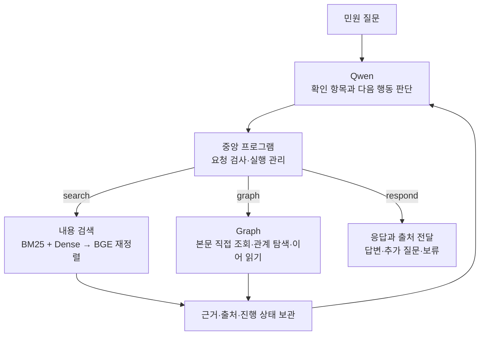

# Civic-Link

Civic-Link는 **수정구청의 무인민원발급 서비스에 적용하기 위한 행정·법률 기반 Graph RAG 프로젝트**입니다. 행정 서비스, 필요 서류, 처리기관, 근거 조문과 관련 법령을 연결하고, 민원 질문에 맞는 안내와 공식 원문 근거를 함께 제공하는 것을 목표로 합니다.

> 인하대학교 탄소중립 아카데미 7기 산업체 연계 프로젝트 · 마음AI

현재 **Week 8에서는 Qwen이 필요한 근거를 판단하고 검색·Graph 조회를 반복하는 에이전트를 구현해, 기존 608문항으로 세 가지 탐색 방식을 비교했습니다.** 반복 검색으로 필수 근거 회수는 개선됐으며, 응답 내용의 충족 여부와 Graph의 추가 효과를 함께 분석하고 있습니다.

[에이전트 설계](week8/AGENT.md) · [성능 평가 결과](week8/AGENT.md#performance-results) · [비교 실험 설계](week8/EXPERIMENT.md) · [벤치마크 구성](week8/REPORT.md)

## Week 8 — 질문에 필요한 근거를 찾아가는 에이전트

Week 7에서는 필요한 근거가 검색 후보에 있어도 최종 상위 결과에서 빠지는 사례를 확인했습니다. Week 8에서는 Qwen이 질문을 확인 항목으로 나누고, 확보한 본문을 읽은 뒤 부족한 내용을 추가로 찾도록 구성했습니다.

예를 들어 두 증명서의 대리 발급 서류를 비교할 때 한쪽 안내만 확보했다면, 다른 증명서의 서류와 적용 조건을 미확인 항목으로 남깁니다. 이후 검색어를 바꾸거나 특정 서비스·조문을 직접 조회해 두 대상의 근거를 모읍니다.

| 구성 요소 | 역할 |
|---|---|
| **Qwen** | 질문에서 확인할 항목을 만들고, 본문의 충족 여부를 검토해 검색·조회·응답 중 다음 행동을 선택 |
| **내용 검색** | BM25와 Dense 검색의 후보를 합치고 BGE로 재정렬해 현재 검색어에 맞는 본문 제공 |
| **Graph 도구** | 서비스·문서·조문을 직접 조회하거나 저장된 관계를 따라 연결 본문을 확인. 긴 본문은 이어 읽기 지원 |
| **중앙 프로그램** | 요청 형식과 근거 사용을 검사하고, 도구 호출·근거 누적·호출 한도·응답 종료 관리 |

판단·응답 모델은 **Qwen3.8-Flash-Next**, Dense 검색은 **Qwen3-VL-Embedding-8B**, 재정렬은 **BAAI/bge-reranker-v2-m3**를 사용합니다. Qwen은 제목이나 검색 점수만으로 결론을 내리지 않고, 실제 전달받은 본문과 적용 조건을 확인하도록 설계했습니다. 세부 입력·출력은 [실제 요청 예시](week8/examples/first_qwen_request.md)에 정리했습니다.

## Week 8 비교 실험과 결과

**V100 GPU 4장·총 16개 작업자로 기존 608문항 × 세 조건을 실행했습니다.** 각 문항의 첫 검색 결과를 공유하고, 이후 허용하는 탐색 행동을 달리해 반복 검색과 Graph의 효과를 비교했습니다.

| 조건 | 탐색 방식 | 비교 목적 |
|---|---|---|
| **A · 한 번 검색** | 원래 질문으로 Hybrid+BGE 검색 후 응답 | 같은 환경에서 측정한 기준선 |
| **B · 반복 검색** | 공통 첫 결과를 읽고 검색·응답을 반복 선택 | 부족한 항목을 재검색하는 효과 |
| **C · 반복 검색 + Graph** | 공통 첫 결과를 읽고 검색·Graph·응답을 반복 선택 | 직접 조회·관계 탐색·이어 읽기의 추가 효과 |

비교 실험은 첫 검색 이후의 보완 효과를 측정합니다. 일반 에이전트는 Qwen이 첫 행동부터 선택하며, 비교 실험에서는 세 조건에 같은 첫 검색 결과를 제공합니다. B와 C의 한도는 Qwen 최대 8회·도구 최대 6회이며, 공통 첫 검색도 도구 호출에 포함합니다.

### 대표 지표

| 지표 · 평가 범위 | A | B | C |
|---|---:|---:|---:|
| **필수 근거 완전회수율** · 답변형 488문항 | 89.14% (435/488) | 93.85% (458/488) | 94.26% (460/488) |
| **내용 통과율** · 표본 60문항 | 75.0% (45/60) | 71.7% (43/60) | 76.7% (46/60) |
| 실행 실패율 · 전체 608문항 | 0.33% (2/608) | 0.16% (1/608) | 0.49% (3/608) |
| 문항당 평균 시간 · 전체 608문항 | 35.0초 | 44.7초 | 46.6초 |

**필수 근거 완전회수율**은 문항에 지정된 필수 근거를 모두 최종 Qwen 입력에 전달한 비율입니다. **내용 통과율**은 요구한 답변·추가 질문·보류를 적절히 수행하고, 사실 주장과 인용이 본문으로 뒷받침되는지를 판정한 비율입니다.

내용 평가는 사전에 선정한 60문항에 대해 조건 이름을 가린 뒤 **응답 생성과 같은 Qwen 모델**로 수행했습니다. 일부 자동 채점 설명에 오독이 있어 사람 검토가 필요하며, 이 수치를 전체 608문항의 답변 정확도로 해석하지 않습니다. [상세 결과와 판정 기준](week8/AGENT.md#performance-results)

### 현재 확인한 점

- **반복 검색은 근거 회수를 늘렸습니다.** A에서 B로 바꾸면 완전회수가 23문항 늘었지만, 표본 내용 통과는 2문항 줄었습니다. 근거 확보와 응답 충족을 각각 평가해야 합니다.
- **Graph의 추가 효과는 사례별 확인이 필요합니다.** B에서 C로 바꾸면 완전회수가 5문항 개선되고 3문항 퇴보해 순증 2문항이었습니다. 개선된 5문항 중 실제 Graph 조회를 한 경우는 1문항이므로, 조건 간 차이 전체를 Graph 조회의 효과로 설명하기는 어렵습니다.
- **추가 질문·보류가 주요 보완 대상입니다.** 표본의 추가 질문 6문항은 세 조건 모두 내용 판정에서 통과하지 못했습니다. 보류 6문항의 통과 수는 A·B 각 2개, C 1개였습니다. 자동 판정 검수와 함께 응답 내용 및 종료 판단을 검토해야 합니다.

## 벤치마크와 평가 범위

| 데이터 | 구성 | 현재 확인 범위 |
|---|---|---|
| **기존 608문항** | 답변 488 · 추가 확인 60 · 보류 60 | 위 A/B/C 실험의 실행·근거 회수 평가 대상. 내용 판정은 이 중 60문항 |
| **Week 8 개발 벤치마크 1,000문항** | 기존 608 + 복합 과제 392 | 문항 구성·원문 인용·출처 연결 검증 완료. 위 성능표의 평가 대상은 기존 608문항 |

새 복합 과제는 두 문의를 한 요청에 담아, 한쪽의 조건을 다른 쪽에 적용하지 않고 각각 처리할 수 있는지 살펴보기 위한 데이터입니다. 복합 답변 312개, 부분 안내와 추가 확인 40개, 부분 안내와 보류 40개를 추가했습니다. 전체 기대 행동은 답변 800개·추가 확인 100개·보류 100개입니다.

벤치마크 입력 파일에는 질문 ID와 질문만 담고, 정답·필수 근거·문의별 기대 행동은 평가에만 사용합니다. 확장 문항은 기존 질문과 근거를 재조합한 **개발용 데이터**로, 독립적으로 검수한 홀드아웃 평가셋은 아닙니다. [구성·검증·한계](week8/REPORT.md) · [데이터 검증 기록](data/benchmark/week8/validation.json)

## 프로젝트 진행 과정

| 주차 | 주요 내용 | 자료 |
|---|---|---|
| Week 1 | 대상 서비스와 민원 질문 범위, 평가 데이터 구조 정의 | — |
| Week 2 | 행정 안내·법령 수집, BM25·Dense·Hybrid 검색 기반 구축 | — |
| Week 3 | 서비스·서류·기관·조문 관계 구조화, Graph Retriever 구현 | — |
| Week 4 | Hybrid 기반 Graph 확장, 토큰화·참조·누락 근거 보완 | [보고서](week4/REPORT.md) |
| Week 7 | 608문항 검수, coverage·BGE 비교, 후보 누락·순위 탈락·입력 길이 분석 | [보고서](week7/REPORT.md) · [실험 2](week7/EXPERIMENT2.md) |
| **Week 8** | **Qwen 에이전트와 Graph 도구 구현, A/B/C 비교, 복합 벤치마크 확장** | [설계·평가 결과](week8/AGENT.md) · [벤치마크](week8/REPORT.md) |

Week 7은 고정 후보의 검색·재정렬을 비교했고, Week 8은 같은 첫 검색 이후의 추가 탐색과 최종 응답을 비교합니다. 모델·검색 환경과 지표 범위가 달라 두 주차의 수치를 직접 차감하지 않습니다.

## 저장소 안내

| 위치 | 내용 |
|---|---|
| [week8/AGENT.md](week8/AGENT.md) | 현재 에이전트 설계, 구현 현황, 실제 비교 실험 결과 |
| [week8/EXPERIMENT.md](week8/EXPERIMENT.md) | A/B/C 가설·공통 조건·평가 기준 |
| [week8/REPORT.md](week8/REPORT.md) | 1,000문항 벤치마크 구성과 데이터 검증 |
| [week8/GRAPH_CASE_REVIEW.md](week8/GRAPH_CASE_REVIEW.md) | Graph 도구 설계에 활용한 Week 7 순위 탈락 44문항 검토 |
| [src/civic_link/agent/](src/civic_link/agent/) | Qwen 입력·판단 제어, 실시간 검색, Graph 조회, 비교 실험·평가 |
| [src/civic_link/](src/civic_link/) | Graph 구축, 검색·재정렬, 벤치마크·평가 공통 코드 |
| [data/](data/) | 행정 서비스, 원문 코퍼스, Graph, 검색 후보, 평가 데이터 |
| [scripts/](scripts/) · [tests/](tests/) | 데이터·실험·평가 도구와 테스트 |
| [week7/](week7/) · [week4/REPORT.md](week4/REPORT.md) | 이전 주차의 보고서·실험 기록 |
