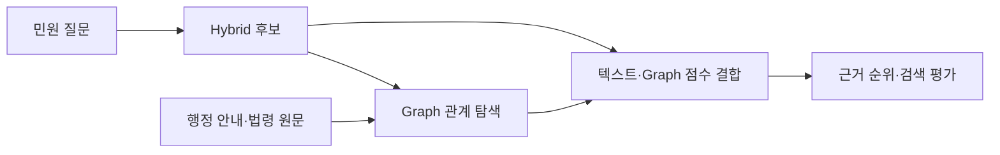

# Civic-Link

Civic-Link는 **수정구청의 무인민원발급 서비스에 적용하기 위한 행정·법률 기반 Graph RAG 시스템 구축 프로젝트**입니다. 행정 서비스와 필요 서류, 처리기관, 근거 조문 및 관련 법령의 관계를 지식 그래프로 구조화합니다. 이를 바탕으로 민원인의 질문에 적합한 서비스를 안내하고, 안내 내용의 공식적인 법적·행정적 근거를 함께 제시하는 것을 목표로 합니다.

> 인하대학교 탄소중립 아카데미 7기 산업체 연계 프로젝트 · 마음AI

현재 저장소는 이 목표를 위한 **근거 검색과 평가**에 초점을 두고 있습니다. 행정 안내문과 법령에서 근거를 찾는 Hybrid + Graph 검색, 질문별 정답·근거를 연결한 벤치마크, 검색 결과를 재현하고 비교하는 도구를 제공합니다.

[실행 안내](week7/README.md) · [최신 실험 보고서](week7/REPORT.md) · [벤치마크 질문 목록](week7/data/benchmark/questions.md)

## 접근 방법

민원 안내에는 서비스 설명뿐 아니라 구비서류, 자격·예외 조건, 다른 법령의 조문을 함께 확인해야 하는 질문이 있습니다. Civic-Link는 텍스트 검색으로 찾은 후보에서 출발해, 공식 원문에 연결된 그래프 관계를 따라 관련 근거를 확장합니다.

1. **Hybrid 검색**: BM25와 Dense 검색을 결합해 질문에 관련된 텍스트 후보를 찾습니다.
2. **Graph 확장**: 서비스·서류·기관·법령·조문 간 관계를 따라 추가 근거를 탐색합니다. 그래프의 연결은 원문 인용과 청크에 연결되어 있습니다.
3. **점수 결합과 평가**: 텍스트 관련도와 그래프 경로의 지원 점수를 결합해 근거를 정렬하고, 질문에 필요한 근거를 얼마나 회수했는지 평가합니다.



현재 실행은 저장된 Hybrid 후보를 입력으로 받아 Graph 탐색부터 재현합니다. 새로운 질문의 Hybrid 후보 생성과 답변 생성 품질 평가는 별도 작업입니다.

## 진행 과정

### Week 1 — 문제 및 평가 기준 정의

- 수정구청 무인민원발급을 중심으로 대상 서비스 범위 설정
- 민원 질문 유형과 평가용 데이터 구조 설계
- 질문별 행정 서비스와 공식 근거 연결

### Week 2 — 데이터 및 텍스트 검색 기반 구축

- 행정 서비스 안내와 관련 법령 원문 수집
- BM25, Dense, Hybrid 검색 파이프라인 구현
- 검색 방식별 성능 비교 및 실패 사례 분석

### Week 3 — 지식 그래프 및 관계 검색 구축

- 행정 서비스, 필요 서류, 처리기관, 법령, 조문의 관계 구조화
- 그래프의 노드와 관계를 공식 원문 근거에 연결
- Graph Retriever 구현 및 텍스트 검색과 비교

### Week 4 — Hybrid + Graph 확장 및 개선 검증

- 토큰화·법령 참조·누락 근거 연결 보완
- Hybrid 기반 그래프 확장 검색 구현
- 개선 가설 3개 실험 및 성능 비교

### Week 7 — 벤치마크 확장 및 검색 수식 개편

- 기존 204문항에 신규 404문항을 더한 **608문항 벤치마크**와 균형 진단용 **480문항 부분집합** 구성
- 신규 문항과 근거를 대조하고 21문항의 보조 주석·확인 정책 보완. 작성 차수별 컬럼은 통합하고 질문 ID와 검색 정답은 유지
- `coverage` 수식 도입: Hybrid 순위, 질문–청크 관련도, Graph 경로의 지원 점수를 연속 점수로 결합
- Git에서 현재 원문·그래프·고정 검색 입력을 받아 복원·검색·평가할 수 있도록 실행 구조 정리

같은 질문·후보·근거로 비교한 결과, 답변 가능한 488문항의 **Complete@10은 391/488(80.12%) → 411/488(84.22%)**로 개선됐습니다. Complete@10은 질문에 필요한 모든 근거 묶음을 상위 10개에서 찾은 비율입니다. 전체에서 30문항이 개선되고 10문항이 퇴보했습니다.

이 결과는 개발 구간에서 수식을 선택하고 검증 구간을 고정해 확인한 **진단용 벤치마크 결과**입니다. 합성·반복 개발 자료이며 원천 문서를 공유하므로 독립 시험 성적이나 실제 답변 정확도를 의미하지 않습니다. 이번 비교에는 BGE나 임베딩 서버를 실행하지 않았습니다. 수식, 구간별 결과와 한계는 [Week 7 보고서](week7/REPORT.md)에 정리했습니다.

## 저장소 구조

```text
data/
  services.jsonl       행정 서비스 목록
  processed/           검색용 그래프·근거 연결 및 복원된 원문 DB
scripts/               DB 복원·그래프 구축·검색·평가·수식 비교 코드
tests/                 검색·근거·행동 라벨·입력 검증 테스트
week7/
  assets/              현재 원문 DB와 고정 Hybrid 후보의 압축 입력
  inputs/              Hybrid 실행 메타데이터
  data/benchmark/      608문항·480문항 부분집합과 질문 목록
  reviews/             AI 검수 결과와 주석 변경 내역
  evaluation/          수식 비교·개선 및 퇴보·재현 결과
  docs/assets/         검색 흐름과 결과 그림
  README.md            팀 실행 안내
  REPORT.md            최신 실험 보고서
```

Git에는 현재 실행에 필요한 코드·데이터·문서를 포함합니다. 실행 시 복원되는 DB, 검색 결과와 개인 가상환경은 Git에서 제외합니다. 이전 단계의 진행 과정은 위에 요약했으며, 과거 파일은 Git 이력에서 확인할 수 있습니다.

## 실행

Python 3.12를 사용합니다. 저장소 루트에서 의존성을 설치하고 현재 검색 DB를 복원한 뒤, 608문항의 근거 검색을 실행합니다.

```sh
python3.12 -m venv .venv
.venv/bin/python -m pip install -r requirements-dev.txt
.venv/bin/python scripts/restore_week7.py restore

.venv/bin/python scripts/hybrid_graph.py \
  --queries week7/data/benchmark/queries.jsonl \
  --hybrid-results week7/assets/hybrid_candidates.jsonl.gz \
  --hybrid-run week7/inputs/hybrid_candidates.run.json \
  --rerank coverage \
  --output week7/results/team-run/predictions.jsonl
```

최초 패키지 설치 이후 위 복원·검색은 로컬에서 실행됩니다. Hybrid 후보는 압축 상태로 직접 읽고, 원문 DB만 복원합니다. 출력 파일이 이미 있으면 새 경로를 지정합니다. Windows에서는 `.venv/bin/python`을 `.venv/Scripts/python.exe`로 바꿉니다.

평가, 기존 H3 기준선과의 비교, 테스트 및 입력 검증 명령은 [팀 실행 안내](week7/README.md)를 참고하세요. 새 Git 파일 복사본에서 608문항 검색·평가와 현재 기능 테스트 67개를 통과한 기록은 [재현 결과](week7/evaluation/reproduction.json)에 있습니다.
