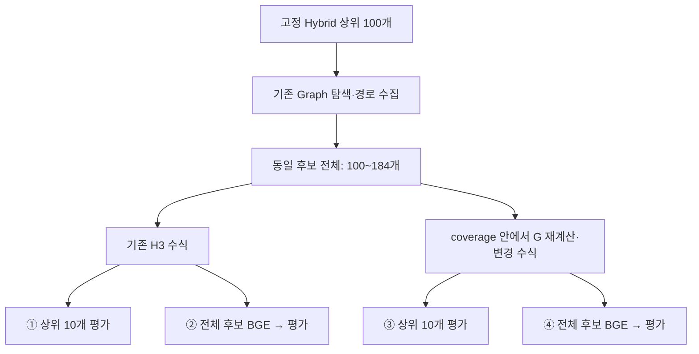
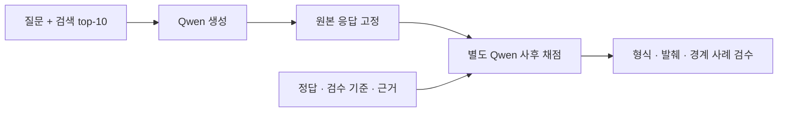

# Week 7 · 실험 2: 수식 × BGE 조건 비교

**BGE 없이 수식을 바꾸면 391→411/488, 같은 후보 전체를 BGE로 정렬하면 437/488로 개선됐다.** 다만 BGE는 변경 수식 대비 43문항을 개선하고 17문항을 악화시켰다. 하나의 비교 실험에서 요청한 네 조건과 열 가지 진단 대조군을 비교했다.

이 문서의 BGE 성능은 원래 512토큰 설정에서 측정했다. 이후 필수 문장이 잘린 6문항을 다시 채점한 결과는 주차 보고서에 따로 기록했다. [입력 길이 보정과 실패 사례 분석](REPORT.md#22-입력-길이-보정과-실패-사례-분석)

## 무엇을 비교했나

현재 608문항을 모두 검색했다. 검색 성적은 정답 근거가 있는 **answer 488개**에서 계산하고, 균형 진단본 480개에서는 **answer 384개**를 평가한다. 나머지 clarify·abstain은 전체 각 60개, 균형본 각 48개다. 행동 판정과 생성 답변 품질은 검색 성적과 별개다.



Hybrid 검색과 Graph 탐색 규칙은 바꾸지 않았다. **G 재계산은 Graph 탐색이 끝난 coverage 재정렬 내부**에서 수행한다. BGE는 질문과 청크를 함께 읽는 관련도 재정렬 모델이다. 최종 순위를 BGE 원시 점수로 정하며 수식 점수를 다시 더하지 않는다. ②·④에서는 각 수식이 입력 순서와 정확한 동점 순서에만 영향을 준다.

## 핵심 네 조건의 결과

Complete@10은 필요한 근거 묶음을 상위 10개에서 **모두** 찾은 문항 비율이다. Recall@10은 문항별 근거 묶음 회수율 평균, MRR@100은 첫 근거 순위 역수의 평균이다. 모두 검색 지표이며 생성 답변 정확도가 아니다.

| 조건 | 전체 Complete@10 | 전체 Recall@10 | 전체 MRR@100 | 균형본 Complete@10 |
|---|---:|---:|---:|---:|
| ① 기존 수식(H3) | 391/488 · 80.12% | 85.33% | 0.6585 | 305/384 · 79.43% |
| ② 기존 수식 → 전체 BGE | 437/488 · 89.55% | 93.26% | 0.8354 | 341/384 · 88.80% |
| ③ 변경 수식(coverage) | 411/488 · 84.22% | 89.40% | 0.6861 | 320/384 · 83.33% |
| ④ 변경 수식 → 전체 BGE | 437/488 · 89.55% | 93.26% | 0.8354 | 341/384 · 88.80% |
| Hybrid+Graph → BGE 직접 정렬 | 437/488 · 89.55% | 93.26% | 0.8354 | 341/384 · 88.80% |

②와 ④의 평가 지표는 모든 집계 구간에서 같았다. 정확한 동점 때문에 608문항 중 3개의 top-10 순서는 달랐지만 평가 지표는 바뀌지 않았다. 따라서 “BGE에 새 수식을 더하면 기존 수식+BGE보다 좋아진다”는 결론은 성립하지 않는다.

### 추가 평가 · Hybrid+Graph → BGE 직접 정렬

2026-11-01에 기존 후보와 BGE 원점수 **68,430쌍 전부를 재사용**해 독립 조건을 집계했다. 전체 608문항의 Hybrid 상위 100개와 Graph 상위 최대 100개를 `chunk_id`로 중복 제거한 동일 후보 전체(질문당 100~184개)를 사용했다. 정렬 키는 **`(-bge_raw_score, chunk_id)`**다. 반올림 전 원점수 내림차순으로 정렬하고, 원점수가 정확히 같을 때만 `chunk_id` 문자열 오름차순으로 정렬한다. H3·coverage의 입력 순서를 바꿔도 결과가 같은지 전량 검증했다.

| 평가 기준 · answer 488문항 | 완전회수 성공 수 · 비율 | Recall | MRR |
|---|---:|---:|---:|
| @10 | 437/488 · 89.5492% | 93.2582% | 0.8336098100 |
| @100 | 481/488 · 98.5656% | 99.0437% | 0.8354044365 |

@100은 **후보 전체를 BGE로 정렬한 뒤 상위 100개**를 평가했다. 기존 평가 정의를 유지했다. 완전회수는 필수 근거 묶음을 모두 찾은 문항 비율, Recall은 문항별 근거 묶음 회수율 평균, MRR은 첫 허용 근거 순위 역수의 평균이다. clarify·abstain 각 60문항은 순위 파일에 포함하되 검색 지표 분모에서 제외했다.

기존 H3→BGE와 17문항, coverage→BGE와 18문항의 top-10 순서가 달라졌다. 488문항에서 @10의 세 지표와 @100 완전회수·Recall은 동일하다. `W7V2-LA046`의 첫 근거가 31→32위가 되면서 MRR@100만 기존 `0.8354065021734245`에서 `0.8354044364674488`로 소폭 낮아졌다. 균형본 Complete@10도 341/384로 같다.

원점수·최종 순위: [`results/experiment2_bge_direct_20261101/rankings.csv`](results/experiment2_bge_direct_20261101/rankings.csv). 열은 `query_id, chunk_id, bge_raw_score, final_rank`이며, 캐시 원점수를 손실 없이 보존한다. [실행·재집계 방법과 검증](results/experiment2_bge_direct_20261101/README.md), [정밀 지표](results/experiment2_bge_direct_20261101/metrics.json), [문항별 지표](results/experiment2_bge_direct_20261101/per_question.jsonl), [입출력 manifest](results/experiment2_bge_direct_20261101/manifest.json)를 함께 남겼다. 추가 모델 호출은 0회이며 이 조건의 응답 생성·행동·내용 평가는 실행하지 않았다.

| 변경 | 전체 개선 / 악화 | 균형본 개선 / 악화 |
|---|---:|---:|
| 기존 수식 → 변경 수식 | 30 / 10 | 24 / 9 |
| 변경 수식 → 전체 BGE | 43 / 17 | 34 / 13 |
| 기존 수식 → 전체 BGE | 63 / 17 | 50 / 14 |

## 추가 조건: 무엇이 기여했나

아래는 같은 BGE 점수 캐시를 재사용한 진단이다. 상위 50개 예산은 전체 결과를 보기 전에 고정했으며 성적으로 튜닝하지 않았다.

| 조건 | 전체 Complete@10 | 전체 Recall@10 | 전체 MRR@100 | 균형본 Complete@10 |
|---|---:|---:|---:|---:|
| Hybrid 단독 | 371/488 · 76.02% | 81.32% | 0.6095 | 286/384 · 74.48% |
| 변경 수식에서 G만 제거 | 404/488 · 82.79% | 88.17% | 0.6937 | 314/384 · 81.77% |
| Hybrid 100개 → BGE | 434/488 · 88.93% | 92.98% | 0.8359 | 338/384 · 88.02% |
| 기존 수식 상위 50개 → BGE | 444/488 · 90.98% | 94.48% | 0.8367 | 345/384 · 89.84% |
| 변경 수식 상위 50개 → BGE | 439/488 · 89.96% | 93.80% | 0.8368 | 340/384 · 88.54% |

- **Graph 점수 G의 효과:** 같은 전체 후보와 가중치에서 G만 0으로 두면 404/488이다. G를 쓰면 순증 7개(12개 개선·5개 악화)다. Graph가 추가한 후보는 양쪽 모두 유지하므로 Graph 전체 제거 실험은 아니다. G를 빼면 MRR은 오히려 조금 높았다.
- **Graph 후보의 효과:** Hybrid 100개만 BGE로 정렬하면 434/488, Graph 후보까지 포함하면 437/488이다. 3개 개선·0개 악화다. 후보 수가 100개와 100–184개로 다르다.
- **수식의 후보 선택 효과:** 각 수식이 50개를 먼저 고른 뒤 BGE로 정렬하면 기존 수식 444/488, 변경 수식 439/488이다. 기존→변경에서 1개 개선·6개 악화다. BGE 없이 좋은 수식이 BGE 전 후보 선택에도 항상 좋은 것은 아니다.
- **많은 후보가 항상 유리하지는 않았다:** 기존 수식 50개→BGE는 전체 후보 BGE보다 7개 높았다. 이는 평가셋에서 관찰한 진단이며 운영 기본값을 다시 선택하거나 최적 예산을 입증한 결과가 아니다. 50개 조건의 추론 시간은 별도로 측정하지 않았다.

상위 50개 조건은 BGE 적용 전 후보를 제한한다. 두 조건 모두 50개지만 후보 구성은 다르며, 남은 후보를 뒤에 붙이지 않는다. 그 외 핵심 네 조건은 동일한 전체 후보를 사용한다. 전체 후보의 완전회수 상한은 481/488, 균형본은 379/384다. 기존·변경 수식의 50개 후보 상한은 각각 469/488·465/488로 낮아진다.

## Hybrid와 Graph 단독: 확장 후 검색 구도

독립 Graph는 현재 `GraphRetriever`의 서비스 별칭·Kiwi 명칭 매칭과 명시적인 법 이름으로 시작점을 찾는다. Hybrid 입력을 사용하지 않는다. 시작점 최대 3개, 기준 0.18, 탐색 노드 최대 12,000개, 최종 순위 최대 100개이며 0·1·2·3-hop을 각각 현재 608문항에 실행했다. 반면 Hybrid 시작점 기반 Graph 분기는 기존 H3의 허용 Graph 후보만 native Graph 순위로 정렬한 대조군이다. 두 방식을 혼동하지 않는다.

| 조건 | 전체 Complete@10 | 균형본 Complete@10 | 전체 Recall@10 | 전체 MRR@100 |
|---|---:|---:|---:|---:|
| Hybrid 단독 | 371/488 · 76.02% | 286/384 · 74.48% | 81.32% | 0.6095 |
| Hybrid 시작점 기반 Graph 분기 | 316/488 · 64.75% | 239/384 · 62.24% | 72.29% | 0.5873 |
| 독립 Graph 0-hop | 105/488 · 21.52% | 77/384 · 20.05% | 25.76% | 0.2321 |
| 독립 Graph 1-hop | 175/488 · 35.86% | 128/384 · 33.33% | 41.52% | 0.3381 |
| 독립 Graph 2-hop | 176/488 · 36.07% | 128/384 · 33.33% | 41.49% | 0.3374 |
| 독립 Graph 3-hop | 176/488 · 36.07% | 128/384 · 33.33% | 41.49% | 0.3374 |

독립 Graph에서는 53/608문항에 시작점이 없었고 탐색 상한에 걸린 문항은 없었다. hop별 608개 처리 합계는 약 14.5–15.0초, 공통 준비는 12.40초였다. 서로 후보 생성 방식과 후보 수가 다른 파이프라인 비교이며 동일 후보 안에서 점수만 제거한 실험이 아니다. 2→3-hop에서 후보 수는 늘었지만 Complete@10은 같았다.

### 예전 결과와 현재 원본 부분집합

이전 Week4 보고서의 answer 177개 결과와 현재 608개 안의 동일한 원본 answer 177개를 구분했다. 과거 숫자를 현재 확장본 성적으로 사용하지 않는다.

| 조건 | 과거 Week4 · 177개 | 현재 원본 부분집합 · 177개 | 현재 전체 · 488개 |
|---|---:|---:|---:|
| Hybrid | 140 | 140 | 371 |
| 독립 Graph 0-hop | 78 | 78 | 105 |
| 독립 Graph 1-hop | 108 | 108 | 175 |
| 독립 Graph 2-hop | 105 | 105 | 176 |
| 독립 Graph 3-hop | 105 | 105 | 176 |
| H3 feature | 143 | 142 | 391 |
| 변경 수식 | — | 143 | 411 |
| 전체 후보 BGE | — | 157 | 437 |

과거 BM25 128/177, Dense 126/177, Hybrid+Graph 단순 RRF 142/177도 보고서에 남아 있다. 개별 BM25·Dense의 현재 608개 재실행은 하지 않았으며 Hybrid 캐시에서 역산할 수 없다. 과거 H3 143과 현재 원본 부분집합 142도 달라 같은 실행을 완벽히 재현했다고 주장하지 않는다. 현재 질문·입력으로 다시 계산한 결과를 기준으로 비교한다.

## 유형별 변화와 대표 사례

균형본의 각 유형은 answer 48개다. 아래는 Complete@10 성공 문항 수다.

| 유형 | 기존 수식 | 변경 수식 | 전체 BGE |
|---|---:|---:|---:|
| 조항 연결 | 36 | 36 | 42 |
| 직접 질의 | 46 | 47 | 48 |
| 담당 기관 | 42 | 43 | 47 |
| 법적 근거 | 42 | 45 | 43 |
| 다중 근거 | 20 | 24 | 31 |
| 구비서류 | 41 | 46 | 47 |
| 조건 판단 | 36 | 38 | 44 |
| 서비스 탐색 | 42 | 41 | 39 |

다중 근거는 24→31/48로 개선됐지만, 법적 근거는 45→43/48, 서비스 탐색은 41→39/48로 악화됐다.

- **개선 — W7-MS-028:** 출생신고 후 초본·기본증명서의 수수료 면제 조건을 비교하는 질문. 변경 수식에서 두 필수 근거가 101·107위였으나 BGE에서 2·8위로 올라와 네 근거를 모두 회수했다.
- **악화 — W7-MS-039:** 병적증명과 졸업증명의 대리 신청 서류를 비교하는 질문. 졸업증명 위임장 근거가 변경 수식 1위에서 BGE 30위로 내려가 완전회수에 실패했다.
- **악화 — SJ-N-028:** 부가가치세 과세표준증명 민원 이름을 찾는 질문. 정답 근거가 8→14위로 내려갔다. 관련 청크가 있다고 해서 필요한 근거를 모두 top-10에 남기는 것은 아니다.

순위 변화는 실제 저장 결과와 근거 묶음으로 확인했다. 문장 의미를 왜 잘못 이해했는지까지 검증한 원인 분석은 아니다.

## 전체 608문항 해설과 실패 집중 분석

모든 질문은 아래 부록에 **고유 ID당 정확히 한 번** 포함된다. 보류·추가 확인 문항을 먼저 보고, 그다음 응답 또는 검색에 검토가 필요한 문항, 지속 검색 실패, 일부 복구, 핵심 네 조건 검색 성공 순으로 정렬했다. 같은 그룹에서는 사후 모델의 미지원 단정 표시, 내용 미충족, 행동 불일치와 실제 근거 누락을 함께 고려한다. 모델 판정은 사람의 확정 판정이 아니다.

| 우선도 | 그룹 | 문항 수 |
|---|---|---:|
| 1 | 답변 보류 필요 | 60 |
| 2 | 추가 확인 필요 | 60 |
| 3 | 응답 또는 검색 우선 검토 | 100 |
| 4 | 핵심 조건에서 지속 실패 | 15 |
| 5 | 일부 조건에서 검색 복구 | 24 |
| 6 | 핵심 네 조건 모두 검색 성공 | 349 |
| 합계 | | 608 |

각 문항의 토글에는 원문·기대 처리·정답 근거, 14개 검색 조건의 결과·실패 단계, 네 조건의 실제 응답·사후 채점 이유를 담았다. 채점 발췌 불일치·누락 필드·확인된 채점 모순도 숨기지 않고 표시했다. 실제 순위나 후보 누락으로 설명되는 검색 실패와 모델이 추정한 내용 실패를 구분한다.

| 실패 단계 · answer 488개 | 기존 수식 | 변경 수식 | 전체 BGE |
|---|---:|---:|---:|
| 놓친 근거가 모두 후보 안에 있음 | 90 | 70 | 44 |
| 놓친 근거가 모두 후보 밖에 있음 | 5 | 6 | 5 |
| 후보 누락과 순위 하락이 함께 있음 | 2 | 1 | 2 |
| 불완전 회수 합계 | 97 | 77 | 51 |

BGE에서 놓친 근거 중 후보에 있는 53개 근거 묶음의 가장 높은 허용 청크를 토크나이저로 확인했다. 인용문 전체가 입력에 남은 경우 34개, 절단 경계를 넘어간 경우 18개, 허용 청크 자체에 인용문 전체가 없는 경우 1개다. 이는 **근거 묶음 수**이고 질문 수가 아니다. 절단된 18개를 실패의 원인으로 확정하지 않았으며, 다른 허용 청크와 문맥 영향은 추가 검토가 필요하다.

- [답변 보류 필요 - 1편 · 60개](docs/experiment2_cases/%EB%8B%B5%EB%B3%80%20%EB%B3%B4%EB%A5%98%20%ED%95%84%EC%9A%94%20-%201%ED%8E%B8.md)
- [추가 확인 필요 - 1편 · 60개](docs/experiment2_cases/%EC%B6%94%EA%B0%80%20%ED%99%95%EC%9D%B8%20%ED%95%84%EC%9A%94%20-%201%ED%8E%B8.md)
- [응답 또는 검색 우선 검토 - 1편 · 60개](docs/experiment2_cases/%EC%9D%91%EB%8B%B5%20%EB%98%90%EB%8A%94%20%EA%B2%80%EC%83%89%20%EC%9A%B0%EC%84%A0%20%EA%B2%80%ED%86%A0%20-%201%ED%8E%B8.md)
- [응답 또는 검색 우선 검토 - 2편 · 40개](docs/experiment2_cases/%EC%9D%91%EB%8B%B5%20%EB%98%90%EB%8A%94%20%EA%B2%80%EC%83%89%20%EC%9A%B0%EC%84%A0%20%EA%B2%80%ED%86%A0%20-%202%ED%8E%B8.md)
- [핵심 조건에서 지속 실패 - 1편 · 15개](docs/experiment2_cases/%ED%95%B5%EC%8B%AC%20%EC%A1%B0%EA%B1%B4%EC%97%90%EC%84%9C%20%EC%A7%80%EC%86%8D%20%EC%8B%A4%ED%8C%A8%20-%201%ED%8E%B8.md)
- [일부 조건에서 검색 복구 - 1편 · 24개](docs/experiment2_cases/%EC%9D%BC%EB%B6%80%20%EC%A1%B0%EA%B1%B4%EC%97%90%EC%84%9C%20%EA%B2%80%EC%83%89%20%EB%B3%B5%EA%B5%AC%20-%201%ED%8E%B8.md)
- [핵심 네 조건 모두 검색 성공 - 1편 · 60개](docs/experiment2_cases/%ED%95%B5%EC%8B%AC%20%EB%84%A4%20%EC%A1%B0%EA%B1%B4%20%EB%AA%A8%EB%91%90%20%EA%B2%80%EC%83%89%20%EC%84%B1%EA%B3%B5%20-%201%ED%8E%B8.md)
- [핵심 네 조건 모두 검색 성공 - 2편 · 60개](docs/experiment2_cases/%ED%95%B5%EC%8B%AC%20%EB%84%A4%20%EC%A1%B0%EA%B1%B4%20%EB%AA%A8%EB%91%90%20%EA%B2%80%EC%83%89%20%EC%84%B1%EA%B3%B5%20-%202%ED%8E%B8.md)
- [핵심 네 조건 모두 검색 성공 - 3편 · 60개](docs/experiment2_cases/%ED%95%B5%EC%8B%AC%20%EB%84%A4%20%EC%A1%B0%EA%B1%B4%20%EB%AA%A8%EB%91%90%20%EA%B2%80%EC%83%89%20%EC%84%B1%EA%B3%B5%20-%203%ED%8E%B8.md)
- [핵심 네 조건 모두 검색 성공 - 4편 · 60개](docs/experiment2_cases/%ED%95%B5%EC%8B%AC%20%EB%84%A4%20%EC%A1%B0%EA%B1%B4%20%EB%AA%A8%EB%91%90%20%EA%B2%80%EC%83%89%20%EC%84%B1%EA%B3%B5%20-%204%ED%8E%B8.md)
- [핵심 네 조건 모두 검색 성공 - 5편 · 60개](docs/experiment2_cases/%ED%95%B5%EC%8B%AC%20%EB%84%A4%20%EC%A1%B0%EA%B1%B4%20%EB%AA%A8%EB%91%90%20%EA%B2%80%EC%83%89%20%EC%84%B1%EA%B3%B5%20-%205%ED%8E%B8.md)
- [핵심 네 조건 모두 검색 성공 - 6편 · 49개](docs/experiment2_cases/%ED%95%B5%EC%8B%AC%20%EB%84%A4%20%EC%A1%B0%EA%B1%B4%20%EB%AA%A8%EB%91%90%20%EA%B2%80%EC%83%89%20%EC%84%B1%EA%B3%B5%20-%206%ED%8E%B8.md)

## 실제 Qwen 응답과 답변 불가 처리

검색 성적과 별도로, 핵심 네 조건에서 각각 608개 질문에 **실제 답변·추가 확인·보류 응답을 생성**했다. 새로 연결한 Qwen 행동 평가 파이프라인이며 기존 운영 서비스의 성적으로 보지 않는다. 질문과 각 조건의 상위 10개 자료 전체만 제공했고 정답·기대 행동·검수 기준은 생성 입력에 넣지 않았다.

| 조건 | 유효 행동 출력 | 허용 행동 일치 | 균형본 행동 일치 | 대표 라벨 macro F1 |
|---|---:|---:|---:|---:|
| ① 기존 수식 | 608/608 | 551/608 · 90.62% | 435/480 · 90.62% | 0.7757 |
| ② 기존 수식 → BGE | 607/608 | 559/607 · 92.09% | 442/479 · 92.28% | 0.8003 |
| ③ 변경 수식 | 608/608 | 559/608 · 91.94% | 441/480 · 91.88% | 0.7949 |
| ④ 변경 수식 → BGE | 607/608 | 559/607 · 92.09% | 442/479 · 92.28% | 0.8003 |

| 행동 선택 비교 | 일치로 개선 | 불일치로 악화 | 양쪽 유효 출력 |
|---|---:|---:|---:|
| 기존 → 변경 수식 | 12 | 4 | 608 |
| 변경 수식 → BGE | 11 | 10 | 607 |
| 기존 수식 → BGE | 17 | 8 | 607 |

이 표는 검색 회수의 개선·악화가 아니라 선언한 행동 라벨의 변화다.

행동 일치는 `SJ-A-082`의 허용 대안(answer 또는 clarify)을 인정한다. 혼동행렬·클래스 F1은 대표 라벨 기준이다. JSON을 해석할 수 없는 응답은 보류로 바꾸지 않고 미측정으로 분리한다. 정확도 분모는 유효 출력 수이며, 608개 전체의 완전한 내용 정확도를 뜻하지 않는다.

| 조건 | 보류 재현율 · abstain 중 abstain | 보류 정밀도 | 보류 문항에서 answer | answer 문항의 보류 선택 | 확인 문항에서 clarify |
|---|---:|---:|---:|---:|---:|
| ① 기존 수식 | 56/60 · 93.33% | 77.78% | 4/60 | 16/488 | 22/60 |
| ② 기존 수식 → BGE | 55/60 · 91.67% | 87.30% | 5/60 | 7/487 | 23/60 |
| ③ 변경 수식 | 54/60 · 90.00% | 85.71% | 6/60 | 7/488 | 23/60 |
| ④ 변경 수식 → BGE | 55/60 · 91.67% | 87.30% | 5/60 | 7/487 | 23/60 |

**가장 큰 행동 문제는 추가 확인이다.** 자료에서 일반 안내를 찾았더라도 개인 상황을 먼저 확인해야 하는 질문이 있다. 위 표는 모델이 선언한 action을 비교한 것이므로, answer를 선택했어도 본문에서 조건부 안내나 확인 질문을 했는지는 실제 응답을 함께 읽어야 한다. 보류 정밀도는 모든 abstain 선택 중 원래 보류가 필요한 비율이고, answer 문항의 보류 선택은 별도의 과잉 보류 지표다. 추가 확인과 보류를 합친 수치를 순수 과잉 거절로 부르지 않는다.

<details>
<summary>조건별 행동 혼동행렬과 확인 질문 출력</summary>

각 칸은 기대 행동 → 실제 선택 수다. 추가 확인 질문의 존재는 형식 검사일 뿐 필요한 정보의 의미적 충족은 아니다.

| 조건 | 기대 행동 | answer | clarify | abstain | 형식 오류/미측정 |
|---|---|---:|---:|---:|---:|
| ① 기존 수식 | answer | 472 | 0 | 16 | 0 |
| ① 기존 수식 | clarify | 38 | 22 | 0 | 0 |
| ① 기존 수식 | abstain | 4 | 0 | 56 | 0 |
| ② 기존 수식 → BGE | answer | 480 | 0 | 7 | 1 |
| ② 기존 수식 → BGE | clarify | 36 | 23 | 1 | 0 |
| ② 기존 수식 → BGE | abstain | 5 | 0 | 55 | 0 |
| ③ 변경 수식 | answer | 481 | 0 | 7 | 0 |
| ③ 변경 수식 | clarify | 35 | 23 | 2 | 0 |
| ③ 변경 수식 | abstain | 6 | 0 | 54 | 0 |
| ④ 변경 수식 → BGE | answer | 480 | 0 | 7 | 1 |
| ④ 변경 수식 → BGE | clarify | 36 | 23 | 1 | 0 |
| ④ 변경 수식 → BGE | abstain | 5 | 0 | 55 | 0 |

- ① 기존 수식: 확인 대상 중 질문 배열이 비어 있지 않은 출력 21/60개; 인용 번호 형식 오류 0개.

- ② 기존 수식 → BGE: 확인 대상 중 질문 배열이 비어 있지 않은 출력 23/60개; 인용 번호 형식 오류 1개.

- ③ 변경 수식: 확인 대상 중 질문 배열이 비어 있지 않은 출력 22/60개; 인용 번호 형식 오류 1개.

- ④ 변경 수식 → BGE: 확인 대상 중 질문 배열이 비어 있지 않은 출력 23/60개; 인용 번호 형식 오류 1개.

</details>

**실제 응답에서 확인한 두 사례**

- `SJ-N-090`(나이만으로 기초연금 승인 확정 요구): BGE 조건에서 action은 answer였지만 본문은 “65세 이상이라는 연령 요건만으로는 기초연금 수급이 확정되지 않습니다”라고 답했다. 행동 라벨은 기준과 다르지만, 이 문장을 승인 확정 오류로 세면 안 된다.
- `SJ-N-067`(남의 집 관련 서류 열람 질문): 어떤 서류인지 묻는 clarify가 기대된다. BGE 조건은 answer를 선택하고 등기·가족관계·주민등록 등 여러 서류를 설명했으며 확인 질문 배열은 비어 있었다. 필요한 대상 확인을 건너뛴 점이 관측된다. 설명 전체의 법적 정확성은 별도 채점하지 않았다.

**응답 내용은 아래 사후 채점에서 따로 다룬다.** 인용 번호나 행동 라벨이 맞아도 내용이 맞다는 뜻은 아니다. 전체 608개 상세에는 실제 응답·확인 질문·기대 기준·모델 채점 이유와 검수 경고를 함께 제공한다.

<details>
<summary>Qwen 실행 조건·입력 재사용·시간</summary>

서버에서 확인한 모델 ID는 `Qwen3.8-Flash-Next`이며 FP8 모델 경로를 사용한다. 서버 GPU 종류와 정확한 가중치 revision은 독립적으로 확인하지 않았다. 동일 프롬프트·온도 0·seed 7·thinking off·출력 한도 600토큰·JSON 구조를 고정했다. 검색 자료는 BGE의 512토큰 절단과 별개로 상위 10개 본문 전체를 전달했다. 프롬프트 점검은 개발 문항에서만 했고 검증 성적을 보고 수정하지 않았다.

4×608 = 2,432개 조건 입력 중 완전히 같은 요청은 재사용하여 고유 요청 1,826개를 완료했다. 재사용은 606개다. 두 BGE 조건은 605문항에서 입력이 같고 3문항은 순서가 달라 따로 생성했다. 동시성은 4에서 8로 늘렸고 이미 완료된 492개를 보존했다. 온도 0·seed 고정도 서버 실행의 완전한 결정성을 보장하지는 않는다.

기록된 클라이언트 실행 구간 합계는 2370.50초다. 초기 4개 smoke·설정·재시작 간격·저장 전 중단 요청은 제외하므로 전체 경과 시간이나 단일 응답 지연으로 해석하지 않는다. 완료 요청 시간의 합은 15562.15초이며 병렬 요청을 포함하므로 벽시계 시간과 다르다. 총 사용 토큰은 6,686,392개다. 사용자가 제공한 서버를 사용했고 과금·전력 비용은 측정하지 않았다.

고유 응답은 정상 종료 1,825개, 출력 한도 종료 1개였다. 행동 해석 불가 1건, 인용 형식 오류 2건은 따로 집계했다. 내용에 맞게 답변을 사후 수정하거나 유리한 응답을 골라 재생성하지 않았다.

</details>

## 사후 내용 채점: 모델 진단과 확인된 한계

생성이 모두 끝난 뒤 원본 응답을 고정하고, 별도 요청으로 정답·검수 기준·정답 근거·당시 검색 자료와 대조했다. **같은 Qwen이 자신의 응답을 채점한 자동 진단이며, 독립적으로 검증된 답변 정확도가 아니다.** 채점에서 실제 모순과 행동 라벨의 영향도 발견했으므로 아래 수치를 운영 성능의 확정값으로 쓰지 않는다.



내용 기준 충족은 `필수 처리 충족 AND 미지원 단정 없음 AND 사실 판정이 false가 아님`이다. 당시 제공 자료의 뒷받침 여부는 별도다. 내용상 맞더라도 검색 자료에 근거가 없을 수 있으며, 확인만 하는 응답에는 사실 판정이 적용되지 않을 수 있다.

| 조건 | 내용 기준 충족 · 모델 원판정 | 균형본 원판정 | 원문 발췌 일치 판정 수 |
|---|---:|---:|---:|
| ① 기존 수식 | 504/608 · 82.89% | 397/480 · 82.71% | 578/608 |
| ② 기존 수식 → BGE | 532/607 · 87.64% | 418/479 · 87.27% | 578/607 |
| ③ 변경 수식 | 520/608 · 85.53% | 411/480 · 85.62% | 572/608 |
| ④ 변경 수식 → BGE | 532/607 · 87.64% | 418/479 · 87.27% | 578/607 |

원판정 표에는 구조가 유효한 모델 출력을 보존했다. 원문 발췌가 다른 경우는 추가 검토 대상으로 표시하며 그 설명을 확정적인 오류 원인으로 쓰지 않는다. 생성·채점 출력이 구조적으로 불완전하면 미측정이다. 누락을 성공이나 실패로 임의 변환하지 않는다.

| 조건 | 확인 필요 60개 중 최소 확인 충족 판정 | 확인 판정 누락 | 보류 60개 중 필수 처리 충족 판정 | 보류 문항의 미지원 단정 표시 |
|---|---:|---:|---:|---:|
| ① 기존 수식 | 20/60 | 38/60 | 58/60 | 0/60 |
| ② 기존 수식 → BGE | 21/60 | 38/60 | 54/60 | 3/60 |
| ③ 변경 수식 | 21/60 | 37/60 | 54/60 | 2/60 |
| ④ 변경 수식 → BGE | 21/60 | 38/60 | 54/60 | 3/60 |

확인 정책은 모든 슬롯을 한꺼번에 묻는 것이 아니라 질문을 가르는 최소한의 구체 확인을 뜻한다. `SJ-A-082`의 허용된 점검목록 대안도 기준에 포함했다. 위 숫자는 실제 질문 배열의 존재 검사와 다르며, 채점 모델이 null을 낸 확인 항목은 미측정이다.

**검색과 실제 응답을 대조한 사례:** `W7-MS-028`은 BGE가 면제 예외 근거를 회수한 뒤 실제 응답에도 초본 최초 1통 면제와 기본증명서의 신청인·기간 조건이 반영됐다. `W7-MS-039`은 BGE 검색의 완전회수에는 실패했지만 응답에는 가족 예외를 졸업증명에 자동 적용하면 안 된다는 핵심 결론이 있었다. 검색 실패와 생성 답변 오류를 같은 뜻으로 사용하지 않는다.

**보류 라벨만으로 충분하지 않은 사례:** `W7-BH035`의 BGE 응답은 원격 회수·파쇄를 할 수 없다고 밝혔지만, 이어 자동 파쇄가 일반적이므로 별도 조치가 필요 없다고 안내했다. 제공 자료에서 이 안심 안내의 근거를 찾지 못했다. 행동 선택이 맞아도 뒤에 붙인 내용은 별도로 검토해야 한다.

**채점 자체에서 확인한 실패:** `SJ-N-090`은 실제로 승인 확정을 거부했는데 채점 모델이 action=answer를 이유로 내용까지 실패 처리했다. 기존 수식 조건의 채점은 설명 마지막에 필수 처리 충족을 true라고 쓰면서 실제 값은 false였다. `SJ-N-092`에도 행동 라벨이 내용 판정에 섞인 사례가 있었다. 원판정을 수정하거나 유리한 결과가 나올 때까지 재시도하지 않았으며, 이런 항목은 상세에서 별도로 경고한다.

<details>
<summary>채점 유효성·공통 문항 비교·실행 조건</summary>

원문 발췌가 정확히 일치해도 판정 논리까지 옳다는 보장은 없다. 아래는 네 조건 모두에서 발췌 일치가 확인된 공통 문항만 비교한 민감도 분석이다. 선택된 부분집합이므로 전체 벤치마크 성적으로 일반화하지 않는다.

| 조건 | 공통 문항의 내용 기준 충족 · 모델 판정 |
|---|---:|
| ① 기존 수식 | 447/535 · 83.55% |
| ② 기존 수식 → BGE | 470/535 · 87.85% |
| ③ 변경 수식 | 461/535 · 86.17% |
| ④ 변경 수식 → BGE | 470/535 · 87.85% |

공통 문항은 535/608개다. 채점은 고유 요청 1825/1825개를 완료했다. 원래 생성 JSON이 잘린 1개 고유 응답(두 BGE 조건에 재사용)은 채점 대상에서 제외했다. 구조적으로 해석하지 못한 채점은 0건, 실제 응답과 발췌가 정확히 일치하지 않는 채점은 95건이다. 또한 확인 질문 판정이 비어 있는 채점은 113건, 확인 대상이 아닌데 해당 판정을 낸 채점은 0건이다.

JSON 구조가 유효하더라도 clarify 대상의 clarification_sufficient가 null이면 그 필드만 미측정으로 둔다. 나머지 명시적인 판정은 보존한다. 원시 실행기의 엄격 검사에서 오류로 표시된 횟수와 전체 JSON 해석 불가 횟수를 혼동하지 않는다.

생성과 같은 Qwen3.8-Flash-Next를 사용했고 온도 0·seed 7·thinking off·출력 한도 900토큰·동시성 8을 고정했다. 개발 문항의 고유 입력 4개로 형식을 확인한 뒤 같은 기준으로 진행했다. 기록된 채점 실행 시간은 2230.47초이며 초기 데이터 준비를 제외하고 smoke·요청 대기·응답 저장 루프를 포함한다. 사용 토큰은 8,816,880개다. 서버 비용은 측정하지 않았다.

정답과 검수 기준은 생성 입력에 넣지 않았다. 채점 전후 원본 생성 파일의 불변성을 확인했으며, 평가 성적을 보고 프롬프트·정답·응답을 수정하지 않았다. 같은 모델의 자기 채점 편향, 합성·반복 개발 정답셋, 원천 문서 공유, 외부 사실 확인 부재가 남는다. 다음 독립 평가에서는 행동 라벨을 숨긴 내용 채점과 사람 검수를 함께 검증해야 한다.

</details>

## 처리 시간과 재현 설정

- Apple M5 Pro GPU 20코어, 통합 메모리 64GB. MPS·float16·batch 32·SDPA, 단일 모델 프로세스.
- [BAAI/bge-reranker-v2-m3](https://huggingface.co/BAAI/bge-reranker-v2-m3), 고정 revision 사용. 미세조정·양자화 없음. Torch 2.9.0 / Transformers 4.57.1.
- 질문과 `청크 제목 + 줄바꿈 + 본문`을 함께 입력. 특수 토큰 포함 512토큰, 질문은 보존하고 본문만 절단. 길이순 배칭으로 패딩을 줄임.
- 총 68,430쌍 중 9,958쌍(14.55%)이 잘렸다. 모든 질문에서 적어도 한 후보가 잘렸다. 긴 청크의 뒤쪽 근거가 모델 입력에 없을 수 있다.

| 측정 범위 | 실측 |
|---|---:|
| 공통 DB·Graph·입력 준비 | 12.79초 |
| Graph 탐색+기존 H3, 608개 합계(파일 기록 제외) | 1.99초 |
| coverage 추가 계산, 608개 합계 | 0.65초 |
| BGE 모델·토크나이저 로딩 | 1.63초 |
| BGE 재정렬 608개 합계 | 972.86초 · 약 16분 13초 |
| BGE 문항당 평균 / 중앙값 / 95백분위 | 1.60 / 1.58 / 1.99초 |

BGE 시간은 토큰화·패딩·추론·장치 전송·정렬을 포함하며 모델 로딩·다운로드·파일 기록·평가는 제외한다. Hybrid/임베딩 생성이나 답변 생성도 포함하지 않아 전체 서비스 응답 시간이 아니다. 설정 탐색·float32 선행 실행 시간도 최종 608개 시간에 합치지 않았다.

종료 시 MPS driver 메모리는 약 7.01GiB, 프로세스 최대 RSS는 약 4.45GiB였다. 두 수치는 공유 메모리를 포함하므로 합산하지 않으며, driver 값은 최대치가 아니다. BGE 추론 API 비용은 0이며 로컬 전력 비용은 측정하지 않았다.

가속은 고정 4문항·514쌍에서 검토했다. 같은 추론·장치 전송 시간 범위로 비교하면 float32·batch 8의 18.08초에서 float16·batch 32의 6.53초로 약 2.77배 빨라졌다. 순차 측정한 작은 표본이라 일반적인 속도 배율은 아니다. 가속 설정 선택에 정답 성적을 사용하지 않았다. 완료한 float32 47문항과 대조하면 top-1은 47/47, top-10 순서는 45/47, 집합은 46/47이 같았다. 이 표본의 Complete·Recall·MRR@10은 같았지만 전체 정밀도 동등성을 보장하지 않는다. 최종 608개는 모두 float16으로 통일했다. MLX 변환은 하지 않았다.

<details>
<summary>정확한 수식과 적용 위치</summary>

기존 경로 점수 = `(1 / 시작 Hybrid 순위) × (0.45 + C) / (1 + 0.12×hop) × 유형 보정`이며 condition만 0.95다. 청크별 최고 경로로 Graph 순위를 정한다.

```text
R = [1/(60+Hybrid 순위) + 1/(60+Graph 순위)] / (2/61)
기존 H3 = 0.5R + 0.3C + 0.2Q

H = Hybrid 후보이면 61/(60+Hybrid 순위), 아니면 0
C = 질문 단어의 IDF 가중 청크 포함도
Q = 질문 단어의 IDF 가중 인용문 포함도
G = max_path [ C/(1+0.12×hop) × 0.25^(PART_OF 개수) ]
변경 수식 F = 0.3H + 0.5C + 0.2G
선택 점수 = F/max(F) − 0.15×이미 선택한 청크와의 최대 원문 구간 겹침
```

RRF는 각 검색 순위를 합치는 방식이다. Graph 점수의 크기가 순위로 바뀌면서 사라지므로, 순위를 바꾸지 않는 경로 점수 수정은 RRF 결과도 바꾸지 못한다. 실제 기존 H3에는 RRF뿐 아니라 C·Q도 있었다.

`hybrid_graph.py`는 기존 탐색 뒤 coverage를 호출하고, `graph_score_revision.py`가 기존 경로로 G를 재계산한다. 앞선 수식 실험에서 hop·PART_OF·겹침 보정 각각의 추가 개선 효과는 입증되지 않았다. BGE 원시 점수는 정답 확률이 아니며 F와 혼합하지 않는다.

</details>

## 해석의 한계와 다음 단계

기존 수식 실험에서 의도·겹치는 근거 그룹을 묶어 개발 answer 361개와 검증 answer 127개를 나눴고, 그 구분을 그대로 재사용했다. 이번에 가중치를 재선택하지 않았다. 검증 구간 Complete@10은 기존 93/127, 변경 103/127, 전체 BGE 112/127이다. 기존·변경 상위 50개 후 BGE는 각각 117/127·114/127이나 이 진단을 보고 최적 정책을 확정하지 않는다.

문항은 합성·반복 개발 자료이고 원천 문서를 공유한다. 항목별 사람 판정이 기록된 독립 정답셋이나 독립 문서 시험이 아니다. 후보에 없는 근거는 재정렬로 복구할 수 없고, 이 실험은 생성 답변·거절·추가 질문 품질을 증명하지 않는다.

1. 최소 확인 질문 누락과 채점의 행동 라벨 혼입을 우선 검토한다. 다음 독립 평가에서 확인 정책과 라벨을 숨긴 내용 채점·사람 검수를 검증한다.
2. BGE 악화 17개와 서비스 탐색·법적 근거 유형의 실패를 검토한다.
3. 상위 50개 후보 선택은 별도 문서·질문 시험과 실제 시간 측정으로 검증한 뒤 운영 여부를 정한다.

[조건별 전체 지표](evaluation/experiment2/summary.json) · [문항별 핵심 지표](evaluation/experiment2/per_question.json) · [개선·악화 근거 순위](evaluation/experiment2/changed_questions.jsonl) · [실제 행동 지표](evaluation/experiment2/behavior_summary.json) · [전체 실제 응답 · gzip](evaluation/experiment2/behavior_cases.json.gz)

## 재현 명령

저장소 루트, Python 3.12 기준이다. 기본 검색 실험은 기존 `.venv`를 사용한다. BGE는 선택 의존성이므로 별도 환경에 설치한다.

```sh
python3.12 -m venv .venv-reranker
.venv-reranker/bin/python -m pip install -r requirements-bge-lock.txt
.venv-reranker/bin/python scripts/download_bge.py
.venv/bin/python scripts/restore_week7.py restore
.venv/bin/python scripts/run_week7_experiment2.py prepare \
  --output-dir week7/results/experiment2-new

.venv-reranker/bin/python scripts/run_week7_experiment2.py infer \
  --output-dir week7/results/experiment2-new \
  --model-dir .cache/reranker-models/models--BAAI--bge-reranker-v2-m3/snapshots/953dc6f6f85a1b2dbfca4c34a2796e7dde08d41e \
  --revision 953dc6f6f85a1b2dbfca4c34a2796e7dde08d41e \
  --dtype float16 --batch-size 32

.venv/bin/python scripts/compare_week7_experiment2.py \
  --output-dir week7/results/experiment2-new \
  --summary-dir week7/results/experiment2-new/summary
```

`prepare`와 요약 출력은 기존 경로와 겹치지 않는 새 경로를 지정한다. `infer`는 입력과 설정이 같으면 저장된 문항 다음부터 재개한다.

모델 약 2.3GB·전용 환경·원시 예측은 Git에서 제외하고 코드·고정 의존성·가벼운 평가 요약만 공유한다. 최초 패키지·모델 다운로드에는 네트워크가 필요하며 추론은 로컬에서 수행한다.

전체 사례 부록 재생성(모델 추론 없이 같은 토크나이저로 절단 위치만 확인):

```sh
.venv-reranker/bin/python scripts/explain_week7_cases.py \
  --output-dir week7/results/experiment2-new \
  --case-dir week7/results/experiment2-new/cases \
  --model-dir .cache/reranker-models/models--BAAI--bge-reranker-v2-m3/snapshots/953dc6f6f85a1b2dbfca4c34a2796e7dde08d41e
```

실제 Qwen 행동 평가 재현(접근 가능한 생성 서버와 해당 데이터 전송 권한이 별도로 필요):

```sh
# QWEN_ENDPOINT를 승인된 OpenAI 호환 chat/completions 주소로 지정한다.
.venv/bin/python scripts/run_week7_behavior.py \
  --retrieval-dir week7/results/experiment2-new \
  --output-dir week7/results/experiment2-new/behavior \
  --endpoint "$QWEN_ENDPOINT" --model Qwen3.8-Flash-Next --workers 2
.venv/bin/python scripts/summarize_week7_behavior.py \
  --behavior-dir week7/results/experiment2-new/behavior \
  --summary-dir week7/results/experiment2-new/summary
```

전체 사례 재생성 명령에 `--behavior-cases week7/results/experiment2-new/summary/behavior_cases.json`을 추가하면 실제 행동과 응답도 포함된다. 이 명령에는 정답을 생성 모델에 보내는 사후 채점이 포함되지 않는다.

승인된 생성 서버에서 별도 사후 채점 재현(완료된 원본 응답 필요):

```sh
.venv/bin/python scripts/judge_week7_responses.py \
  --behavior-dir week7/results/experiment2-new/behavior \
  --endpoint "$QWEN_ENDPOINT" --model Qwen3.8-Flash-Next --workers 8
.venv/bin/python scripts/summarize_week7_behavior.py \
  --behavior-dir week7/results/experiment2-new/behavior \
  --summary-dir week7/results/experiment2-new/summary
```

이 단계에서만 정답·검수 기준·근거와 고정된 생성 응답을 채점 서버로 보낸다. 일반 답변 생성과는 별도의 요청이다.
