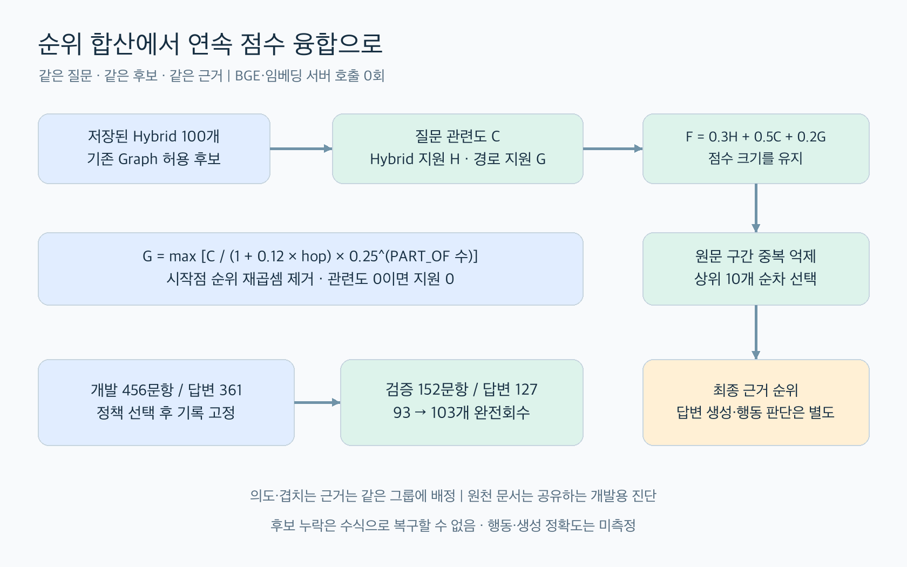
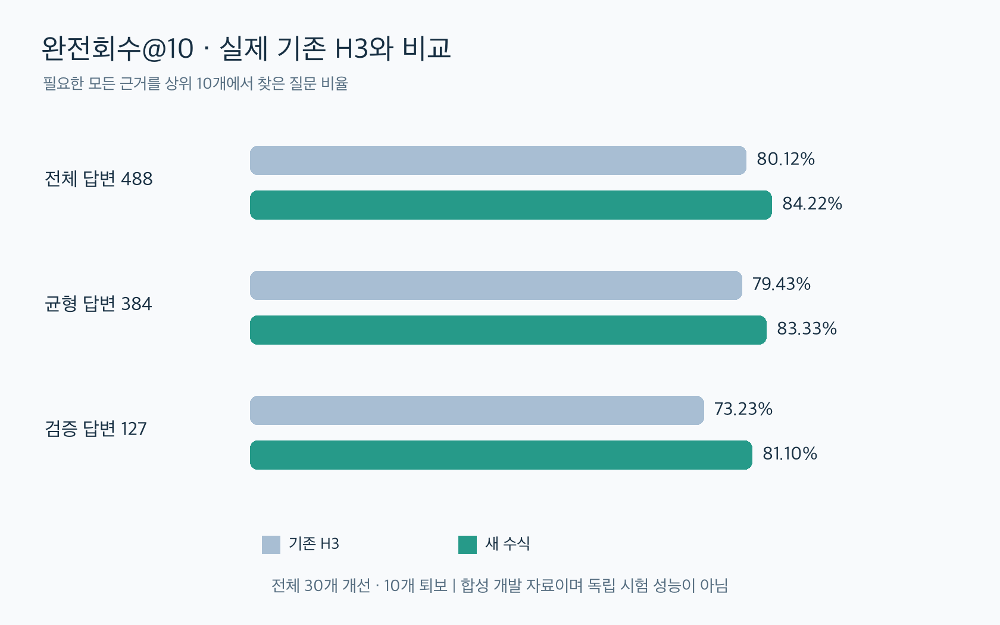

# Week 7 · 수식 개편과 최종 검수

기존 H3의 완전회수@10은 391/488(80.12%), 새 수식은 411/488(84.22%)다. 개발 구간으로 식을 선택한 뒤 고정한 검증 구간에서도 93→103/127개로 개선됐다. 전체에서는 30개가 성공으로, 10개가 실패로 바뀌었다. BGE와 임베딩 서버를 실행하지 않았으며, 저장된 동일 후보·질문·근거로 비교했다.

## 실제 기준선부터 바로잡기

사용자가 제시한 Graph 점수와 RRF는 코드에 존재한다. 다만 최신 저장 H3는 그 뒤에 청크·인용문 관련도를 결합한다.

```text
기존 경로 점수 = (1 / 시작 Hybrid 순위)
               × (0.45 + 청크 관련도)
               ÷ (1 + 0.12 × hop)
               × 근거 유형 보정

R = [1/(60+Hybrid 순위) + 1/(60+Graph 순위)] ÷ (2/61)
실제 기존 H3 = 0.5R + 0.3 × 청크 관련도 + 0.2 × 인용문 관련도
```

Graph 순위가 같은 한 원래 점수 크기를 바꿔도 RRF에 전달되지 않는다. 시작점 1위와 2위는 가중치가 2배 차이 나며, 고정 바닥값 0.45는 대표 경로의 질문 관련도 중앙값 0.098보다 크다. 조건 근거에 곱하는 0.95는 같은 청크의 일반 경로에 밀려 대표 경로로 한 번도 선택되지 않았다. 반면 Hybrid→H3 자체가 아무것도 바꾸지 않는 것은 아니다. 608문항에서 상위 10개 순서가 그대로인 문항은 0개였다.

## 채택한 식

```text
H = Hybrid 후보이면 61/(60+Hybrid 순위), 아니면 0
C = 질문의 IDF 가중 단어 중 청크 제목·본문에 포함된 비율
G = max 경로 [C ÷ (1+0.12×hop) × 0.25^(PART_OF 관계 수)]
    허용된 Graph 후보가 아니면 0

기본 점수 F = 0.3H + 0.5C + 0.2G
선택 점수 = F/max(F) − 0.15 × 이미 선택된 청크와의 최대 원문 구간 겹침
```

상위 10개를 선택 점수로 순차 선택하고 나머지 후보는 기본 점수 순서로 유지한다. 겹침은 같은 문서에서만 계산하며, 교집합 길이를 두 청크 중 짧은 길이로 나눈다. 시작점은 후보 탐색에 계속 쓰지만 최종 Graph 점수에 시작점 순위를 다시 곱하지 않는다. 질문 관련도가 0이면 Graph 지원점수도 0이다. Graph 점수의 크기를 보존해 융합하고 조건 근거의 일괄 감점은 제거한다.

PART_OF 0.25와 hop 0.12는 구조에 관한 보수적인 가정이다. 이번 성적만으로 최적 계수나 신뢰도를 입증하지 않는다. 질문 ID·정답·유형·서비스 라벨은 점수 함수에 입력하지 않는다.

## 비교 조건



- 전체 608문항, 답변 가능 488개만 검색 지표에 포함. 추가 확인·보류 120개는 검색 점수에서 제외.
- 균형본 480개는 전체의 부분집합이며 검색 분모는 384개.
- 동일 의도와 겹치는 근거를 공유하는 문항을 합쳐 320개 그룹으로 구성. 개발 456문항(답변 361), 검증 152문항(답변 127)로 고정.
- 개발 Complete@10 → Recall@10 → MRR@100 순으로 후보 정책을 선택하고, 선택 기록을 저장한 후 검증 지표를 계산.
- Hybrid 상위 100개와 기존 허용 Graph 후보의 합집합을 그대로 사용. 모든 정책에서 608개 후보 집합 일치.
- 후속 항 제거 실험은 원인 설명용이다. 검증 결과를 본 뒤 정책을 재선택하지 않았다.
- 합성·반복 개발 자료이며 원천 문서는 공유된다. 독립 시험이나 실사용 일반화 성능이 아니다. 기존 임베딩의 실행 시기 차이는 남지만 이번 두 방식은 같은 저장 입력을 사용한다.

## 실측 결과



Complete@10은 필요한 모든 근거 묶음을 상위 10개에서 찾은 비율이다. Recall@10은 근거 묶음 회수율의 문항별 평균, MRR@100은 첫 근거 순위 역수의 평균이다.

| 범위 | 기존 H3 완전회수 | 새 수식 완전회수 | 변화 |
|---|---:|---:|---:|
| 개발 답변 361 | 298 · 82.55% | 308 · 85.32% | +10 |
| 검증 답변 127 | 93 · 73.23% | 103 · 81.10% | +10 |
| 전체 답변 488 | 391 · 80.12% | 411 · 84.22% | +20 |
| 균형 답변 384 | 305 · 79.43% | 320 · 83.33% | +15 |

전체 Recall@10은 85.33→89.40%, MRR@100은 0.6585→0.6861이다. 검증 구간에서는 Recall@10 82.39→88.03%, MRR@100 0.6544→0.7080이다. 새 수식 적용 후 기존 H3와 상위 10개 순서가 같은 질문은 1/608개, 집합이 같은 질문은 32/608개다.

| 개발 단계 비교 후보 | 개발 완전회수 /361 | 전체 완전회수 /488 |
|---|---:|---:|
| 제시된 식의 단순 RRF | 275 | 364 |
| 시작점 균등화 + RRF | 282 | 372 |
| 실제 기존 H3 | 298 | 391 |
| 기존 H3 + 중복 억제 | 298 | 391 |
| 연속 융합 0.4 / 0.4 / 0.2 | 298 | 400 |
| 위 식 + 중복 억제 | 301 | 403 |
| 텍스트 우선 0.3 / 0.5 / 0.2 + 중복 억제 · 선택 | 308 | 411 |
| Hybrid 우선 0.5 / 0.3 / 0.2 + 중복 억제 | 295 | 395 |

## 어느 항이 기여했나

| 선택안에서 한 항만 변경 | 전체 완전회수 /488 | 검증 완전회수 /127 | 전체 MRR@100 |
|---|---:|---:|---:|
| 선택안 그대로 | 411 | 103 | 0.6861 |
| 같은 0.3 / 0.5 가중치에서 Graph 항만 제거 | 404 | 101 | 0.6937 |
| 중복 억제 제거 | 411 | 103 | 0.6850 |
| PART_OF 감점 제거 | 411 | 103 | 0.6860 |
| hop 감점 제거 | 411 | 103 | 0.6873 |

동일 텍스트 비중에서 Graph 지원은 전체 +7개, 검증 +2개 완전회수에 기여했지만 첫 근거 순위는 약간 낮췄다. 중복 억제·hop·PART_OF만 제거해도 완전회수는 같았다. 따라서 이번 개선의 핵심은 연속 점수 융합과 텍스트 비중이며, 중복 억제나 hop 계수의 성과라고 설명하지 않는다.

저장 특징의 재계산과 상위 10개 선택은 질문당 평균 약 0.82ms였다. 이 값은 파일 읽기·Graph 탐색·임베딩을 제외한 추가 계산 시간으로 전체 서비스 지연시간이 아니다.

## 개선과 퇴보를 함께 보기

| 균형본 유형 · 각 48문항 | 기존 H3 | 새 수식 |
|---|---:|---:|
| 직접 질의 | 46 | 47 |
| 서비스 탐색 | 42 | 41 |
| 조건·예외 판단 | 36 | 38 |
| 구비서류 | 41 | 46 |
| 담당 기관 | 42 | 43 |
| 법적 근거 | 42 | 45 |
| 문서 간 참조 | 36 | 36 |
| 여러 근거 종합 | 20 | 24 |

전체 30개 개선·10개 퇴보, 검증 12개 개선·2개 퇴보다. 퇴보 문항은 SJ-N-022, SJ-N-027, SJ-N-041, SJ-N-047, SJ-N-061, SJ-A-003, W7-MS-018, W7-MS-034, W7V2-LA002, W7V2-MS014다. 서비스 탐색은 균형본에서 42→41/48로 낮아졌다. 완전회수와 첫 근거 순위가 함께 좋아지지 않는 유형도 있다.

전체 후보에 모든 근거가 있는 문항은 481/488개, 균형본은 379/384개다. 후보 누락 7개는 고정 후보의 점수 변경만으로 해결되지 않는다.

## 벤치마크 최종 판단과 정리

신규 404개와 인용 590건을 전수 검토하고, 로컬 원문·위치·허용 청크를 다시 대조했다. 명백한 정답 전복이나 제외 사유는 찾지 못했다. 전체 608문항과 답변 488·확인 60·보류 60은 유지한다. 사용자 검토가 있었다는 사실과 AI 검수는 구분하며, 비어 있는 사람 검수란을 AI가 채우지 않았다.

21문항의 보조 주석·정책을 수정했다. 온라인 한정 제거 1개, 확인 슬롯 통일 13개, 누락 확인 구조 복원 2개, 허용 행동 대안 1개, 동일 규칙 문항 연결 2개, 조건부 확인·생계 공동 설명 2개다. 질문 원문·검색 정답·근거 요구는 모두 동일하며 새 임베딩은 필요 없다.

SJ-A-082는 기본 clarify를 유지하되 정확한 점검목록을 제공하는 answer도 허용한다. 평가기는 허용 행동 정확도를 실제 계산하고, 기본 라벨의 혼동행렬·F1은 별도로 유지한다. 허용 행동만으로 응답 내용이 정확하다고 판정하지 않는다. 실제 행동 예측은 아직 없어 행동 정확도·F1과 생성 답변 품질은 미측정이다.

활성 목록에서 작성 차수 컬럼과 분리 목록을 제거하고 전체·기존·신규로 통합했다. 안정적인 질문 ID와 근거·선택 연결은 보존했다. 중복 링크 471개, 동일 일반 파일 7개, 과거 중간·표시 자료 138개 등 총 616개 항목을 복구 가능한 보관 폴더로 이동했다. 영구 삭제와 모델·원문 제거는 하지 않았다. 예전 넓은 근거 인용 40건(38문항)은 여전히 별도 검토가 필요하다.

## Git 공유 범위

현재 파일은 65개이며 전송용 ZIP은 제거했다. 과거 제출·실험·대형 임베딩 DB·구형 복원 도구를 활성 프로젝트에서 제거했다. 현재 원문·근거·정답과 작은 검수 전 fixture는 유지했다. `restore_week7.py`는 현재 검색 DB만 복원하며 Hybrid gzip은 직접 읽는다. Git 이력은 삭제하지 않았고, 미추적 과거 파일은 별도 복구 보관소로 이동했다. 기존 `submission_manifest.json` 검증 대신 현재 입력 manifest를 검증한다. 기준선 생성과 수식 비교 CLI도 새 Git 구성에서 재실행했다.

## 다음 작업

현재 Git 공유 파일만 새 폴더에 복사해 DB 복원부터 실행하고 현재 기능 테스트 67개를 통과했다. 이전 Week3/4 제출·실험 복원과 초안 빌더를 지원 범위에서 제거하여 관련 구형 테스트도 제외했다. 608문항 전체의 `coverage` 검색과 평가를 재실행했으며, 기존 선택 실험과 상위 10개가 608개 모두 일치하고 완전회수 411/488이 재현됐다. BGE·임베딩 서버·모델 API 호출은 0회다.

1. 퇴보 10문항과 서비스 탐색 실패를 검토해 어휘 불일치·넓은 법령 청크 편중을 구분한다. 이번 검증 구간을 다시 튜닝용으로 쓴다면 새 검증본을 마련한다.
2. 기존 넓은 근거 인용 40건을 명제 단위로 좁히고, 후보 누락 7문항을 근거 정정과 검색 연결 누락으로 구분한다.
3. 실제 answer·clarify·abstain 출력과 응답 본문을 연결한다. 허용 행동 정확도, 기본 라벨 F1, 인용·답변 정확성을 분리 평가한다.
4. 사람이 새로 작성한 독립 문항과 문서·의도 분리 계획을 확정한다.
5. 임베딩 revision·전처리·허용오차를 고정해 재현성 문제를 정리한다. BGE 재실행은 이번 작업에 포함하지 않았다.
