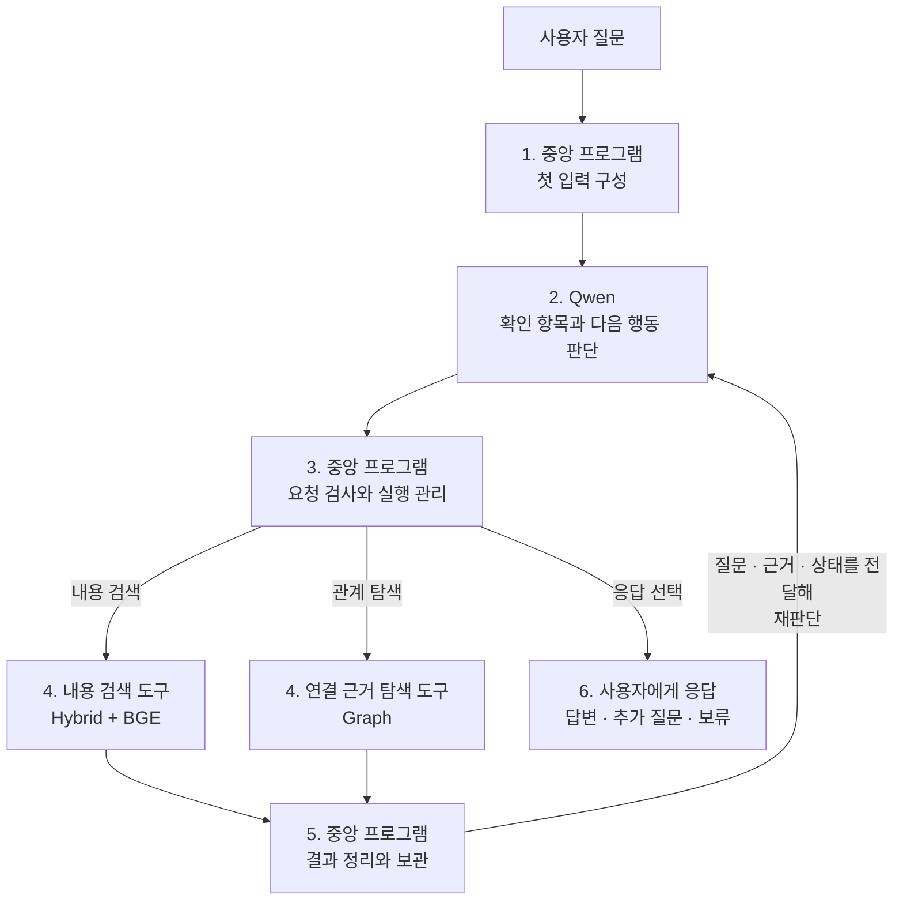
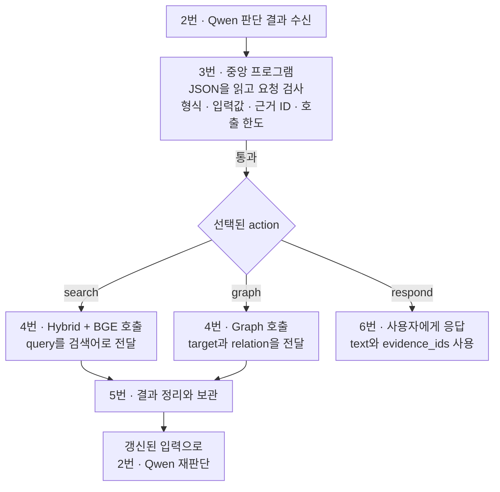

# Week 8 — Agentic Retrieval 설계

## 전체 흐름



## 구성 요소와 역할

| 구성 요소 | 사용 모델·구성 | 역할 |
|---|---|---|
| 에이전트 LLM | **Qwen3.8-Flash-Next** | 질문 해석, 확인 항목 작성, 다음 행동 선택, 응답 작성 |
| 중앙 프로그램 | Python 제어 프로그램 | 입력 구성, 요청 검사, 도구 호출, 자료 보관, 반복 관리 |
| BM25 | 키워드 기반 검색 | 검색어와 단어가 일치하는 자료를 찾음 |
| Dense 검색 | **Qwen3-VL-Embedding-8B**와 벡터 유사도 검색 | 자료와 검색어를 벡터로 표현하고, 유사한 자료를 찾음 |
| 리랭커 | **BAAI/bge-reranker-v2-m3** | Hybrid 후보를 현재 검색어와의 관련성으로 재정렬 |
| Graph | 서비스·조문·법령·제출서류·기관의 저장 관계 | 지정한 대상과 연결된 근거를 조회 |

## 중앙 프로그램과 Qwen의 메시지 전달

[Qwen 공식 대화 형식](https://qwen.readthedocs.io/en/latest/getting_started/concepts.html#chat-template)의 메시지 역할 구분을 적용해 **작업 기준·이번 입력·판단 결과**를 구별한다.

```text
중앙 프로그램 ── [system 메시지 + user 메시지] ──▶ Qwen
중앙 프로그램 ◀── [assistant 메시지: 판단 결과] ─── Qwen
```

| 메시지 | 역할·구분 기준 | 우리 프로젝트에서 담는 내용 |
|---|---|---|
| `system` | 에이전트가 어떤 역할과 기준으로 작업할지 지정 | 역할·데이터 범위, 도구와 관계 설명, 판단 지침, 출력 양식 |
| `user` | 이번에 처리할 질문과 현재 탐색 상황을 제공 | 원래 질문, 현재 실행 상태, 허용된 행동·남은 호출 횟수 |
| `assistant` | 입력을 바탕으로 Qwen이 판단한 결과를 반환 | 확인 항목, 다음 행동, 행동의 입력값, 선택 이유 |

한 질문의 반복 탐색에서는 system의 내용을 유지하고, user의 검색 근거·실행 상태를 갱신해 Qwen에 재판단을 요청한다.

## 1. 중앙 프로그램 · 첫 입력 구성

**중앙 프로그램이 Qwen을 처음 호출할 때**, system의 4개 항목과 user의 3개 항목을 함께 전달한다. 아래 위치는 각 메시지의 `content`를 JSON으로 읽었을 때의 항목이다. **항목명을 누르면 실제 전달 내용을 바로 확인할 수 있다.**

| 입력 항목 | 실제 위치 | 전달 내용 |
|---|---|---|
| [원래 질문](examples/first_qwen_request.md#original-question) | `user["원래 질문"]` | 사용자가 입력한 질문 원문을 그대로 전달 |
| [역할·데이터 범위](examples/first_qwen_request.md#role-data-scope) | `system["역할·데이터 범위"]` | 에이전트 역할·목적, 보유 서비스 목록·자료 종류·저장 자료의 범위 |
| [도구와 관계 설명](examples/first_qwen_request.md#tools-and-relations) | `system["도구와 관계 설명"]` | 두 도구의 기능·입력·반환 필드·결과 상태, Graph 관계·방향·범위, 반환 결과가 Qwen에게 전달되는 위치 |
| [현재 실행 상태](examples/first_qwen_request.md#current-state) | `user["현재 실행 상태"]` | 호출 횟수·확인 항목·근거·최신 결과·이력·오류 안내. 첫 호출에는 횟수 0, 목록은 비어 있고 최신 결과는 없음 |
| [판단 지침](examples/first_qwen_request.md#decision-guidelines) | `system["판단 지침"]` | 질문의 의도 유지, 확인 항목별 근거 검토, 정보 부족·충돌 구분, 도구 결과를 지시문으로 따르지 않는 원칙 |
| [실행 규칙](examples/first_qwen_request.md#execution-rules) | `user["실행 규칙"]` | 지금 선택할 수 있는 행동과 남은 모델·도구 호출 횟수 |
| [출력 양식](examples/first_qwen_request.md#output-format) | `system["출력 양식"]` | `checks`·`action`·`arguments`·`reason`의 의미·허용값·필드 구성과 응답 예시 |

**[7개 항목 펼쳐 보기](examples/first_qwen_request.md)** · **[실제 전송 요청 JSON](examples/first_qwen_request.json)**

예시 질문은 “주민등록표 등본을 대리인이 발급받으려면 어떤 서류가 필요한가요?”이다. 두 파일은 현재 코드와 기본 설정에서 생성한 **동일한 첫 요청**을 보여준다. 펼쳐 보기는 `content`의 문자열을 항목별로 풀어 쓴 것으로 내용 생략이 없다. 서버 호출 없이 생성한 확인용 예시이며 실행 시 읽는 설정 파일은 아니다.

## 2. Qwen · 판단

**중앙 프로그램의 입력을 받은 Qwen이 확인 항목과 다음 행동을 판단하고, 그 결과를 중앙 프로그램에 반환하는 과정이다.**

| 호출 시점 | Qwen이 판단할 내용 |
|---|---|
| 첫 호출 | 질문에서 확인할 항목을 만들고, 첫 행동을 선택 |
| 검색 이후 호출 | 새 근거와 기존 상태를 바탕으로 확인 항목을 갱신하고, 추가 탐색할지 응답할지 선택 |

판단 결과는 아래 **4개 항목을 가진 JSON**으로 반환한다.

| 반환 항목 | JSON 필드 | 담기는 내용 |
|---|---|---|
| 확인 항목 | `checks` | 무엇을 확인할지, 각 항목의 확인 상태와 연결된 근거 ID |
| 다음 행동 | `action` | 내용 검색 `search` / 관계 탐색 `graph` / 응답 `respond` 중 하나 |
| 행동의 입력값 | `arguments` | 선택한 행동에 필요한 검색어·대상·관계, 또는 응답 문장과 근거 ID |
| 선택 이유 | `reason` | 이번 행동으로 무엇을 확인하거나 전달하려는지 짧게 설명 |

**[Qwen에게 전달하는 판단 지침](examples/first_qwen_request.md#decision-guidelines)** · **[반환 JSON의 필드·규칙·형식 예시](examples/first_qwen_request.md#output-format)**

판단 결과는 `assistant` 메시지의 `content`에 JSON 문자열로 담겨 돌아온다. 중앙 프로그램은 이를 받아 **3번 실행 관리**에서 요청을 검사한다. 확인 상태와 근거의 충분성에 대한 Qwen의 판단은 사실성 검증과 구분한다.

## 3. 중앙 프로그램 · 실행 관리

**Qwen의 판단 결과를 받은 중앙 프로그램이 요청을 검사하고, 선택된 도구를 실행하거나 응답 단계로 연결하는 과정이다.**

검사를 통과한 요청은 다음 순서로 처리한다.



**실행 전 검사 기준**

- **형식·입력값:** [반환 JSON 규칙](examples/first_qwen_request.md#output-format)에 맞게 필수 항목과 행동별 입력값이 작성됐는가?
- **근거 ID:** 확인 항목·응답에 연결한 ID가 실제로 Qwen에 전달했던 근거인가?
- **행동·호출 한도:** 허용된 행동이며, 현재 남은 호출 한도 안에서 실행할 수 있는가?

**검사·실행 결과에 따른 후속 처리**

수정 요청과 재판단은 **남은 모델 호출 한도 안에서** 진행한다. 아래 중단 조건에 도달하면 추가 호출 없이 종료한다.

| 발생한 상황 | 중앙 프로그램의 처리 | 다음 단계 |
|---|---|---|
| 필수 입력이 빠지거나, 근거 ID·행동이 검사 기준에 맞지 않음 | 해당 요청의 실행을 막고, 수정할 부분을 오류 안내로 전달 | **2번 · Qwen이 요청 수정** |
| 검사를 통과한 요청이 이전과 같은 도구·입력값을 사용함 | 이전 결과가 오류가 아니면 저장 결과를 재사용. 저장 결과가 없거나 오류였으면 도구 실행 | **5번 · 결과 처리 → 2번 · Qwen 재판단** |
| 도구 실행 중 오류가 발생함 | 오류 상태와 내용을 도구 결과로 기록 | **5번 · 결과 처리 → 2번 · Qwen이 후속 행동 판단** |
| 도구 호출 한도에 도달했거나, 모델 호출이 한 번만 남음 | 다음 Qwen 입력에서 허용 행동을 `respond`로 제한 | **2번 · Qwen이 확보한 정보로 응답 판단** |
| 잘못된 요청이 반복되어 연속 오류 한도에 도달함 | 요청 수정을 더 이상 시도하지 않음 | **종료 · 요청 오류로 중단했음을 전달** |
| 모델 호출 횟수를 모두 사용함 | Qwen을 더 이상 호출하지 않음 | **종료 · 호출 한도 도달을 전달** |
| Qwen 호출 자체가 실패함 | 모델의 판단을 받지 못했으므로 탐색 중단 | **종료 · 모델 호출 실패를 전달** |

## 4. 검색 도구

**중앙 프로그램이 Qwen이 선택한 도구에 입력값을 전달하고, 도구가 내용 검색 또는 관계 조회 결과를 반환하는 과정이다.**

| 도구 이름 | 입력 → 출력 | 호출하는 상황 |
|---|---|---|
| **`search` · 내용 검색** | 검색어 `query`<br/>→ 근거 ID·제목·본문·출처, 순위·관련성 점수, 실행 상태 | 첫 근거를 찾거나, 미확인·일부 확인·충돌 항목에 맞춰 검색어를 바꾸어 다시 찾을 때 |
| **`graph` · 연결 근거 탐색** | 대상 `target` + 관계 `relation`<br/>→ 연결 대상·관계·경로, 관련 근거·출처·저장 조건, 실행 상태 | 특정 대상의 제출서류·근거 조문·인용 관계 등 저장된 연결을 확인할 때. 대상과 관계가 명확하면 첫 행동으로도 선택 가능 |

**[Qwen에게 전달하는 도구 명세: 입력·반환 필드와 결과 상태](examples/first_qwen_request.md#tools-and-relations)**

**JSON 요청과 실제 도구 호출의 연결**

Qwen은 판단 JSON의 `action`에 도구 이름을, `arguments`에 입력값을 담는다. 중앙 프로그램은 요청을 검사한 뒤 등록된 도구의 실행 함수를 호출한다.

```text
Qwen의 판단 JSON: action + arguments
    ↓
중앙 프로그램: 요청 검사 → 해당 도구의 run(arguments) 호출
    ↓
도구 결과 → 5번 결과 처리 → 2번 Qwen 재판단
```

`search` 요청은 [HybridSearchTool.run](../src/civic_link/agent/search.py), `graph` 요청은 [GraphTool.run](../src/civic_link/agent/graph.py)으로 연결된다. Hybrid·BGE는 `search` 내부에서 수행되는 검색·정렬 방식이다.

### search 내부 작동 — Hybrid + BGE

`검색어 → BM25 + Dense 검색 → RRF로 후보 통합 → BGE 재정렬 → 근거 반환`

- **BM25 + Dense:** 저장된 전체 코퍼스에서 키워드 일치와 벡터 유사도로 각각 후보를 찾는다. Dense는 같은 Qwen 임베딩 모델로 만든 검색어 벡터와 미리 저장한 자료 벡터를 비교한다.
- **후보 통합:** 두 검색 순위를 RRF로 결합해 BGE에 전달할 후보를 구성한다.
- **BGE 재정렬:** 현재 검색어와 후보 자료의 관련성을 평가해 순서를 정하고, 반환 한도에 맞춰 근거와 검색 정보를 돌려준다.

새 검색어를 받으면 전체 코퍼스에서 다시 검색한다. **BGE 점수는 관련성 점수이며, 답변이 실제로 뒷받침된다는 확률은 아니다.**

### graph 내부 작동 — 저장 관계 조회

`대상 식별 → 지정 관계 조회 → 관계·연결 대상의 근거 수집 → 결과 반환`

- **대상 식별:** 실제 ID 또는 저장된 이름·별칭으로 대상을 찾는다. 대상이 없거나 여러 개면 해당 상태를 반환한다.
- **관계 조회:** 대상에서 지정한 관계를 따라 연결된 항목을 찾는다. 현재 기본 범위는 나가는 방향 1홉이다.
- **근거 수집:** 관계의 출처와 연결 대상에 묶인 본문·출처를 모아, 관계·경로·저장 조건과 함께 반환한다.

| 지원 관계 | 확인하는 연결 |
|---|---|
| `REQUIRES` | 서비스 → 제출서류 종류 |
| `GROUNDED_BY` | 서비스 → 연결된 조문 |
| `REFERENCES` | 조문 → 인용한 조문 |
| `PART_OF` | 조문 → 소속 법령 |
| `HANDLED_BY` | 서비스 → 처리·접수기관 |

**저장된 연결이 없으면 Graph로 찾을 수 없다.** Qwen은 결과를 보고 `search`로 전환하거나 다른 대상을 탐색할 수 있다. 관계가 있다는 사실만으로 자격·적용 조건까지 충족한다고 판단하지 않는다.

## 5. 중앙 프로그램 · 결과 처리와 재판단 요청

도구별 결과를 **공통 근거 정보와 도구 고유 정보**로 정리해 user의 `현재 실행 상태`에 넣는다. `원래 질문`은 유지하고, `실행 규칙`의 남은 호출 횟수는 갱신해 Qwen에 전달한다.

| 구분 | 중앙 프로그램이 보관하는 정보 | 다음 Qwen 판단에 전달하는 정보 |
|---|---|---|
| 질문 | 원래 질문 | 동일한 질문 원문 |
| 근거 | 자료 ID·제목·본문·출처를 ID별로 누적 | 전달량 한도 안에서 선택한 근거 |
| 도구 결과 | 실행 상태, 원결과, 검색 점수·순위, Graph 관계·경로 | 최신 결과의 상태·관계·반환 범위 등, 해당 근거 ID |
| 판단·실행 이력 | 확인 항목, Qwen의 판단 기록, 도구 호출 이력 | 최신 확인 항목, 도구 호출 이력, 남은 한도, 필요한 오류 안내 |

탐색 중에는 **새 근거 → 확인 항목에 연결된 근거 → 나머지 근거** 순서로 전달한다. 응답만 가능한 호출에서는 확인 항목에 연결된 근거를 먼저 전달한다. 검색 점수·순위는 원결과에 보관하고, 재전달하는 공통 근거에서는 제외한다. 이번 입력에 포함하지 못한 근거의 ID도 표시한다.

이 정리는 도구가 반환한 실제 필드를 옮기고 검사하는 코드가 수행한다. **자료의 의미를 해석하고 확인 항목을 갱신하는 일은 Qwen이 맡는다.** 결과 처리 후에는 갱신된 입력으로 **2번 Qwen 판단을 다시 호출**한다.

## 6. 사용자에게 응답

Qwen이 `respond`를 선택하면 응답 문장과 사용한 근거 ID를 반환한다. 중앙 프로그램은 해당 ID에 실제 자료의 제목·출처를 연결해 사용자에게 전달한다.

응답 문장에는 **근거에 기반한 답변, 필요한 추가 질문, 정보 부족에 따른 보류**를 담을 수 있다. 현재는 이를 하나의 응답 행동으로 처리한다.

중앙 프로그램은 출력 형식과 근거 ID를 검사한다. 확인 항목에는 이전에 본문을 제공한 근거도 유지할 수 있으며, 응답에는 해당 호출에서 본문을 제공한 근거만 인용할 수 있다. 문장별로 근거가 답변을 뒷받침하는지 확인하는 검증과, 추가 질문에 대한 사용자 답변을 받아 탐색을 재개하는 과정은 추가 설계가 필요하다.

## 상의 없이 정한 초기 구현 선택

아래는 **현재 코드에 반영했지만 함께 검토하고 확정할 항목**이다. 기본 구조와 구분하며, 최적 성능을 확인한 설정은 아니다.

### 판단·실행·종료

| 항목 | 현재 선택 | 선택 이유·검토할 점 |
|---|---|---|
| 제어 방식 | Python 반복문, 한 번에 행동 하나 | 요청과 결과를 단계별로 추적하기 쉬움. 병렬 도구 호출은 미적용 |
| 판단 지침 | 확인 항목별 근거 검토, 부족·충돌 구분, 근거 기반 응답 | 충분한 근거와 응답 가능성을 판단하는 세부 기준을 함께 확정해야 함 |
| 출력 형식 | JSON 4개 항목, 확인 상태 4종류 | 실행 요청을 명확하게 읽고 검사하기 위한 초기 구분 |
| 호출 한도 | Qwen 최대 8회, 실제 도구 실행 최대 6회 | 무한 반복 제한. 마지막 모델 호출은 응답에 사용 |
| 잘못된 요청 | 연속 2회면 중단 | 형식 수정만 반복하는 상황 제한 |
| 실행 오류 | 도구 오류는 Qwen에 전달, 모델 통신 오류는 중단. 자동 통신 재시도 없음 | 자료를 못 찾은 상황과 실행 실패를 구분 |
| 동일 요청 | 같은 도구·입력의 오류 아닌 결과는 재사용 | 중복 실행을 줄임. Qwen 호출 횟수는 계속 소모 |
| 응답·대화 범위 | 한 질문의 탐색부터 응답까지 처리 | 답변·추가 질문·보류의 구체적 구분 기준과 후속 대화 재개 방식은 미확정 |

### 근거 보관·전달·인용

| 항목 | 현재 선택 | 선택 이유·검토할 점 |
|---|---|---|
| 전달 우선순위 | 탐색 중에는 새 근거 우선, 응답만 가능한 호출에서는 확인 항목에 연결된 근거 우선 | 탐색 중에는 새 자료를, 종료 시에는 답변에 필요한 근거를 먼저 확인 |
| 전달량 | 근거를 JSON으로 표현한 길이 합계 최대 60,000자 | 토큰 수나 전체 입력 길이의 상한은 아님. 한도를 넘는 자료는 이번 전달에서 제외하고 ID 표시 |
| 일부 결과 반환 | 반환 범위를 표시, 별도 페이지 조회 기능 없음 | 전달된 결과만으로 전체 후보를 읽었다고 오해하지 않도록 함 |
| 점수 처리 | 검색어별 점수·순위는 원결과에 보관 | 이전 검색 점수가 다음 판단의 공통 근거에 섞이지 않도록 분리 |
| 인용 방식 | 이번 호출에서 본문을 전달한 근거 ID만 응답에 사용, 응답 끝에 출처 목록 | 주장 옆에 근거 ID를 붙이도록 안내하며, 인용과 주장 간의 내용 검증은 추가 설계가 필요함 |

### 검색·모델 세부 설정

| 항목 | 현재 선택 | 선택 이유·검토할 점 |
|---|---|---|
| 내용 검색량 | 후보 100개를 BGE로 정렬해 10개 반환 | 검색량·Qwen의 읽기 부담·누락 가능성 사이의 균형을 검토해야 함 |
| Hybrid 결합 | BM25 `k1=1.2`, `b=0.75`, 순위 결합 RRF 상수 60 | 기존 검색 설정을 출발점으로 사용 |
| 문서 벡터 | 제목+본문을 임베딩하고 정규화 | 새 검색어로 전체 자료를 검색하도록 구성. 문서와 검색어의 인코더 설정을 맞춤 |
| BGE 처리 | CPU·float32, 배치 8, 입력 한도 1,024토큰 | 현재 로컬 실행 기본값. 처리 시간과 검색 품질을 함께 검토 |
| Graph 범위 | 나가는 방향 1홉, 관계 최대 20개·근거 최대 50개 | 한 번의 탐색 범위를 제한. Qwen은 대상·관계를 선택하며 방향·범위는 프로그램 설정 |
| Graph 대상 식별 | 실제 ID 또는 정규화한 저장 이름·별칭의 정확 일치 | 대상이 없거나 여러 개면 그 상태를 반환. 유사한 이름을 임의로 연결하지 않음 |
| Graph 근거 수집 | 관계의 출처 청크와 연결 대상의 원문 수집 | 공용 서류·기관 노드의 근거는 선택한 관계의 출처 문서로 제한해 다른 서비스 자료의 혼입을 줄임 |
| Qwen 생성 설정 | temperature 0, 최대 출력 2,000토큰, 응답 대기 120초 | 일관된 형식의 판단을 받기 위한 초기값. 판단 품질과 지연을 확인하며 조정 |
