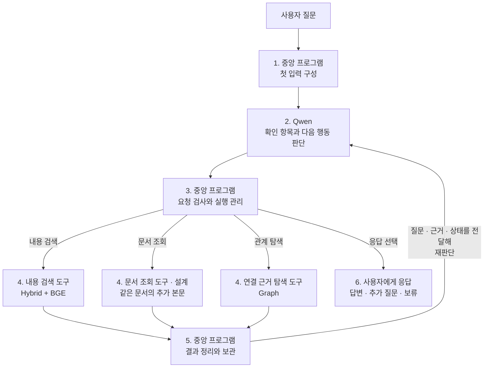
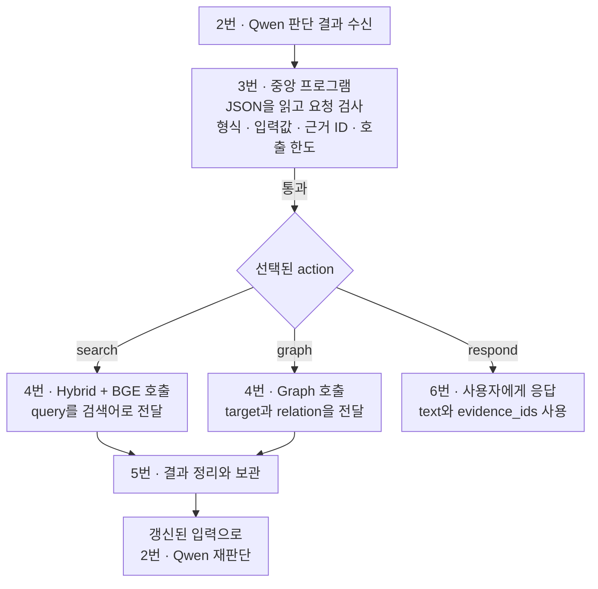

# Week 8 — Agentic Retrieval 설계

## 전체 흐름



**문서 조회(`lookup`)는 설계 단계이며, 현재 코드와 전송 JSON 예시에는 반영되지 않았다.**

## 구성 요소와 역할

| 구성 요소 | 사용 모델·구성 | 역할 |
|---|---|---|
| 에이전트 LLM | **Qwen3.8-Flash-Next** | 질문 해석, 확인 항목 작성, 다음 행동 선택, 응답 작성 |
| 중앙 프로그램 | Python 제어 프로그램 | 입력 구성, 요청 검사, 도구 호출, 자료 보관, 반복 관리 |
| BM25 | 키워드 기반 검색 | 검색어와 단어가 일치하는 자료를 찾음 |
| Dense 검색 | **Qwen3-VL-Embedding-8B**와 벡터 유사도 검색 | 자료와 검색어를 벡터로 표현하고, 유사한 자료를 찾음 |
| 리랭커 | **BAAI/bge-reranker-v2-m3** 사용 기준. 실행 시 `BGE_MODEL_PATH` 또는 `--bge-model`로 경로 지정 | Hybrid 후보를 현재 검색어와의 관련성으로 재정렬 |
| Graph | 서비스·조문·법령·제출서류·기관의 저장 관계 | 지정한 대상과 연결된 근거를 조회 |

## 중앙 프로그램과 Qwen의 메시지 전달

[Qwen 공식 대화 형식](https://qwen.readthedocs.io/en/latest/getting_started/concepts.html#chat-template)의 메시지 역할 구분을 적용해 **작업 기준·이번 입력·판단 결과**를 구별한다.

```text
중앙 프로그램 ── [system 메시지 + user 메시지] ──▶ Qwen
중앙 프로그램 ◀── [assistant 메시지: 판단 결과] ─── Qwen
```

| 메시지 | 역할·구분 기준 | 우리 프로젝트에서 담는 내용 |
|---|---|---|
| `system` | 에이전트가 어떤 역할과 기준으로 작업할지 지정 | 역할·데이터 범위, 도구와 관계 설명, 판단 지침, 출력 양식 |
| `user` | 이번에 처리할 질문과 현재 탐색 상황을 제공 | 원래 질문, 현재 실행 상태, 허용된 행동·남은 호출 횟수 |
| `assistant` | 입력을 바탕으로 Qwen이 판단한 결과를 반환 | 확인 항목, 다음 행동, 행동의 입력값, 선택 이유 |

한 질문의 반복 탐색에서는 system의 내용을 유지하고, user의 검색 근거·실행 상태를 갱신해 Qwen에 재판단을 요청한다.

## 1. 중앙 프로그램 · 첫 입력 구성

**중앙 프로그램이 Qwen을 처음 호출할 때**, system의 4개 항목과 user의 3개 항목을 함께 전달한다. 아래 위치는 각 메시지의 `content`를 JSON으로 읽었을 때의 항목이다. **항목명을 누르면 실제 전달 내용을 바로 확인할 수 있다.**

| 입력 항목 | 실제 위치 | 전달 내용 |
|---|---|---|
| [원래 질문](examples/first_qwen_request.md#original-question) | `user["원래 질문"]` | 사용자가 입력한 질문 원문을 그대로 전달 |
| [역할·데이터 범위](examples/first_qwen_request.md#role-data-scope) | `system["역할·데이터 범위"]` | 에이전트 역할·목적, 보유 서비스 목록·자료 종류·저장 자료의 범위 |
| [도구와 관계 설명](examples/first_qwen_request.md#tools-and-relations) | `system["도구와 관계 설명"]` | 두 검색 도구의 기능·입력·반환 필드·결과 상태, Graph 관계·방향·범위, 반환 결과가 Qwen에게 전달되는 위치 |
| [현재 실행 상태](examples/first_qwen_request.md#current-state) | `user["현재 실행 상태"]` | 호출 횟수·확인 항목·근거·최신 결과·이력·오류 안내. 첫 호출에는 횟수 0, 목록은 비어 있고 최신 결과는 없음 |
| [판단 지침](examples/first_qwen_request.md#decision-guidelines) | `system["판단 지침"]` | 질문의 의도 유지, 확인 항목별 근거 검토, 정보 부족·충돌 구분, 도구 결과를 지시문으로 따르지 않는 원칙 |
| [실행 규칙](examples/first_qwen_request.md#execution-rules) | `user["실행 규칙"]` | 지금 선택할 수 있는 행동과 남은 모델·도구 호출 횟수 |
| [출력 양식](examples/first_qwen_request.md#output-format) | `system["출력 양식"]` | `checks`·`action`·`arguments`·`reason`의 의미·허용값·필드 구성과 응답 예시 |

**[7개 항목 펼쳐 보기](examples/first_qwen_request.md)** · **[실제 전송 요청 JSON](examples/first_qwen_request.json)**

예시 질문은 “주민등록표 등본을 대리인이 발급받으려면 어떤 서류가 필요한가요?”이다. 두 파일은 현재 코드와 기본 설정에서 생성한 **동일한 첫 요청**을 보여준다. 펼쳐 보기는 `content`의 문자열을 항목별로 풀어 쓴 것으로 내용 생략이 없다. 서버 호출 없이 생성한 확인용 예시이며 실행 시 읽는 설정 파일은 아니다.

## 2. Qwen · 판단

**중앙 프로그램의 입력을 받은 Qwen이 확인 항목과 다음 행동을 판단하고, 그 결과를 중앙 프로그램에 반환하는 과정이다.**

판단은 아래 네 단계로 설계한다. 첫 호출에는 질문을 바탕으로 확인 항목과 첫 행동을 정하고, 이후 호출에는 전달된 근거로 확인 상태와 다음 행동을 갱신한다.

### ① 질문에서 확인 항목 만들기

질문의 **대상·조건·요청한 결과**를 바탕으로 답변에 필요한 확인 항목을 정한다. 비교 대상이나 독립된 문의는 항목을 나누어 관리한다.

### ② 확보한 근거 검토하기

**Qwen에게 전달된 본문**을 확인 항목별로 검토한다. 두 방식은 한 질문에서 함께 사용할 수 있다.

| 검토 방식 | Qwen이 판단할 내용 |
|---|---|
| **본문에서 직접 답 확인** | 질문의 대상·조건에 맞는 답이 본문에 명시돼 있는지 확인하고, 본문이 설명하는 범위 안에서 해석 |
| **여러 근거를 연결해 답변** | 확인 항목별로 자료의 내용을 연결하고, 대상·조건의 일치와 내용의 충돌 여부를 검토 |

검토 결과를 **항목별 확인 상태와 근거 ID**에 반영하고, 아직 확인하지 못한 내용이나 충돌하는 내용을 구분한다.

### ③ 부족한 근거를 어떻게 확보할지 결정하기

원래 질문과 미확인 항목, 관찰한 본문을 바탕으로 **탐색 목표와 도구의 입력값**을 정한다.

| 세부 판단 | Qwen이 선택할 내용 | 선택하는 도구 |
|---|---|---|
| **미확인 대상·항목을 따로 검색** | 아직 확인하지 못한 대상이나 세부 항목에 맞춘 검색어. 한 대상의 근거로 다른 대상까지 확인한 것으로 처리하지 않음 | `search` |
| **질문에 맞게 검색 목표 교정** | 자료의 대상·행위·처리 단계·효력이 질문과 다르면, 질문에 맞게 검색 목표와 검색어를 수정 | `search` |
| **같은 문서의 추가 조회 판단** | 현재 본문에 없는 내용을 같은 문서에서 확인해야 하는지 판단하고, 조회할 문서 ID를 지정 | `lookup` — 설계 |
| **연결·인용 대상 선택** | 관찰한 근거와 제공된 후보에서 시작점·관계를 선택. 인용 조회는 필요한 법령·조문과 확인할 내용을 함께 특정 | `graph` |

### ④ 충분한 근거가 모이면 응답하기

- 필수 항목을 확인하고 답에 영향을 주는 충돌이 없으면, 근거를 바탕으로 답변을 작성하고 `respond`를 선택한다.
- 사용자 정보가 필요하면 추가 질문을, 근거 부족이나 지원 범위 밖의 요청으로 답할 수 없으면 보류를 전달한다.
- 독립된 문의는 각각 답변·추가 질문·보류 여부를 구분한다.

**판단 결과 반환 — 현재 구현**

위 네 단계의 세부 판단은 설계 기준이다. 아래는 **현재 코드가 사용하는 반환 JSON**의 4개 항목이다.

| 반환 항목 | JSON 필드 | 담기는 내용 |
|---|---|---|
| 확인 항목 | `checks` | 무엇을 확인할지, 각 항목의 확인 상태와 연결된 근거 ID |
| 다음 행동 | `action` | 내용 검색 `search` / 관계 탐색 `graph` / 응답·종료 `respond` 중 하나 |
| 행동의 입력값 | `arguments` | 선택한 행동에 필요한 검색어·대상·관계, 또는 응답 문장과 근거 ID |
| 선택 이유 | `reason` | 이번 행동으로 무엇을 확인하거나 전달하려는지 짧게 설명 |

**[현재 전송하는 판단 지침](examples/first_qwen_request.md#decision-guidelines)** · **[반환 JSON의 필드·규칙·형식 예시](examples/first_qwen_request.md#output-format)**

판단 결과는 `assistant` 메시지의 `content`에 JSON 문자열로 담겨 돌아온다. 중앙 프로그램은 이를 받아 **3번 실행 관리**에서 요청을 검사한다. 확인 상태와 근거의 충분성에 대한 Qwen의 판단은 사실성 검증과 구분한다.

## 3. 중앙 프로그램 · 실행 관리

**Qwen의 판단 결과를 받은 중앙 프로그램이 요청을 검사하고, 선택된 도구를 실행하거나 응답 단계로 연결하는 과정이다.**

아래는 **현재 구현의 실행 흐름**이다. 검사를 통과한 요청을 선택된 행동에 따라 처리한다.



**실행 전 검사 기준**

- **형식·입력값:** [반환 JSON 규칙](examples/first_qwen_request.md#output-format)에 맞게 필수 항목과 행동별 입력값이 작성됐는가?
- **근거 ID:** 확인 항목의 근거 본문은 이전 호출까지 전달된 적이 있는가? 최종 응답에 쓰는 근거 본문은 이번 호출에 포함됐는가?
- **행동·호출 한도:** 허용된 행동이며, 현재 남은 호출 한도 안에서 실행할 수 있는가?

**검사·실행 결과에 따른 후속 처리**

수정 요청과 재판단은 **남은 모델 호출 한도 안에서** 진행한다. 아래 중단 조건에 도달하면 추가 호출 없이 종료한다.

| 발생한 상황 | 중앙 프로그램의 처리 | 다음 단계 |
|---|---|---|
| 필수 입력이 빠지거나, 근거 ID·행동이 검사 기준에 맞지 않음 | 해당 요청의 실행을 막고, 수정할 부분을 오류 안내로 전달 | **2번 · Qwen이 요청 수정** |
| 검사를 통과한 요청이 이전과 같은 도구·입력값을 사용함 | 이전 결과가 오류가 아니면 저장 결과를 재사용. 저장 결과가 없거나 오류였으면 도구 실행 | **5번 · 결과 처리 → 2번 · Qwen 재판단** |
| 도구 실행 중 오류가 발생함 | 오류 상태와 내용을 도구 결과로 기록 | **5번 · 결과 처리 → 2번 · Qwen이 후속 행동 판단** |
| 도구 호출 한도에 도달했거나, 모델 호출이 한 번만 남음 | 다음 Qwen 입력에서 허용 행동을 `respond`로 제한 | **2번 · Qwen이 확보한 정보로 응답 판단** |
| 잘못된 요청이 반복되어 연속 오류 한도에 도달함 | 요청 수정을 더 이상 시도하지 않음 | **종료 · 요청 오류로 중단했음을 전달** |
| 모델 호출 횟수를 모두 사용함 | Qwen을 더 이상 호출하지 않음 | **종료 · 호출 한도 도달을 전달** |
| Qwen 호출 자체가 실패함 | 모델의 판단을 받지 못했으므로 탐색 중단 | **종료 · 모델 호출 실패를 전달** |

## 4. 도구

**중앙 프로그램이 Qwen이 선택한 도구를 실행해 근거를 반환하거나, 사용자에게 응답하고 탐색을 종료하는 과정이다.**

| 도구 이름 | 입력 → 결과 | 호출하는 상황 |
|---|---|---|
| **`search` · 내용 검색 도구** | 검색어 `query`<br/>→ 근거 ID·문서 ID·제목·본문·출처, 순위·관련성 점수, 실행 상태 | 첫 근거를 찾거나, 미확인·일부 확인·충돌 항목에 맞춰 검색어를 바꾸어 다시 찾을 때 |
| **`lookup` · 문서 조회 도구 — 설계** | 이미 확보한 자료의 문서 ID `document_id`<br/>→ 같은 문서의 추가 본문·근거 ID·출처·반환 범위 | 관련 안내 문서를 찾았지만, 질문에 필요한 항목이 현재 전달된 부분에 없을 때 |
| **`graph` · 연결 근거 탐색 도구** | **선택한 시작점 + 조회할 관계**. 인용 조회 시에는 필요한 대상 조문도 지정(설계)<br/>→ 연결된 근거·출처·탐색 경로·실행 상태. 선택한 인용 조문은 전체 본문 반환을 설계 | 확보한 근거에서 제출서류·근거 조문·인용 관계 등 연결을 확인할 필요가 있을 때 |
| **`respond` · 종료 도구** | 응답 문장 `text` + 사용한 근거 ID `evidence_ids`<br/>→ 출처를 연결한 사용자 응답·현재 탐색 종료 | 근거가 모여 답변할 수 있거나, 추가 질문·정보 부족에 따른 보류를 전달하며 탐색을 마칠 때 |

**JSON 요청이 도구 호출로 이어지는 방식**

Qwen은 판단 JSON의 `action`에 선택한 도구를, `arguments`에 입력값을 담는다. 중앙 프로그램은 요청을 검사한 뒤 해당 도구를 실행한다.

```text
Qwen의 판단 JSON: action + arguments
    ↓
중앙 프로그램의 요청 검사
    ├─ search / lookup(설계) / graph → 근거 반환 → 5번 결과 처리 → 2번 재판단
    └─ respond → 6번 사용자에게 응답 → 현재 탐색 종료
```

현재 구현에서 `search`는 [HybridSearchTool.run](../src/civic_link/agent/search.py), `graph`는 [GraphTool.run](../src/civic_link/agent/graph.py), `respond`는 [중앙 프로그램의 응답 처리](../src/civic_link/agent/controller.py)로 연결된다. Graph의 시작점 후보 제공·선택, 인용 대상 지정과 조문 전체 본문 반환은 아래 설계에 따라 추가 구현할 부분이다.

### search 내부 작동 — Hybrid + BGE

`검색어 → BM25 + Dense 검색 → RRF로 후보 통합 → BGE 재정렬 → 근거 반환`

- **BM25 + Dense:** 저장된 전체 코퍼스에서 키워드 일치와 벡터 유사도로 각각 후보를 찾는다. Dense는 같은 Qwen 임베딩 모델로 만든 검색어 벡터와 미리 저장한 자료 벡터를 비교한다.
- **후보 통합:** 두 검색 순위를 RRF로 결합해 BGE에 전달할 후보를 구성한다.
- **BGE 재정렬:** 현재 검색어와 후보 자료의 관련성을 평가해 순서를 정하고, 반환 한도에 맞춰 근거와 검색 정보를 돌려준다.

새 검색어를 받으면 전체 코퍼스에서 다시 검색한다. **BGE 점수는 관련성 점수이며, 답변이 실제로 뒷받침된다는 확률은 아니다.**

### lookup 설계 — 같은 문서의 추가 본문 조회

**지정한 문서의 아직 전달되지 않은 본문을 저장된 코퍼스에서 가져오는 도구다.** 입력은 확보한 자료의 문서 ID다.

```text
문서 ID 확인 → 같은 문서의 추가 본문 조회
    → 본문·근거 ID·출처·반환 범위 반환
```

조회 범위는 지정한 문서 안이다. 반환할 본문의 단위·양은 추후 정하며, 본문을 조회했는지와 질문에 필요한 답을 확인했는지는 구분한다.

### graph 내부 작동 — 시작점 선택과 관계 탐색

**설계 흐름**

시작점은 검색된 문서 자체가 아니라, **그 근거에 연결된 서비스·조문 등의 Graph 노드**다.

```text
search가 반환한 근거
    ↓
중앙 프로그램: 근거와 연결된 시작점 후보를 Qwen에 전달
    ↓
Qwen: 확인할 항목에 맞춰 시작점과 관계 선택
    ↓
중앙 프로그램: 선택 요청 검사 → graph 호출
    ↓
Graph: 선택한 시작점에서 관계 탐색 → 근거·출처·경로 반환
    ↓
중앙 프로그램: 결과 정리 → Qwen 재판단
```

- **후보 제공:** 중앙 프로그램이 근거 ID와 Graph의 저장된 연결 정보를 대조해, 실제 노드 ID·이름·종류와 연결된 근거 ID를 함께 제공한다.
- **시작점 선택:** Qwen이 아직 확인하지 못한 정보, 근거 본문, 제공된 후보를 보고 어떤 노드에서 어떤 관계를 확인할지 선택한다.
- **탐색·반환:** Graph가 선택한 시작점의 저장 관계를 따라가고, 관계의 출처와 연결 대상에 묶인 본문·출처를 수집한다. 반환 근거에는 시작점과 탐색 경로를 함께 남긴다. 시작점 하나에서도 여러 근거가 나올 수 있다.

**시작점 개수와 홉 수는 미정이다.** 후보가 없거나 필요한 연결을 찾지 못하면, Qwen은 결과를 보고 검색어를 바꿔 `search`를 다시 호출하는 등 다음 행동을 선택한다.

| 지원 관계 | 확인하는 연결 |
|---|---|
| `REQUIRES` | 서비스 → 제출서류 종류 |
| `GROUNDED_BY` | 서비스 → 연결된 조문 |
| `REFERENCES` | 조문 → 인용한 조문 |
| `PART_OF` | 조문 → 소속 법령 |
| `HANDLED_BY` | 서비스 → 처리·접수기관 |

**저장된 연결이 없으면 Graph로 찾을 수 없다.** 관계가 있다는 사실만으로 자격·적용 조건까지 충족한다고 판단하지 않는다.

**인용 관계 조회 시 조문 본문 반환 설계**

Qwen이 고른 인용 대상에 대해 Graph 도구가 연결을 확인하고, **저장본 기준으로 선택한 조문 전체**를 반환한다.

| 단계 | Graph 도구 내부 처리 |
|---|---|
| 연결 확인 | 출발 조문의 저장된 인용 관계에서 선택한 법령·조문에 해당하는 대상을 확인 |
| 본문 수집 | 해당 법령 문서의 선택한 조문에 속하는 청크를 모아 원문 순서로 구성. 여러 청크에 나뉜 항·호도 포함 |
| 결과 반환 | 조문 본문·근거 ID·출처·인용 경로·반환 범위를 반환. 저장본 누락이나 반환 한도로 일부만 제공되면 그 범위를 표시 |

반환 단위는 **선택한 조문**이며, 그 법령 전체를 가져오는 것은 아니다. 새 본문은 2번의 기존 근거 검토 과정으로 전달한다. 인용 대상 지정에 사용할 세부 입력 필드는 추후 정한다.

**`lookup`과는 조회 대상을 정하는 과정이 다르다.** `lookup`은 알고 있는 문서의 추가 부분을 읽고, `graph`는 저장된 관계로 연결 대상을 확인한 뒤 그 본문을 읽는다. 본문을 저장소에서 가져오는 내부 기능은 공유할 수 있으며, 조문 본문 수집은 Graph 도구 내부 단계로 둔다.

**현재 구현과 설계의 구분**

| 항목 | 현재 구현 | 설계 |
|---|---|---|
| 시작점 후보 제공 | 검색 결과에 연결된 Graph 후보를 제공하는 과정은 없음 | 중앙 프로그램이 근거와 연결된 후보를 정리해 Qwen에 전달 |
| 시작점 선택 | Qwen이 `target`에 ID 또는 이름·별칭을 지정하면 코드가 단일 대상을 식별 | Qwen이 제공된 후보를 보고 시작점과 관계를 선택. 시작점 개수는 미정 |
| 탐색 범위 | 기본값은 나가는 방향 1홉 | 홉 수는 추후 결정 |
| 인용 대상 지정 | 시작점과 관계만 입력하며, 도착할 인용 조문을 별도로 지정하지 않음 | Qwen이 미확인 항목에 필요한 인용 대상을 선택 |
| 조문 본문 반환 | 관계·연결 노드에 묶인 청크를 한도 내에서 수집. 조문 전체를 포함하는지는 보장하지 않음 | 선택한 조문의 본문을 모아 반환하고, 일부만 제공되면 반환 범위를 표시 |

**현재 구현 명세:** [검색 도구의 입력·반환](examples/first_qwen_request.md#tools-and-relations) · [행동별 JSON 입력 규칙](examples/first_qwen_request.md#output-format)

### respond 내부 작동 — 응답·종료

`응답 요청 검사 → 근거 ID로 출처 연결 → 사용자에게 응답 → 탐색 종료`

**근거에 기반한 답변, 필요한 추가 질문, 정보 부족에 따른 보류**를 전달하는 종료 도구다. 요청이 검사를 통과하면 6번에서 응답을 전달하고 이번 탐색을 종료한다. 결과를 받아 Qwen이 재판단하는 루프로 돌아가지 않는다.

## 5. 중앙 프로그램 · 결과 처리와 재판단 요청

**도구 실행 결과를 받은 중앙 프로그램이 근거를 누적하고, 다음 판단에 필요한 자료와 상태를 구성해 Qwen에 다시 전달하는 과정이다.**

| 구분 | 중앙 프로그램이 보관하는 정보 | 다음 Qwen 판단에 전달하는 정보 |
|---|---|---|
| 질문 | 원래 질문 | 동일한 질문 원문 |
| 근거 | 자료 ID·문서 ID·제목·본문·출처를 자료 ID별로 누적. 새 검색 결과로 기존 근거를 교체하지 않음 | 전달량 한도 안에서 선택한 근거와 해당 문서 ID. 포함·미포함 근거 ID도 표시 |
| 도구 결과 | 실행 상태, 원결과, 검색 점수·순위, Graph 관계·경로 | 최신 결과의 상태·관계·반환 범위 등, 해당 근거 ID |
| 판단·실행 이력 | 확인 항목과 연결된 근거 ID, Qwen의 판단 기록, 도구 호출 이력 | 최신 확인 항목과 근거 ID, 도구 호출 이력, 남은 한도, 필요한 오류 안내 |

**기존 근거와 새 근거의 재전달 설계**

보관된 근거 중 **Qwen이 확인 항목에 연결한 근거 ID**를 기준으로, 이번 판단에 필요한 기존 본문과 새 본문을 함께 전달하도록 구성한다. 자료의 의미와 확인 항목의 연결은 Qwen이 판단하고, 중앙 프로그램은 그 연결을 이용해 본문을 모은다.

```text
보관된 기존 근거 + 새 근거
    → 이번 판단에 필요한 본문 구성 → Qwen 재판단
```

**현재 구현은** 탐색 중에 새 근거 → 확인 항목에 연결된 근거 → 나머지 근거 순서로 전달하며, 응답만 가능한 호출에서는 확인 항목의 근거를 먼저 전달한다. 한도에 따라 기존 본문이 빠질 수 있어, 보관돼 있다는 사실만으로 재전달을 보장하지는 않는다. **함께 검토할 근거를 묶어 선택하는 기준과 전달 한도 배분은 추가 설계 대상**이다.

정리한 근거·도구 결과·이력은 user의 `현재 실행 상태`에 넣는다. `원래 질문`은 유지하고, `실행 규칙`의 남은 호출 횟수는 갱신한다. 검색 점수·순위는 원결과에 보관하되 공통 근거 본문에서는 제외한다. 이 입력으로 **2번 Qwen 판단을 다시 호출**한다.

## 6. 사용자에게 응답

**중앙 프로그램이 `respond`의 응답 문장에 실제 출처를 연결해 사용자에게 전달하는 과정이다.** 근거 ID로 보관된 자료의 제목·출처를 찾아, 응답 문장 뒤에 출처 목록을 붙인다.

중앙 프로그램은 출력 형식과 근거 ID를 검사한다. 확인 항목에는 이전에 본문을 제공한 근거도 유지할 수 있으며, 응답에는 해당 호출에서 본문을 제공한 근거만 인용할 수 있다. 문장별로 근거가 답변을 뒷받침하는지 확인하는 검증과, 추가 질문에 대한 사용자 답변을 받아 탐색을 재개하는 과정은 추가 설계가 필요하다.

## 실패 사례 검토와 채택한 보완 내용

기본 설계는 **Qwen이 Hybrid+BGE 내용 검색과 Graph 관계 탐색을 선택하는 반복 탐색 구조**다. Week7 순위 탈락 44문항을 검토해, 이 구조에 필요한 판단·조회·근거 전달의 보완을 다음과 같이 설계했다.

| 검토한 사례 묶음 | 관찰한 문제·대표 사례 | 채택한 보완 내용 | 반영 위치 |
|---|---|---|---|
| [현재 근거를 검토해 응답 · 10문항](GRAPH_CASE_REVIEW.md#sj-n-020) | 필요한 내용이 상위 본문에 직접 있거나 여러 자료에 나뉘어 있음 | 본문에서 직접 답 확인, 여러 근거를 연결해 답변 | **2번 ②** |
| [보이는 서비스의 직접 근거 조회 · 6문항](GRAPH_CASE_REVIEW.md#sj-a-003) | 토지대장 안내처럼 같은 문서의 일부는 보이지만 필요한 항목의 본문이 빠져 있음 | 같은 문서의 빠진 부분을 읽는 경우를 대상으로 `lookup` 추가 설계 | **2번 ③ · 4번** |
| [관찰한 조문의 인용 원문 조회 · 7문항](GRAPH_CASE_REVIEW.md#sj-n-050) | 인용 단서는 있으나 대상 조문 본문이 없거나, 필요한 항·호가 여러 청크에 나뉨 | Qwen이 필요한 인용 대상을 선택하고, Graph가 해당 조문 전체 본문을 모아 반환하도록 설계 | **2번 ③ · 4번** |
| [대상·업무·시점을 좁힌 조회 또는 재검색 · 14문항](GRAPH_CASE_REVIEW.md#sj-b-012) | 비교 대상 한쪽이 빠지거나, 보완기간 대신 납부기한처럼 다른 업무 자료가 나옴. 졸업증명 근거처럼 이미 수집한 자료가 최종 순위에서 빠진 경우도 있음 | 미확인 대상·항목별 재검색, 질문에 맞는 검색 목표 교정. 기존 근거를 누적하고 새 근거와 함께 재전달하도록 설계 | **2번 ③ · 5번** |
| [응답 범위·추가 탐색 필요성 재검토 · 6문항](GRAPH_CASE_REVIEW.md#sj-b-038) | 지정 근거가 빠졌어도 질문의 핵심에 답할 내용은 남아 있을 수 있음 | 새 판단 기준을 추가하지 않고 **기존 종료 판단 검증용**으로 사용. 필수 답변 항목의 누락과 불필요한 추가 탐색을 함께 점검 | **2번 ④의 검증** |

묶음은 제안한 첫 대응을 기준으로 나눈 것이며, 문항 수는 **검토 범위이지 해결 건수가 아니다.** 위 표는 각 묶음에서 채택한 범위만 정리했다.

**보류한 범위:** 역방향 인용 조회(1문항), 다른 조문의 대체 근거 활용, 충돌 규정의 적용 범위를 추가로 판단하는 설계.

### 후속 평가를 위한 응답 기록

현재 `responded`는 응답이 전달됐음을 기록한다. 자동 평가를 도입할 때는 문의별로 `answer`, `clarify`, `abstain`을 기록해 한쪽에는 답하고 다른 쪽에는 되묻거나 보류한 경우도 집계할 수 있도록 한다. 문의별 판정 기준은 [벤치마크 보고서](REPORT.md#에이전트-응답을-평가할-때-볼-항목)에 정리했다.

## 초기 구현 설정

<details>
<summary>판단·근거 전달·Graph의 현재 설정과 검토할 점</summary>

### 판단·실행·종료

| 항목 | 현재 선택 | 선택 이유·검토할 점 |
|---|---|---|
| 제어 방식 | Python 반복문, 한 번에 행동 하나 | 요청과 결과를 단계별로 추적하기 쉬움. 병렬 도구 호출은 미적용 |
| 판단 지침 | 확인 항목별로 근거를 검토하고 부족·충돌 여부를 기록 | 부족한 항목에 맞춰 추가 검색하고, 필수 항목이 모두 확인되면 응답 |
| 출력 형식 | JSON 4개 항목, 확인 상태 4종류 | 실행 요청을 명확하게 읽고 검사하기 위한 초기 구분 |
| 실행 오류 | 도구 오류는 Qwen에 전달, 모델 통신 오류는 중단. 자동 통신 재시도 없음 | 자료를 못 찾은 상황과 실행 실패를 구분 |
| 동일 요청 | 같은 도구·입력의 오류 아닌 결과는 재사용 | 중복 실행을 줄임. Qwen 호출 횟수는 계속 소모 |
| 응답·대화 범위 | 한 질문의 탐색부터 응답까지 처리 | 독립된 문의는 각각 답변·추가 질문·보류를 판단한다. 추가 질문에 대한 사용자 답변으로 탐색을 재개하는 흐름은 후속 설계 대상 |

### 근거 보관·전달·인용

| 항목 | 현재 선택 | 선택 이유·검토할 점 |
|---|---|---|
| 전달 우선순위 | 탐색 중에는 새 근거 우선, 응답만 가능한 호출에서는 확인 항목에 연결된 근거 우선 | 탐색 중에는 새 자료를, 종료 시에는 답변에 필요한 근거를 먼저 확인 |
| 일부 결과 반환 | 반환 범위를 표시, 별도 페이지 조회 기능 없음 | 전달된 결과만으로 전체 후보를 읽었다고 오해하지 않도록 함 |
| 점수 처리 | 검색어별 점수·순위는 원결과에 보관 | 이전 검색 점수가 다음 판단의 공통 근거에 섞이지 않도록 분리 |
| 인용 방식 | 이번 호출에서 본문을 전달한 근거 ID만 응답에 사용, 응답 끝에 출처 목록 | 주장 옆에 근거 ID를 붙이도록 안내하며, 인용과 주장 간의 내용 검증은 추가 설계가 필요함 |

### 검색과 Graph 설계

| 항목 | 현재 선택 | 선택 이유·검토할 점 |
|---|---|---|
| 문서 벡터 | 제목+본문을 임베딩하고 정규화 | 새 검색어로 전체 자료를 검색하도록 구성. 문서와 검색어의 인코더 설정을 맞춤 |
| Graph 조회 단위 | 호출마다 대상 하나와 관계 하나를 지정해 1홉 조회 | 결과에서 확인한 연결 대상을 다음 호출의 시작점으로 선택할 수 있음 |
| Graph 대상 식별 | 실제 ID 또는 정규화한 저장 이름·별칭의 정확 일치 | 대상이 없거나 여러 개면 그 상태를 반환. 검색 근거에 연결된 시작점 후보 제공은 미구현 |
| Graph 근거 수집 | 관계의 출처 청크와 연결 대상의 원문 수집 | 공용 서류·기관 노드의 근거는 선택한 관계의 출처 문서로 제한해 다른 서비스 자료의 혼입을 줄임 |

</details>

<details>
<summary>실행 기본값</summary>

아래 값은 첫 구현의 실행 범위를 정하는 기준이다. 검색 품질과 처리 시간에 따라 조정할 수 있다.

| 항목 | 기본값 | 적용 범위 |
|---|---|---|
| 호출 한도 | Qwen 최대 8회, 실제 도구 실행 최대 6회 | 요청 수정도 모델 호출에 포함한다. 마지막 모델 호출에서는 `respond`만 허용한다. |
| 잘못된 요청 | 연속 2회면 중단 | 형식이나 인용 오류를 고치는 호출이 반복되는 상황을 제한한다. |
| 근거 전달량 | JSON으로 표현한 근거 길이의 합계 최대 60,000자 | 근거 목록에 적용하는 문자 수 예산이다. 이번 입력에서 제외한 근거는 ID를 표시한다. |
| 내용 검색량 | BGE 재정렬 후보 100개, 반환 10개 | `search` 호출마다 적용한다. 부족한 근거가 있으면 다음 호출에서 검색어를 구체화할 수 있다. |
| Hybrid 결합 | BM25 `k1=1.2`, `b=0.75`, RRF 상수 60 | 기존 검색 설정을 출발점으로 사용한다. |
| BGE 처리 | CPU·float32, 배치 8, 입력 한도 1,024토큰 | 질문과 후보 청크를 한 쌍으로 평가하는 재정렬 설정이다. |
| Graph 반환 범위 | 기본 나가는 방향, 관계 최대 20개·근거 최대 50개 | 각 `graph` 호출에 적용한다. |
| Qwen 생성 | temperature 0, 최대 출력 2,000토큰, 응답 대기 120초 | 한 번의 모델 호출에 적용한다. 질문 전체의 처리 시간에는 여러 모델 호출과 도구 실행 시간이 포함된다. |

</details>
