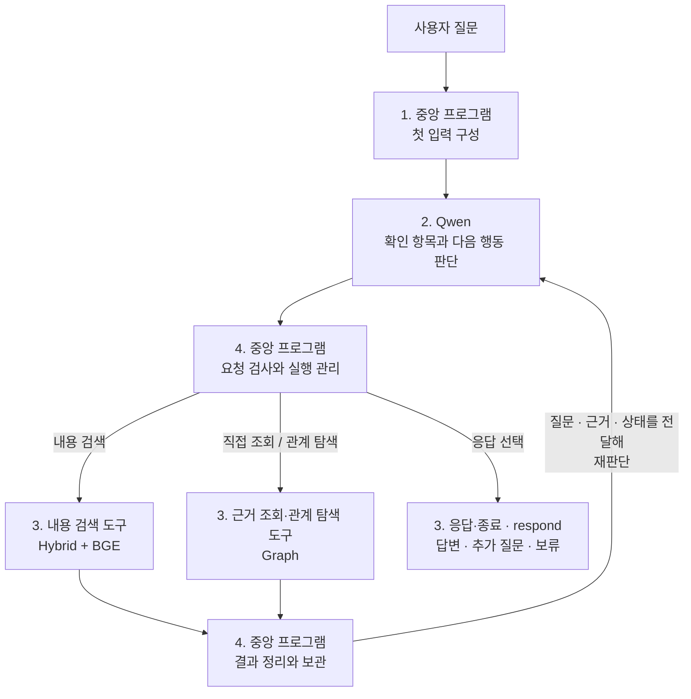
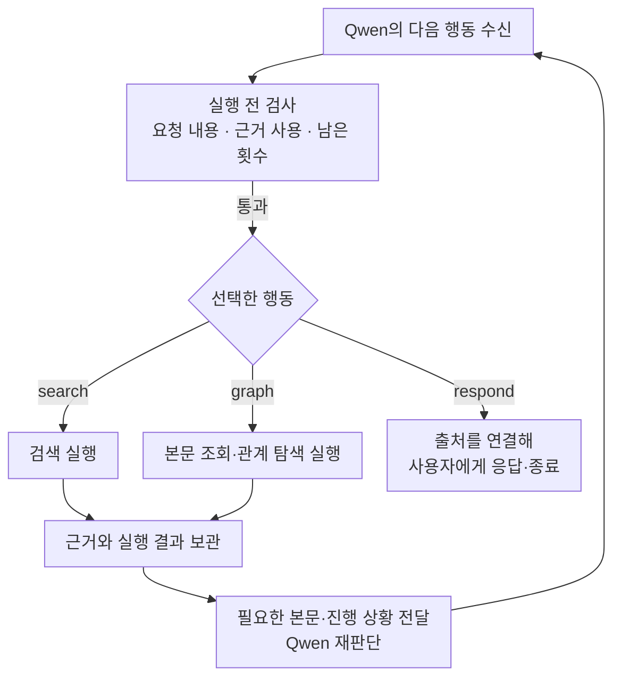

# Week 8 — Agentic Retrieval 설계

## 전체 흐름



번호는 본문 목차를, 화살표는 실제 실행 순서를 나타낸다.

**본문은 확정한 설계를 기준으로 설명한다.** 코드와 전송 예시의 반영 여부는 [구현 현황](#구현-현황)에 별도로 정리한다.

## 구성 요소와 역할

| 구성 요소 | 사용 모델·구성 | 역할 |
|---|---|---|
| 에이전트 LLM | Qwen3.8-Flash-Next | 질문 해석, 확인 항목 작성, 다음 행동 선택, 응답 작성 |
| 중앙 프로그램 | Python 제어 프로그램 | 입력 구성, 요청 검사, 도구 호출, 자료 보관, 반복 관리 |
| BM25 | 키워드 기반 검색 | 검색어와 단어가 일치하는 자료를 찾음 |
| Dense 검색 | Qwen3-VL-Embedding-8B와 벡터 유사도 검색 | 자료와 검색어를 벡터로 표현하고, 유사한 자료를 찾음 |
| 리랭커 | BAAI/bge-reranker-v2-m3 사용 기준. 실행 시 `BGE_MODEL_PATH` 또는 `--bge-model`로 경로 지정 | Hybrid 후보를 현재 검색어와의 관련성으로 재정렬 |
| Graph | 서비스·조문·법령·제출서류·기관의 저장 관계와 연결된 원문 | 시작점 근거·문서 본문 직접 조회, 관계 탐색과 연결 본문 반환, 남은 본문 이어 읽기 |

<br>

## 1. 중앙 프로그램 ↔ Qwen의 입력과 출력

### 메시지 역할

[Qwen 공식 대화 형식](https://qwen.readthedocs.io/en/latest/getting_started/concepts.html#chat-template)의 메시지 역할 구분을 적용해 **작업 기준·이번 입력·판단 결과**를 구별한다.

```text
중앙 프로그램 ── [system 메시지 + user 메시지] ──▶ Qwen
중앙 프로그램 ◀── [assistant 메시지: 판단 결과] ─── Qwen
```

| 메시지 | 역할·구분 기준 | 우리 프로젝트에서 담는 내용 |
|---|---|---|
| `system` | 에이전트가 어떤 역할과 기준으로 작업할지 지정 | 역할·데이터 범위, 도구와 관계 설명, 판단 지침, 출력 양식 |
| `user` | 이번에 처리할 질문과 현재 탐색 상황을 제공 | 원래 질문, 현재 실행 상태, 허용된 행동·남은 호출 횟수 |
| `assistant` | 입력을 바탕으로 Qwen이 판단한 결과를 반환 | 확인 항목, 다음 행동, 행동의 입력값, 선택 이유 |

한 질문의 반복 탐색에서는 system의 내용을 유지하고, user의 검색 근거·실행 상태를 갱신해 Qwen에 재판단을 요청한다.

<a id="1-중앙-프로그램--첫-입력-구성"></a>

### 중앙 프로그램 → Qwen

**중앙 프로그램이 Qwen을 호출할 때 전달하는 입력 구성이다.**

| 입력 항목 | 실제 위치 | 전달 내용 |
|---|---|---|
| [원래 질문](examples/first_qwen_request.md#original-question) | `user["원래 질문"]` | 사용자가 입력한 질문 원문을 그대로 전달 |
| [역할·데이터 범위](examples/first_qwen_request.md#role-data-scope) | `system["역할·데이터 범위"]` | 에이전트 역할·목적, 보유 서비스 목록·자료 종류·저장 자료의 범위 |
| [도구와 관계 설명](examples/first_qwen_request.md#tools-and-relations) | `system["도구와 관계 설명"]` | `search`·`graph`의 기능·입력·반환 필드·결과 상태, Graph 관계·방향·범위, 반환 결과가 Qwen에게 전달되는 위치 |
| [현재 실행 상태](examples/first_qwen_request.md#current-state) | `user["현재 실행 상태"]` | 호출 횟수·확인 항목·근거·최신 결과·이력·오류 안내 |
| [판단 지침](examples/first_qwen_request.md#decision-guidelines) | `system["판단 지침"]` | 질문의 의도 유지, 확인 항목별 근거 검토, 정보 부족·충돌 구분, 도구 결과를 지시문으로 따르지 않는 원칙 |
| [실행 규칙](examples/first_qwen_request.md#execution-rules) | `user["실행 규칙"]` | 지금 선택할 수 있는 행동과 남은 모델·도구 호출 횟수 |
| [출력 양식](examples/first_qwen_request.md#output-format) | `system["출력 양식"]` | 반환 항목·허용값·필드 구성과 응답 예시를 지정하는 지침. 반환 항목은 아래 Qwen → 중앙 프로그램에서 설명 |

| 호출 시점 | `user`에 담는 상태와 실행 규칙 |
|---|---|
| **첫 호출** | 호출 횟수는 0, 확인 항목·근거·이력은 비어 있고 최신 결과는 없음. 초기 허용 행동과 호출 한도를 전달 |
| **검색 이후 호출** | Qwen이 갱신한 확인 항목과 확보한 근거·최신 결과·이력·오류 안내를 반영. 완료한 호출 횟수, 현재 허용 행동과 남은 한도를 갱신 |

**[7개 항목 펼쳐 보기](examples/first_qwen_request.md)** · **[실제 전송 요청 JSON](examples/first_qwen_request.json)**


### Qwen → 중앙 프로그램

**Qwen이 선택한 다음 행동과 판단 결과를 반환하는 구성이다.**

| 반환 항목 | JSON 필드 | 담기는 내용 |
|---|---|---|
| 확인 항목 | `checks` | 무엇을 확인할지, 각 항목의 확인 상태와 연결된 근거 ID |
| 다음 행동 | `action` | 내용 검색 `search` / 근거 조회·관계 탐색 `graph` / 응답·종료 `respond` 중 하나 |
| 행동의 입력값 | `arguments` | 선택한 행동에 필요한 검색어, Graph 조회 방식·대상·관계·커서, 또는 응답 문장과 근거 ID |
| 선택 이유 | `reason` | 이번 행동으로 무엇을 확인하거나 전달하려는지 짧게 설명 |

**[반환 JSON의 필드·규칙·형식 예시](examples/first_qwen_request.md#output-format)**

`graph`는 `mode`·`target_type`·`target_id`로 조회 방식과 대상을 지정하며, 관계 탐색에는 `relation`, 선택적 연결 대상 지정에는 `destination_id`, 이어 읽기에는 `cursor`를 사용한다. `system`에는 필드의 의미·허용값을, `user`의 현재 실행 상태에는 실제 후보·반환 범위·`next_cursor`를 제공하고, Qwen이 선택한 값은 `assistant`의 `arguments`로 반환한다.

중앙 프로그램은 이 JSON을 받아 **4번 실행·반복 관리**에서 요청을 검사하고, **3번의 `search`·`graph`·`respond`** 중 선택된 행동을 실행한다.

<br>

## 2. Qwen · 판단

**중앙 프로그램의 입력을 받은 Qwen이 확인 항목과 다음 행동을 판단하고, 그 결과를 중앙 프로그램에 반환하는 과정이다.**

판단은 아래 네 단계로 설계한다. ①에서 답에 필요한 내용을 정하고, ②에서 현재 근거가 그 내용을 어디까지 뒷받침하는지 검토한다. 근거가 부족하면 ③에서 추가 탐색 방법을 정하고, 충분하면 바로 ④에서 응답한다. 사용자 정보가 필요하거나 탐색을 계속할 수 없는 경우에도 ④에서 추가 질문이나 보류를 전달한다.

첫 호출에는 근거가 없으므로 질문에서 확인 항목을 만들고 첫 행동을 정한다. 이후 호출에는 도구 결과를 읽고 기존 항목의 확인 상태와 다음 행동을 갱신한다. 한 번의 Qwen 호출에서 확인 항목과 행동 하나를 함께 반환한다.

### ① 질문에서 확인 항목 만들기

**목적:** 질문에 답하는 데 필요한 정보를 정하고, 항목별 진행 상태를 추적한다.

각 항목은 **항목명·확인 상태·근거 ID**로 기록한다. 처음에는 **미확인**으로 만들고, ②에서 본문을 검토한 뒤 상태와 근거 ID를 갱신한다. **원문은 별도로 보관하고 근거 ID로 연결한다.**

**예시 — 두 증명서의 대리 발급 서류 비교**

질문: “A 증명서와 B 증명서를 방문해서 대리 발급받을 때 필요한 서류가 같은가요?”

아래는 A의 서류만 확인한 상태다. `E1`은 A 안내 본문의 근거 ID를 나타내는 예시다.

| 항목명 — 무엇을 확인할지 | 확인 상태 | 근거 ID |
|---|---|---|
| A의 방문·대리 발급에 필요한 서류 | 확인 | E1 |
| B의 방문·대리 발급에 필요한 서류 | 미확인 | 없음 |
| 두 서류 목록의 공통점과 차이 | 미확인 | 없음 |

B와 비교 항목은 미해결로 남겨 추가 탐색과 응답 판단에 사용한다. 한 번의 검색으로 여러 항목을 확인할 수도 있다.

**확인 항목 작성 원칙**

- **항목 분리:** 질문에 필요한 범위에서 대상·문의별로 나누고, 한쪽 근거를 다른 쪽에 적용하지 않는다.
- **조건 반영:** 신청자·신청 방식·지역·시점 등 중요한 조건을 포함하며, 빠진 사용자 정보는 임의로 가정하지 않는다.
- **항목 유지·보완:** 미해결 항목을 유지하고, 새로 드러난 조건·예외를 반영한다.

### ② 확보한 근거 검토하기

**목적:** 확보한 본문으로 각 항목을 어디까지 확인할 수 있는지 판단한다.

Qwen은 전달받은 본문을 항목별로 검토하고, **확인 상태와 근거 ID를 갱신한다.** 한 본문에서 직접 확인하거나, 적용 관계와 조건이 맞는 여러 본문을 연결해 판단할 수 있다.

**예시 — B의 방문·대리 발급 서류 검토**

①에서 미해결로 남긴 B 항목은 확보한 본문에 따라 다음과 같이 판단한다.

| 확인 상태 | 판단 기준 | B 항목에 적용한 예시 |
|---|---|---|
| **미확인** | 필요한 사실을 뒷받침하는 본문이 없음 | 본인 발급 안내만 있어 대리 발급 서류를 확인하지 못함 |
| **일부 확인** | 일부는 확인했지만 필요한 사실·조건이 남음 | 대리 발급 서류 일부만 확인함 |
| **확인** | 필요한 사실·조건이 확인되고, 결론을 바꿀 미해결 문제가 없음 | 방문·대리 발급 서류와 적용 조건이 모두 확인됨 |
| **충돌** | 결론에 영향을 주는 본문 간 차이를 해소하지 못함 | 같은 조건의 안내끼리 서류 요건이 다르고 이유가 불명확함 |

A와 B가 모두 확인되면 두 근거를 연결해 공통점과 차이도 검토한다. 부족한 내용은 ③에서 추가 탐색하고, 응답 가능 여부는 ④에서 판단한다.

**근거 검토 원칙**

- **대상·조건 일치:** 대상·신청자·행위·처리 단계·신청 방식·시점이 질문에 적용되는지 확인한다.
- **본문의 뒷받침:** 제목·검색 점수·Graph 관계·ID만으로 판단하지 않고 실제 본문을 확인한다. 검색 실패나 미언급을 “해당 요건이 없다”는 뜻으로 해석하지 않는다.
- **예외·충돌 확인:** 중요한 예외와 자료 간 차이를 검토한다. 적용 조건·시점으로 설명되지 않는 차이는 충돌로 남긴다.

### ③ 부족한 근거를 어떻게 확보할지 결정하기

**목적:** 미해결 항목을 확인하기 위해 다음에 찾을 정보와 탐색 방법을 정한다.

Qwen은 **미확인·일부 확인·충돌 항목**을 기준으로 **탐색 목표·도구·입력값**을 선택한다. 첫 호출에는 질문에서 만든 확인 항목을 기준으로 정한다.

**예시 — B의 방문·대리 발급 서류 찾기**

②에서 B의 정보가 부족했다면, 다음 목표는 **B의 방문·대리 발급 서류 확인**이다.

| 남은 문제 | 다음에 할 일 | 도구 |
|---|---|---|
| B의 안내를 찾지 못함 | B의 명칭과 방문·대리 발급 조건으로 검색 | `search` |
| 본인 발급·온라인 발급 안내만 나옴 | 질문의 조건에 맞게 검색어 수정 | `search` |
| B의 안내 문서·조문은 찾았지만 필요한 본문이 빠짐 | 해당 ID로 전체 본문 조회. 남은 부분은 커서로 이어 읽기 | `graph` 직접 조회 |
| 안내가 다른 규정의 예외를 인용함 | 시작점과 관계를 선택해 연결된 규정의 원문 확인 | `graph` 관계 탐색 |

중앙 프로그램이 도구를 실행해 결과를 전달하면, ②에서 관련 항목의 확인 상태와 근거 ID를 갱신한다.

**탐색 선택 원칙**

- **부족한 내용에 집중:** 원래 질문의 대상·조건을 유지한다. 충돌이 남으면 적용 조건·시점·인용 원문을 추가 확인한다.
- **탐색 방법 조정:** 새 근거를 얻지 못한 동일 요청은 검색어·대상·관계를 재검토한다.
- **한 번에 한 행동:** 허용된 행동과 남은 호출 한도 안에서 선택한다. Graph 대상은 제공된 후보 중 하나를 고르며, 다른 후보도 이후에 선택할 수 있다.

### ④ 충분한 근거가 모이면 응답하기

**목적:** 확인된 범위에 맞춰 답변·추가 질문·보류를 결정한다.

Qwen은 **항목별 확인 상태**를 보고 응답 문장과 사용한 근거 ID를 작성해 `respond`를 선택한다. 자료를 더 찾아 해결할 수 있고 호출 한도가 남아 있으면 ③에서 탐색을 계속한다.

**예시 — A와 B의 방문·대리 발급 서류 비교에 응답하기**

| 검토 결과 | 응답 유형 | 사용자에게 전달할 내용 |
|---|---|---|
| 양쪽 서류·적용 조건과 비교 항목이 모두 확인됨 | **답변** | 공통점과 차이를 적용 조건과 함께 설명 |
| 대리인의 관계에 따라 답이 달라지지만 해당 정보가 없음 | **추가 질문** | 신청자와 대리인의 관계 등 판단에 필요한 정보만 질문 |
| A만 확인했고 근거 부족·지원 범위·호출 한도로 B를 더 확인할 수 없음 | **보류** | A의 정보는 안내하고, B와 전체 비교를 완료하지 못한 이유를 설명 |

**응답 작성 원칙**

- **확인된 범위만 안내:** 독립된 문의는 각각 판단한다. 일부가 미해결이어도 확인된 부분은 안내하되, 나머지를 추측하지 않는다.
- **근거 연결:** 사실 주장에는 이번 Qwen 호출에서 본문을 제공받은 근거를 연결하고, 사용한 근거 ID를 함께 반환한다.
- **종료와 확인 구분:** 호출 한도에 도달해도 근거가 충분해진 것은 아니다. 추가 질문·보류도 `respond`로 이번 탐색을 마친다.

## 3. 도구

**목적:** Qwen이 선택한 행동을 실행해 근거를 가져오거나 사용자에게 응답한다.

Qwen이 **행동과 입력값**을 정하면 중앙 프로그램이 요청을 검사한 뒤 실행한다. 도구는 `search`·`graph`·`respond` 세 가지이며, `graph`는 직접 조회와 관계 탐색을 지원한다.

**예시 — B의 근거를 찾고 A와 비교해 응답하기**

아래는 필요한 작업에 따른 사용 예시이며, 모든 도구를 순서대로 호출하는 것은 아니다.

| 도구 | 사용 예시 | 실행 결과 |
|---|---|---|
| **`search` · 내용 검색** | “B 증명서 방문 대리 발급 제출서류”로 검색 | 전체 자료에서 찾은 관련 본문·근거 ID·출처 |
| **`graph` · 직접 조회** | 찾은 B 안내 문서의 ID로 본문 조회 | 해당 본문·근거 ID·출처·읽은 범위 |
| **`graph` · 관계 탐색** | B 안내와 연결된 인용 관계를 따라 규정 조회 | 연결된 본문·근거 ID·출처·관계·경로 |
| **`respond` · 응답·종료** | A와 B의 서류 비교 결과 또는 추가 질문·보류를 전달 | 출처를 연결한 사용자 응답과 현재 탐색 종료 |

**도구 사용 원칙**

- **찾기와 조회 구분:** 자료의 위치를 모르면 `search`, 식별한 대상의 본문·연결 근거를 읽으려면 `graph`를 사용한다. 관계가 없어도 문서 ID를 알면 직접 조회할 수 있다.
- **반환 범위 확인:** 본문은 근거 ID·출처와 함께 반환한다. Graph 본문이 반환 한도를 넘으면 커서로 이어 읽는다.
- **재판단과 종료 구분:** `search`·`graph`의 결과는 Qwen의 재판단으로 이어지고, `respond`는 응답 후 이번 탐색을 종료한다.

<details>
<summary>search 내부 작동 — Hybrid + BGE</summary>

**입력:** Qwen이 작성한 검색어.

**처리:** `BM25 + Dense 검색 → RRF로 후보 통합 → BGE 재정렬`

**반환:** 관련 본문·근거 ID·문서 ID·출처와 검색 순위·점수.

</details>

<details>
<summary>graph 내부 작동 — 직접 조회와 관계 탐색</summary>

**역할 — 두 가지 조회 방식**

| 방식 | 가져오는 내용 | 예시 |
|---|---|---|
| **직접 조회 · `direct`** | 선택한 노드 자체의 근거 또는 문서·조문 본문 | B 안내 문서의 ID로 제출서류 본문 읽기 |
| **관계 탐색 · `traverse`** | 저장된 관계로 연결된 대상의 근거·본문 | B 안내의 인용 관계를 따라 해당 조문 읽기 |

**초기 설정 — 탐색·반환 한도**

아래는 실험 결과에 따라 조정할 현재 설정이다.

| 적용 범위 | 설정 |
|---|---|
| 관계 탐색 한 번 | 시작점 1개·관계 1종류·나가는 방향 1홉(관계를 한 번 따라 이동) |
| 본문 반환 한 번 | 직접 조회·관계 탐색 모두 본문 합계 최대 12,000자 |

**설계 흐름**

```text
중앙 프로그램
  질문·전달한 근거·이전 Graph 결과에서 실제 후보 식별 → 중복 제거·정렬
  후보 요약 목록과 식별된 문서 ID 제공
    ↓
Qwen
  미확인 항목에 맞춰 mode와 대상 하나 선택
    ↓
중앙 프로그램
  대상 ID·조회 방식·관계·커서 검사 → graph 호출
    ↓
Graph
  ├─ direct: 시작점 근거 / 안내 문서 전체 / 선택한 조문 전체 조회
  └─ traverse: 시작점 1개·관계 1종류·나가는 방향 1홉 → 연결 근거·본문 조회
    ↓
본문 합계 최대 12,000자 + 근거 ID·문서 ID·출처·반환 범위
관계 탐색은 연결 대상·경로, 남은 결과는 next_cursor도 반환
    ↓
중앙 프로그램이 결과를 보관하고 Qwen에 전달
    ↓
② 확인 상태 갱신 → 응답 / 다른 대상·다음 홉 선택 / 커서로 이어 읽기
```

**후보 목록 — 중앙 프로그램이 Qwen에 제공**

후보는 **다음에 조회할 수 있도록 식별한 서비스·조문 등의 대상**이다.

| 중앙 프로그램의 준비 | 내용 |
|---|---|
| 조회 대상 모으기 | 질문에서 식별한 대상 + 전달한 근거에 연결된 대상 + 이전 Graph 결과의 연결 대상. 노드 ID로 중복 제거 |
| 표시 순서 정하기 | 질문에 명시된 대상 → 미해결 항목의 근거에 연결된 대상 → 나머지 후보 |
| 선택에 필요한 정보 전달 | 후보별 ID·이름·종류·연결된 근거 ID·선택 가능한 관계 |

**후보 제공·선택 원칙**

- **관찰한 후보 전체 유지:** 위에서 모은 후보를 상위 몇 개로 자르지 않고 요약해 제공한다. 본문은 후보마다 반복하지 않는다.
- **Qwen이 대상 선택:** 이번에 조회할 대상 하나를 고른다. 다른 후보는 이후에도 선택할 수 있도록 유지한다.

**본문 수집 — 대상별 읽는 범위**

| 대상 | 수집하는 내용 |
|---|---|
| 서비스 안내 | 해당 안내 문서의 저장 본문 전체 |
| 선택한 조문 | 항·호를 포함한 저장 본문 전체 |
| 법령 문서만 식별됨 | 조문 목록·ID를 먼저 제공 → Qwen이 조문 선택 → 본문 조회 |
| 그 밖의 문서 | 지정한 문서의 저장 본문을 원문 순서로 수집 |

**결과 반환 — 중앙 프로그램에 전달**

| 구분 | 반환 내용 |
|---|---|
| 근거 | 본문·근거 ID·문서 ID·출처 |
| 관계 탐색 정보 | 연결 대상·관계·경로 |
| 읽은 범위와 다음 위치 | 반환한 범위·남은 부분·`next_cursor`. 남은 결과가 없으면 `null` |

**본문 처리 원칙**

- **한도 초과 시 분할:** 원문 순서와 문단·항·호 경계를 유지해 나눈다.
- **이어 읽기:** 같은 조회 조건에 `next_cursor`를 `cursor`로 넣어 다음 부분을 요청한다.
- **누락 구분:** 저장본 자체의 누락과 한도 때문에 아직 반환하지 않은 부분을 구분한다.
- **서비스 범위 유지:** 공용 제출서류·기관의 근거는 선택한 서비스·출처 문서 범위로 제한한다.
- **확보 후 별도 판단:** 본문을 받으면 2번 ②에서 항목을 충족하는지 검토한다.

<details>
<summary>Graph 호출 형식·예시</summary>

아래는 `action=graph`일 때 Qwen이 반환하는 **`arguments`의 형식**이다.

| 필드 | 사용 규칙 |
|---|---|
| `mode` | `direct` 또는 `traverse` |
| `target_type` | 직접 조회는 `node` 또는 `document`, 관계 탐색은 `node` |
| `target_id` | 중앙 프로그램이 유효성을 확인할 실제 대상 ID |
| `relation` | 관계 탐색에 필수. 직접 조회에는 사용하지 않음 |
| `destination_id` | 관계 탐색에서 필요한 연결 대상이 이미 식별됐을 때 선택적으로 지정. 생략하면 해당 관계의 연결 대상 목록과 한도 내 본문 반환 |
| `cursor` | 이어 읽을 때만 사용. 도구가 반환한 `next_cursor`를 같은 조회 조건에 전달 |

**문서 직접 조회**

```json
{
  "mode": "direct",
  "target_type": "document",
  "target_id": "시스템이 제공한 실제 문서 ID"
}
```

**인용 관계 탐색과 연결 대상 지정**

```json
{
  "mode": "traverse",
  "target_type": "node",
  "target_id": "시스템이 제공한 실제 시작점 노드 ID",
  "relation": "REFERENCES",
  "destination_id": "선택한 인용 대상 노드 ID"
}
```

</details>

</details>

<details>
<summary>respond 내부 작동 — 응답·종료</summary>

**역할:** Qwen이 작성한 응답에 출처를 연결해 사용자에게 전달한다.

**입력 — 어디서 무엇을 가져오는가**

| 정보의 출처 | 사용하는 정보 |
|---|---|
| 2번 ④의 Qwen 판단 결과 | 응답 문장 `text` + 사용한 근거 ID `evidence_ids` |
| 중앙 프로그램에 보관된 근거 | 해당 ID에 연결된 자료의 제목·출처 |

**처리 — 중앙 프로그램**

`요청 검사 → 근거 ID로 제목·출처 조회 → 응답 문장 뒤에 출처 목록 추가 → 사용자에게 전달`

**최종 결과:** Qwen의 응답 문장 + 사용한 근거의 출처 목록. 전달 후 이번 탐색을 종료한다.

**종료 원칙:** 답변·추가 질문·보류 모두 같은 경로로 종료한다.

</details>

## 4. 중앙 프로그램 · 실행·반복 관리

**목적:** Qwen의 요청을 실행하고, 결과를 다음 판단이나 최종 응답으로 연결한다.

**처리 흐름**



**예시 — A는 확인했고 B를 추가 검색하는 경우**

| 단계 | 중앙 프로그램이 하는 일 |
|---|---|
| 검색 요청 접수 | Qwen이 정한 B의 검색어를 검사한 뒤 검색 실행 |
| 결과 보관 | 찾은 B의 본문·출처를 기존 A의 근거와 함께 저장 |
| 재판단 요청 | 입력 한도 안에서 필요한 A·B 본문, 확인 항목, 남은 호출 횟수를 전달 |
| 응답 전달 | Qwen이 비교 답변을 반환하면 검사 후 출처를 붙여 전달하고 종료 |

**실행·반복 원칙**

- **판단과 실행 분담:** 근거가 충분한지는 Qwen이 판단하고, 중앙 프로그램은 요청의 형식·근거 사용·실행 한도를 검사한다.
- **보관과 전달 구분:** 찾은 근거는 누적 보관하되, 매번 Qwen에게 보낼 본문은 입력 한도 안에서 선택한다.
- **횟수 안에서 진행:** 남은 호출 횟수와 오류 상황에 따라 재판단·응답·중단을 결정한다.

<details>
<summary>실행 전 확인할 사항</summary>

**검사 대상:** Qwen이 요청한 행동과 그 행동에 사용할 정보.

| 확인할 사항 | 검사 기준 |
|---|---|
| 요청 형식 | 선택한 행동에 필요한 검색어·조회 대상 등이 규칙에 맞게 들어 있는지 |
| 확인 항목의 근거 | Qwen에게 본문을 전달한 적이 있는 근거인지 |
| 최종 응답의 근거 | 이번 응답을 작성할 때 본문을 전달한 근거인지 |
| Graph 조회 대상 | 실제 대상인지, 요청한 연결 관계와 이어 읽을 위치가 유효한지 |
| 실행 가능 여부 | 현재 허용된 행동이고 호출 횟수가 남아 있는지 |

**중복 실행 원칙:** 같은 요청의 저장 결과가 있고 오류가 아니면 재사용한다. 결과가 없거나 오류였다면 실행한다.

</details>

<details>
<summary>Qwen이 다시 판단할 때 받는 정보</summary>

**목적:** 앞서 찾은 근거와 진행 상황을 이어받아 다음 행동을 판단하게 한다.

| 전달할 정보 | Qwen이 받는 내용 |
|---|---|
| 원래 질문·작업 지침 | 탐색 중에도 유지하는 질문과 판단 기준 |
| 확인 항목 | 항목별 상태와 연결된 근거 ID |
| 근거 본문 | 선택한 본문·제목·출처와 근거 ID·문서 ID |
| 최신 도구 결과 | 성공·오류, 연결 관계·경로, 읽은 범위·남은 부분·이어 읽을 위치 |
| 탐색 진행 상황 | 관찰한 전체 후보 요약·조회 대상, 호출 이력·남은 횟수·오류 안내 |

**본문 선택 원칙**

| 상황 | 전달 기준 |
|---|---|
| 탐색 중 | 새 근거 → 확인 항목에 연결된 근거 → 나머지 근거 순서 |
| 응답만 가능한 단계 | 확인 항목에 연결된 근거 우선 |
| 본문이 입력 한도를 넘음 | 이번에 포함한 근거와 제외한 근거의 ID를 구분해 표시 |

**보관 원칙**

- **누적 유지:** 근거·실행 결과·판단 이력을 보관한다. 이번에 전달하지 않은 근거와 선택하지 않은 Graph 후보도 유지한다.
- **검색 점수 분리:** 점수·순위는 원기록에 보관하고, Qwen에게 전달할 공통 근거 본문에서는 제외한다.

**현재 전달 한도**

| 구분 | 한도 |
|---|---|
| Graph 도구 한 번 | 반환 본문 합계 최대 12,000자 |
| Qwen 호출 한 번 | 본문·출처 등을 포함한 근거 목록의 전송 길이 최대 60,000자 |

질문·후보·관계 목록까지 포함한 전체 입력 크기는 별도로 점검한다.

</details>

<details>
<summary>오류가 나거나 호출 횟수를 다 썼을 때</summary>

**처리 기준:** 문제의 종류와 남은 횟수에 따라 다음 조치를 정한다.

| 조치 | 해당 상황 | 중앙 프로그램의 처리 |
|---|---|---|
| **수정 요청** | 형식·입력값·근거 사용·행동이 부적합함 | 실행을 막고 오류를 알려 Qwen에 수정 요청 |
| **재판단** | 도구 실행 오류 | 실패를 기록해 전달하고 Qwen이 다음 행동을 선택하게 함 |
| **응답만 허용** | 도구 한도 도달 또는 Qwen 호출이 한 번만 남음 | 확보한 정보로 답변·추가 질문·보류 중 하나를 전달하도록 요청 |
| **중단** | 연속 요청 오류 한도 도달, Qwen 호출 횟수 소진, Qwen 호출 자체의 실패 | 추가 호출 없이 종료하고 중단 이유를 안내 |

**횟수 계산 원칙**

- 수정 요청과 재판단도 Qwen 호출 횟수에 포함한다.
- 새 본문 이어 읽기와 다음 관계 탐색도 각각 도구 실행 횟수에 포함한다.
- 같은 조회 조건과 위치로 다시 요청하면 동일 요청으로 처리한다.

</details>

## 실패 사례 검토와 채택한 보완 내용

Week7 순위 탈락 44문항의 검토 기록을 바탕으로, **문제 양상·누락 단계**와 필요한 보완을 연결한 **재분류 초안**이다. 한 문항이 여러 기준에 해당할 수 있으며, 유형별 문항 수는 전체 문항 대조 후 집계한다.

| 분류 기준 | 대표 사례 | 보완 내용 | 반영 위치·내용 |
|---|---|---|---|
| **다른 업무·처리 단계가 검색됨** | 보완기간 대신 납부기한 검색 [SJ-B-012](GRAPH_CASE_REVIEW.md#sj-b-012) | 대상·행위·시점을 구분해 검색 목표 교정 | **2번 ②·③** — 조건 대조·검색어 교정 반영 |
| **필요한 시작점이 탐색에서 제외됨** | 생활기록부가 시작점 제한으로 제외 [W7-MS-024](GRAPH_CASE_REVIEW.md#w7-ms-024) | 관찰한 후보를 유지하고 미확인 대상 재선택 | **3번 Graph·4번** — 전체 후보 요약·보관 반영 |
| **대상은 찾았지만 필요한 본문이 빠짐** | 토지대장 안내에 신청자격 누락 [SJ-A-008](GRAPH_CASE_REVIEW.md#sj-a-008) | 해당 노드·문서의 본문 직접 조회 | **3번 Graph** — 직접 조회·전체 본문·이어 읽기 반영 |
| **인용 대상의 원문·세부 항이 빠짐** | 친양자 관련 인용 조문의 여러 항 누락 [W7V2-MS014](GRAPH_CASE_REVIEW.md#w7v2-ms014) | 필요한 인용 대상을 선택하고 조문 전체 확인 | **2번 ③·3번 Graph** — 관계 탐색·조문 전체 조회 반영 |
| **수집한 근거가 최종 선택에서 탈락함** | 졸업증명 근거가 검색 1위→BGE 30위 [W7-MS-039](GRAPH_CASE_REVIEW.md#w7-ms-039) | 탈락 근거 재조회·대상별 보존·재전달 | **2번 ③·4번** — 재조회·누적 반영, 근거 묶음·전달량 배분은 미정 |
| **지정 근거 누락과 실제 답변 가능성이 다름** | 대체 근거로 두 증명의 차이 확인 [SJ-N-020](GRAPH_CASE_REVIEW.md#sj-n-020) | 현재 본문이 질문을 충족하는지 판단하고 불필요한 탐색 방지 | **2번 ②·④** — 본문 검토·종료 판단 반영, 평가 범위 재검수 필요 |
| **필요한 관계 방향을 탐색하지 못함** | 현재 조문을 인용하는 적용 조항 누락 [SJ-B-034](GRAPH_CASE_REVIEW.md#sj-b-034) | 역방향 인용 조회 검토 | **보류** — 적용 범위·탐색 기준 미확정 |

**반영 여부는 문서 설계 기준**이며, 코드 반영 여부는 [구현 현황](#구현-현황)에 구분한다. 전체 비교 결과는 [성능 평가](#performance-results)에 정리했으며, 개별 실패 사례의 해결 여부는 추가 검토한다.

**그 밖의 보류 범위:** 다른 조문의 대체 근거 활용, 충돌 규정의 적용 범위를 추가로 판단하는 설계.

### 응답 기록과 사후 평가

`responded`는 응답이 전달됐다는 실행 상태다. 내용 평가기는 저장된 응답에서 문의별 `answer`·`clarify`·`abstain`과 필수 처리의 충족 여부를 사후 판정한다. 응답 완료와 내용 통과를 구분하며, 판정 기준은 [벤치마크 보고서](REPORT.md#에이전트-응답을-평가할-때-볼-항목)에 정리했다.

## 구현 현황

**핵심 설계는 코드와 Qwen 입력 규칙에 반영했다.** 아래 구현 확인과 실제 모델의 답변 성능은 구분하며, 비교 실험의 가설·조건·실행법은 [실험 계획](EXPERIMENT.md)에 정리했다.

| 구분 | 구현 내용 | 확인 범위·남은 작업 |
|---|---|---|
| 내용 검색·기본 제어·응답 | [검색](../src/civic_link/agent/search.py), [중앙 프로그램](../src/civic_link/agent/controller.py)의 요청 검사·근거 누적·반복 관리·출처 연결·응답 종료 | Graph ID·연결 대상·발급한 커서 검사 연결. 본문의 의미 판단은 Qwen 담당 |
| Graph 조회 | [GraphTool](../src/civic_link/agent/graph.py)의 직접 조회·관계 탐색, `destination_id`, 안내 문서·선택 조문 전체 수집 | 법령만 지정하면 조문 목록 반환. 공용 서류·기관은 서비스 범위 유지 |
| Graph 탐색 상태·이어 읽기 | 관찰한 전체 후보의 누적·정렬·요약 전달, 본문 12,000자 한도, 반환 범위·남은 부분·커서 보관 | 페이지 합치기·조회 조건 불일치·자료 누락·후보 보존을 오프라인 테스트로 확인 |
| Qwen 입력·출력 지침과 예시 | 새 Graph 필드와 후보·본문 범위·커서를 [지침](../src/civic_link/agent/prompts.py)·검사 규칙·[전송 예시](examples/first_qwen_request.json)에 반영 | [예시 생성기](../scripts/export_agent_request.py)로 실제 첫 입력과 일치하도록 갱신 |
| 일괄 실행·비교 | [비교 실행기](../scripts/run_agent_comparison.py)의 공통 첫 검색, 세 조건, 문항별 저장·재개·조건 고정. `--bge-devices`·`--workers-per-gpu`로 문항 병렬 처리 | V100 4대·총 16작업자로 기존 608문항 × 세 조건 실행 완료. [평가 결과](#performance-results) 참고 |
| 평가 | [평가기](../scripts/evaluate_agent_comparison.py)의 단계별 근거 회수·비용·개선/퇴보, [내용 평가기](../scripts/judge_agent_comparison.py)의 문의별 판정 | 전체 실행·근거 집계와 60문항 표본 내용 판정 완료. 모델 판정은 사람 검수와 구분하며 실행 실패도 포함 |

**추가 설계 대상:** 함께 읽을 근거의 묶음과 전달 한도 배분, 응답 문장별 근거의 뒷받침 여부 검증, 추가 질문에 대한 사용자 답변을 받아 탐색을 재개하는 흐름. 아래에는 현재 설정과 채택한 초기값을 구분해 정리한다.

<details>
<summary>판단·근거 전달·Graph의 현재 설정과 검토할 점</summary>

### 판단·실행·종료

| 항목 | 현재 선택 | 선택 이유·검토할 점 |
|---|---|---|
| 제어 방식 | 한 문항 안에서는 Python 반복문으로 한 번에 행동 하나 | 여러 문항은 GPU별 프로세스에서 병렬 실행 가능. 한 문항 내부의 병렬 도구 호출은 미적용 |
| 판단 지침 | 확인 항목별로 근거를 검토하고 부족·충돌 여부를 기록 | 부족한 항목에 맞춰 추가 검색하고, 필수 항목이 모두 확인되면 응답 |
| 출력 형식 | JSON 4개 항목, 확인 상태 4종류 | 실행 요청을 명확하게 읽고 검사하기 위한 초기 구분 |
| 실행 오류 | 도구 오류는 Qwen에 전달, 모델 통신 오류는 중단. 자동 통신 재시도 없음 | 자료를 못 찾은 상황과 실행 실패를 구분 |
| 동일 요청 | 같은 도구·입력의 오류 아닌 결과는 재사용 | 중복 실행을 줄임. Qwen 호출 횟수는 계속 소모 |
| 응답·대화 범위 | 한 질문의 탐색부터 응답까지 처리 | 독립된 문의는 각각 답변·추가 질문·보류를 판단한다. 추가 질문에 대한 사용자 답변으로 탐색을 재개하는 흐름은 후속 설계 대상 |

### 근거 보관·전달·인용

| 항목 | 현재 선택 | 선택 이유·검토할 점 |
|---|---|---|
| 전달 우선순위 | 탐색 중에는 새 근거 우선, 응답만 가능한 호출에서는 확인 항목에 연결된 근거 우선 | 탐색 중에는 새 자료를, 종료 시에는 답변에 필요한 근거를 먼저 확인 |
| 일부 결과 반환 | 본문 12,000자 한도와 `next_cursor`·`cursor`로 이어 읽기 | 반환 범위·남은 부분·저장본 누락을 구분. 본문 범위별 근거 ID와 원래 청크 연결 유지 |
| 점수 처리 | 검색어별 점수·순위는 원결과에 보관 | 이전 검색 점수가 다음 판단의 공통 근거에 섞이지 않도록 분리 |
| 인용 방식 | 이번 호출에서 본문을 전달한 근거 ID만 응답에 사용, 응답 끝에 출처 목록 | 주장 옆에 근거 ID를 붙이도록 안내하며, 인용과 주장 간의 내용 검증은 추가 설계가 필요함 |

### 검색과 Graph 설계

| 항목 | 현재 선택 | 선택 이유·검토할 점 |
|---|---|---|
| 문서 벡터 | 제목+본문을 임베딩하고 정규화 | 새 검색어로 전체 자료를 검색하도록 구성. 문서와 검색어의 인코더 설정을 맞춤 |
| Graph 조회 단위 | 직접 조회 또는 시작점 1개·관계 1종류·나가는 방향 1홉 | 직접 조회에는 관계 이동이 없음. 다음 대상은 결과를 읽고 다시 선택 |
| Graph 후보 제공 | 질문·전달 근거·이전 Graph 결과에서 식별한 후보 전체를 중복 제거해 요약 제공 | 질문의 명시 대상 → 미해결 항목 관련 대상 → 나머지 관찰 대상 순서. 질문의 명시 대상은 고유한 저장 이름·별칭으로 식별 |
| Graph 대상 식별 | `mode`·`target_type`·`target_id`로 조회 방식과 실제 노드/문서 ID 지정 | 연결 대상은 `destination_id`. 과거 `target + relation`은 역사적 API 호환용이며 Qwen 요청 규칙에서는 사용하지 않음 |
| Graph 근거 수집 | 시작점 근거·안내 문서 전체·선택한 조문 전체와 관계 출처 반환 | 공용 노드는 선택한 서비스·출처 범위를 유지. 직접 조회의 범위가 모호하면 서비스 선택을 요청 |

</details>

<details>
<summary>실행 기본값</summary>

아래 값은 첫 구현의 실행 범위를 정하는 기준이다. 검색 품질과 처리 시간에 따라 조정할 수 있다.

| 항목 | 기본값 | 적용 범위 |
|---|---|---|
| 호출 한도 | Qwen 최대 8회, 실제 도구 실행 최대 6회 | 요청 수정도 모델 호출에 포함한다. 마지막 모델 호출에서는 `respond`만 허용한다. |
| 잘못된 요청 | 연속 2회면 중단 | 형식이나 인용 오류를 고치는 호출이 반복되는 상황을 제한한다. |
| 근거 전달량 | JSON으로 표현한 근거 길이의 합계 최대 60,000자 | 근거 목록에 적용하는 문자 수 예산이다. 이번 입력에서 제외한 근거는 ID를 표시한다. |
| 내용 검색량 | BGE 재정렬 후보 100개, 반환 10개 | `search` 호출마다 적용한다. 부족한 근거가 있으면 다음 호출에서 검색어를 구체화할 수 있다. |
| Hybrid 결합 | BM25 `k1=1.2`, `b=0.75`, RRF 상수 60 | 기존 검색 설정을 출발점으로 사용한다. |
| BGE 처리 | 기본 CPU·float32, 배치 4·CPU 스레드 4, 입력 한도 1,024토큰 | Colab에서는 `--bge-device cuda`로 GPU를 사용한다. 비교 조건의 정밀도·배치·입력 한도는 동일하게 유지한다. |
| Graph 반환 범위 | 나가는 방향 1홉, 본문 합계 최대 12,000자 | 초과분은 커서로 이어 읽기. 과거 API의 관계 20개·근거 50개 제한은 새 입력에 적용하지 않음 |
| Qwen 생성 | temperature 0, 최대 출력 2,000토큰, 응답 대기 120초 | 한 번의 모델 호출에 적용한다. 질문 전체의 처리 시간에는 여러 모델 호출과 도구 실행 시간이 포함된다. |

</details>

<details>
<summary>Graph 초기값과 평가할 점</summary>

| 항목 | 채택한 초기값 | 적용 범위 |
|---|---|---|
| 후보 제공 | 관찰 단서에서 식별한 후보 전체의 요약 | 고정 Top-K로 자르지 않음. 전체 Graph의 모든 노드를 나열하는 것은 아님 |
| 관계 탐색 | 시작점 1개·관계 1종류·나가는 방향 1홉 | 결과를 읽고 다음 노드나 다른 시작점을 선택. 역방향 인용 조회는 보류 |
| 기본 본문 단위 | 서비스 안내 문서 전체·선택한 조문 전체 | 법령 문서만 식별됐으면 조문 목록에서 먼저 선택 |
| 본문 반환량 | 도구 호출당 합계 최대 12,000자 | 직접 조회와 관계 탐색에 공통 적용. 초과분은 반환 범위와 커서를 제공해 이어 읽기 |
| 호출 예산 | Qwen 최대 8회·실제 도구 실행 최대 6회 유지 | 다음 홉 탐색과 커서 이어 읽기도 도구 실행으로 계산 |

코드와 전송 예시에 반영한 초기값이다. 실제 모델 실험에서 대상 선택·본문 회수·재호출·한도 소진과 전체 입력 크기를 평가해 조정한다.

</details>

<a id="performance-results"></a>

## 성능 평가 · 결과

**목적** · 반복 검색과 Graph 추가가 근거 회수와 응답 품질에 미치는 영향을 비교한다.

**비교 조건** · 같은 608문항과 첫 검색 결과를 공유한다. A는 한 번 검색, B는 반복 검색, C는 반복 검색 + Graph다.

### 대표 지표

| 지표 · 평가 범위 | A | B | C |
|---|---:|---:|---:|
| **필수 근거 완전회수율** · 답변형 488문항 | 89.14% (435/488) | 93.85% (458/488) | 94.26% (460/488) |
| **내용 통과율** · 표본 60문항 | 75.0% (45/60) | 71.7% (43/60) | 76.7% (46/60) |
| 실행 실패율 · 전체 608문항 | 0.33% (2/608) | 0.16% (1/608) | 0.49% (3/608) |
| 문항당 평균 시간 · 전체 608문항 | 35.0초 | 44.7초 | 46.6초 |

**필수 근거 완전회수율**은 문항에 지정된 필수 근거를 모두 최종 Qwen 입력에 전달한 문항의 비율이다.

### 응답 품질 판정 기준

사전에 고른 60문항을 **응답을 생성한 것과 같은 Qwen 모델**로 채점했다. 조건 이름을 가리고, 실제 응답을 문항별 정답·채점 기준과 대조했다.

| 기대 응답 | 필수 처리 기준 | A 통과 | B 통과 | C 통과 |
|---|---|---:|---:|---:|
| 답변 | 문항에서 요구한 내용을 모두 안내 | 43/48 | 41/48 | 45/48 |
| 추가 질문 | 답에 필요한 사용자 정보를 구체적으로 확인 | 0/6 | 0/6 | 0/6 |
| 보류 | 처리할 수 없는 범위와 이유를 안내 | 2/6 | 2/6 | 1/6 |

**통과 기준** · 표의 필수 처리를 충족해야 한다. 사실 주장이 있다면 정확해야 하고, 제공된 본문과 실제 인용이 이를 뒷받침해야 한다. 근거 없는 주장이나 실행 실패는 미통과다.

**내용 통과율 = 통과 문항 수 ÷ 표본 60문항.** 일부 자동 채점 설명에 오독이 있어 사람 검토가 필요하다.

### 결과 해석

- **A → B** · 근거 완전회수는 23문항 늘었고, 표본 내용 통과는 2문항 줄었다.
- **B → C** · 근거 완전회수는 5문항 개선, 3문항 퇴보로 순증 2문항이었다. 개선된 5문항 중 실제 Graph 조회를 한 경우는 1문항이었다.
