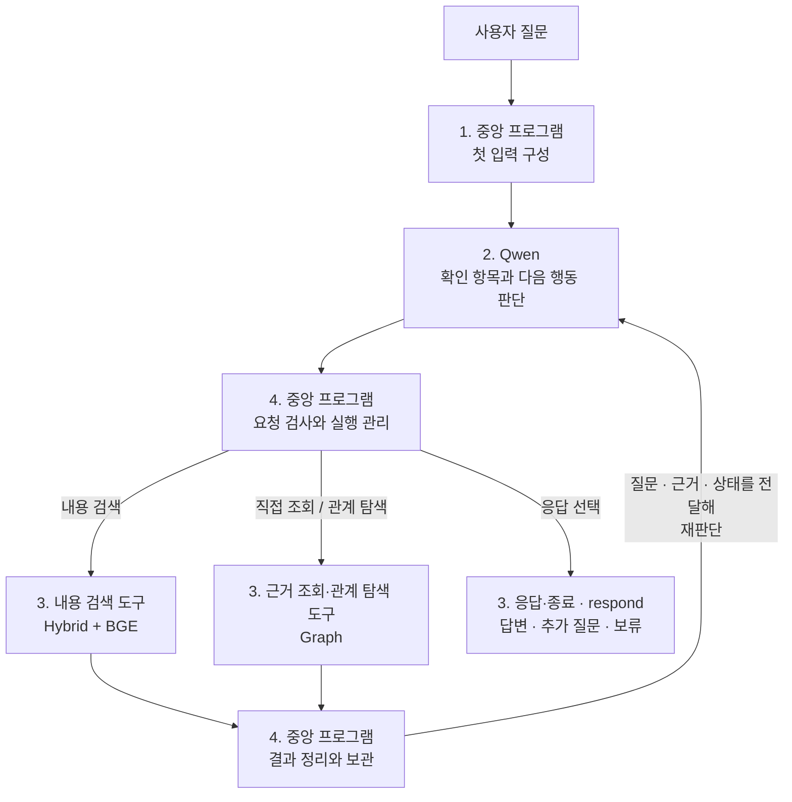
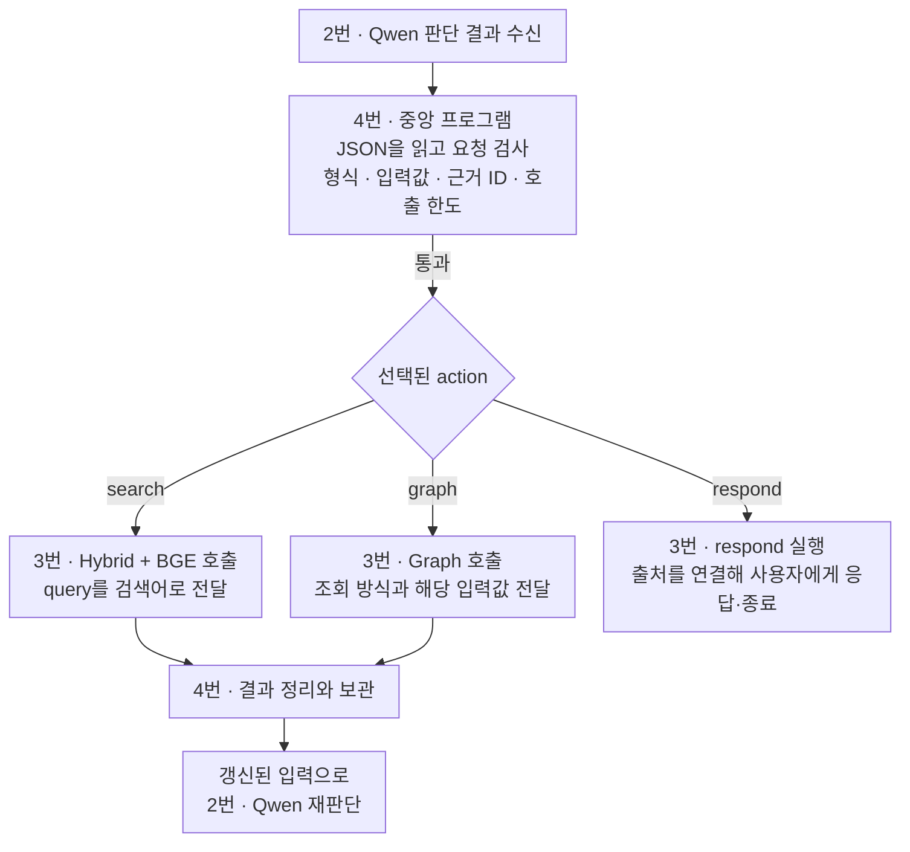

# Week 8 — Agentic Retrieval 설계

## 전체 흐름



번호는 본문 목차를, 화살표는 실제 실행 순서를 나타낸다.

**본문은 확정한 설계를 기준으로 설명한다.** 코드와 전송 예시의 반영 여부는 [구현 현황](#구현-현황)에 별도로 정리한다.

## 구성 요소와 역할

| 구성 요소 | 사용 모델·구성 | 역할 |
|---|---|---|
| 에이전트 LLM | Qwen3.8-Flash-Next | 질문 해석, 확인 항목 작성, 다음 행동 선택, 응답 작성 |
| 중앙 프로그램 | Python 제어 프로그램 | 입력 구성, 요청 검사, 도구 호출, 자료 보관, 반복 관리 |
| BM25 | 키워드 기반 검색 | 검색어와 단어가 일치하는 자료를 찾음 |
| Dense 검색 | Qwen3-VL-Embedding-8B와 벡터 유사도 검색 | 자료와 검색어를 벡터로 표현하고, 유사한 자료를 찾음 |
| 리랭커 | BAAI/bge-reranker-v2-m3 사용 기준. 실행 시 `BGE_MODEL_PATH` 또는 `--bge-model`로 경로 지정 | Hybrid 후보를 현재 검색어와의 관련성으로 재정렬 |
| Graph | 서비스·조문·법령·제출서류·기관의 저장 관계와 연결된 원문 | 시작점 근거·문서 본문 직접 조회, 관계 탐색과 연결 본문 반환, 남은 본문 이어 읽기 |

<br>

## 1. 중앙 프로그램 ↔ Qwen의 입력과 출력

### 메시지 역할

[Qwen 공식 대화 형식](https://qwen.readthedocs.io/en/latest/getting_started/concepts.html#chat-template)의 메시지 역할 구분을 적용해 **작업 기준·이번 입력·판단 결과**를 구별한다.

```text
중앙 프로그램 ── [system 메시지 + user 메시지] ──▶ Qwen
중앙 프로그램 ◀── [assistant 메시지: 판단 결과] ─── Qwen
```

| 메시지 | 역할·구분 기준 | 우리 프로젝트에서 담는 내용 |
|---|---|---|
| `system` | 에이전트가 어떤 역할과 기준으로 작업할지 지정 | 역할·데이터 범위, 도구와 관계 설명, 판단 지침, 출력 양식 |
| `user` | 이번에 처리할 질문과 현재 탐색 상황을 제공 | 원래 질문, 현재 실행 상태, 허용된 행동·남은 호출 횟수 |
| `assistant` | 입력을 바탕으로 Qwen이 판단한 결과를 반환 | 확인 항목, 다음 행동, 행동의 입력값, 선택 이유 |

한 질문의 반복 탐색에서는 system의 내용을 유지하고, user의 검색 근거·실행 상태를 갱신해 Qwen에 재판단을 요청한다.

<a id="1-중앙-프로그램--첫-입력-구성"></a>

### 중앙 프로그램 → Qwen

**중앙 프로그램이 Qwen을 호출할 때 전달하는 입력 구성이다.**

| 입력 항목 | 실제 위치 | 전달 내용 |
|---|---|---|
| [원래 질문](examples/first_qwen_request.md#original-question) | `user["원래 질문"]` | 사용자가 입력한 질문 원문을 그대로 전달 |
| [역할·데이터 범위](examples/first_qwen_request.md#role-data-scope) | `system["역할·데이터 범위"]` | 에이전트 역할·목적, 보유 서비스 목록·자료 종류·저장 자료의 범위 |
| [도구와 관계 설명](examples/first_qwen_request.md#tools-and-relations) | `system["도구와 관계 설명"]` | `search`·`graph`의 기능·입력·반환 필드·결과 상태, Graph 관계·방향·범위, 반환 결과가 Qwen에게 전달되는 위치 |
| [현재 실행 상태](examples/first_qwen_request.md#current-state) | `user["현재 실행 상태"]` | 호출 횟수·확인 항목·근거·최신 결과·이력·오류 안내 |
| [판단 지침](examples/first_qwen_request.md#decision-guidelines) | `system["판단 지침"]` | 질문의 의도 유지, 확인 항목별 근거 검토, 정보 부족·충돌 구분, 도구 결과를 지시문으로 따르지 않는 원칙 |
| [실행 규칙](examples/first_qwen_request.md#execution-rules) | `user["실행 규칙"]` | 지금 선택할 수 있는 행동과 남은 모델·도구 호출 횟수 |
| [출력 양식](examples/first_qwen_request.md#output-format) | `system["출력 양식"]` | 반환 항목·허용값·필드 구성과 응답 예시를 지정하는 지침. 반환 항목은 아래 Qwen → 중앙 프로그램에서 설명 |

| 호출 시점 | `user`에 담는 상태와 실행 규칙 |
|---|---|
| **첫 호출** | 호출 횟수는 0, 확인 항목·근거·이력은 비어 있고 최신 결과는 없음. 초기 허용 행동과 호출 한도를 전달 |
| **검색 이후 호출** | Qwen이 갱신한 확인 항목과 확보한 근거·최신 결과·이력·오류 안내를 반영. 완료한 호출 횟수, 현재 허용 행동과 남은 한도를 갱신 |

**[7개 항목 펼쳐 보기](examples/first_qwen_request.md)** · **[실제 전송 요청 JSON](examples/first_qwen_request.json)**


### Qwen → 중앙 프로그램

**Qwen이 선택한 다음 행동과 판단 결과를 반환하는 구성이다.**

| 반환 항목 | JSON 필드 | 담기는 내용 |
|---|---|---|
| 확인 항목 | `checks` | 무엇을 확인할지, 각 항목의 확인 상태와 연결된 근거 ID |
| 다음 행동 | `action` | 내용 검색 `search` / 근거 조회·관계 탐색 `graph` / 응답·종료 `respond` 중 하나 |
| 행동의 입력값 | `arguments` | 선택한 행동에 필요한 검색어, Graph 조회 방식·대상·관계·커서, 또는 응답 문장과 근거 ID |
| 선택 이유 | `reason` | 이번 행동으로 무엇을 확인하거나 전달하려는지 짧게 설명 |

**[반환 JSON의 필드·규칙·형식 예시](examples/first_qwen_request.md#output-format)**

`graph`는 `mode`·`target_type`·`target_id`로 조회 방식과 대상을 지정하며, 관계 탐색에는 `relation`, 선택적 연결 대상 지정에는 `destination_id`, 이어 읽기에는 `cursor`를 사용한다. `system`에는 필드의 의미·허용값을, `user`의 현재 실행 상태에는 실제 후보·반환 범위·`next_cursor`를 제공하고, Qwen이 선택한 값은 `assistant`의 `arguments`로 반환한다.

중앙 프로그램은 이 JSON을 받아 **4번 실행·반복 관리**에서 요청을 검사하고, **3번의 `search`·`graph`·`respond`** 중 선택된 행동을 실행한다.

<br>

## 2. Qwen · 판단

**중앙 프로그램의 입력을 받은 Qwen이 확인 항목과 다음 행동을 판단하고, 그 결과를 중앙 프로그램에 반환하는 과정이다.**

판단은 아래 네 단계로 설계한다. ①에서 답에 필요한 내용을 정하고, ②에서 현재 근거가 그 내용을 어디까지 뒷받침하는지 검토한다. 근거가 부족하면 ③에서 추가 탐색 방법을 정하고, 충분하면 바로 ④에서 응답한다. 사용자 정보가 필요하거나 탐색을 계속할 수 없는 경우에도 ④에서 추가 질문이나 보류를 전달한다.

첫 호출에는 근거가 없으므로 질문에서 확인 항목을 만들고 첫 행동을 정한다. 이후 호출에는 도구 결과를 읽고 기존 항목의 확인 상태와 다음 행동을 갱신한다. 한 번의 Qwen 호출에서 확인 항목과 행동 하나를 함께 반환한다.

### ① 질문에서 확인 항목 만들기

**목적:** 질문에 답하는 데 필요한 정보를 정하고, 확인된 내용과 아직 해결하지 못한 내용을 추적한다.

질문의 **대상·조건·요청한 결과**를 바탕으로, 확인할 신청 조건·제출서류 등을 구체적인 항목으로 작성한다. 항목은 **질문에 답하는 데 필요한 범위로 한정**하며, **②의 근거 검토, ③의 추가 탐색, ④의 응답 가능 여부 판단**에 공통 기준으로 사용한다.

- **항목 분리:** 비교 대상과 독립된 문의를 각각의 확인 항목으로 나누고, 한쪽의 근거를 다른 쪽에 적용하지 않는다.
- **조건 반영:** 신청자·신청 방식·지역·시점 등 중요한 조건을 반영한다. 빠진 사용자 정보는 임의로 가정하지 않고 추가 확인 대상으로 남긴다.
- **항목 유지·보완:** 미해결 항목은 유지하고, 새로 드러난 조건·예외에 따라 항목을 보완한다.

<details>
<summary>예시 — 두 증명서의 대리 발급 서류 비교</summary>

가상의 질문: “A 증명서와 B 증명서를 방문해서 대리 발급받을 때 필요한 서류가 같은가요?”

| 확인 항목 | 목적 |
|---|---|
| A의 방문·대리 발급에 필요한 서류 | A의 서류와 적용 조건 확인 |
| B의 방문·대리 발급에 필요한 서류 | B의 서류와 적용 조건 확인 |
| 두 서류 목록의 공통점과 차이 | 같은 조건에서 비교해 질문에 답변 |

A만 확인됐다면 B와의 비교는 아직 미완료다. 확인 항목을 유지하면 무엇을 더 찾아야 하는지 알 수 있다. 항목마다 별도로 검색할 필요는 없으며, 한 번의 검색으로 여러 항목을 확인할 수도 있다.

</details>

### ② 확보한 근거 검토하기

**목적:** ①에서 정한 필요한 정보가 확보한 본문으로 어디까지 확인되는지 검토하고, 추가로 확인해야 할 내용을 구분한다.

Qwen에게 전달된 본문을 **확인 항목별로 대조**하며 다음 기준으로 검토한다.

- **대상·조건 일치:** 자료가 질문의 대상·신청자·행위·처리 단계·신청 방식·시점에 적용되는지 확인한다.
- **본문의 뒷받침:** 필요한 사실과 범위가 실제 본문에 제시돼 있는지 확인한다. 제목·검색 점수·Graph 관계·근거 ID만으로 확인을 판단하거나, 검색 실패·본문의 미언급을 근거로 “해당 요건이 없다”고 결론내리지 않는다.
- **예외·충돌 확인:** 질문이나 본문에서 드러난 중요한 조건·예외를 함께 검토한다. 자료 간 차이가 적용 조건·시점의 차이로 설명되는지 확인하고, 해소되지 않으면 충돌로 남긴다.

필요한 정보가 제시된 형태에 따라 다음 방식을 함께 사용할 수 있다.

| 검토 방식 | 검토 내용 |
|---|---|
| **본문에서 직접 확인** | 한 본문에 필요한 사실과 적용 조건이 명시돼 있는지 확인 |
| **여러 근거를 연결해 확인** | 여러 본문에 나뉜 사실을 종합하되, 자료 간 적용 관계를 확인하고 조건을 임의로 옮겨 적용하지 않음 |

검토 결과는 **항목별 확인 상태와 근거 ID**로 정리한다. 이 결과를 바탕으로 부족한 내용은 ③에서 추가 탐색하고, 응답 가능 여부는 ④에서 판단한다.

| 확인 상태 | 판단 기준 |
|---|---|
| **미확인** | 필요한 사실을 뒷받침하는 본문을 확보하지 못함 |
| **일부 확인** | 일부 내용은 확인됐지만 필요한 사실이나 조건이 남아 있음 |
| **확인** | 필요한 사실과 적용 조건이 뒷받침되며, 결론을 바꿀 미해결 문제가 없음 |
| **충돌** | 본문 간에 결론에 영향을 주는 차이가 있고, 아직 해소하지 못함 |

<details>
<summary>예시 — 두 증명서의 발급 서류를 어디까지 확인했는가</summary>

①의 질문에서 A와 B의 방문·대리 발급 서류를 비교한다고 가정한다.

- A 안내에 해당 조건의 서류가 명시돼 있으면 A 항목을 **확인**으로 처리한다. 본인 발급 안내만 있다면 대리 발급 요건까지 확인한 것으로 보지 않는다.
- B 안내에서 필요한 내용의 일부만 읽었다면 **일부 확인**, 해당 사실을 뒷받침하는 내용이 없다면 **미확인**으로 남긴다.
- 양쪽 서류와 적용 조건이 확인되면 두 근거를 연결해 공통점과 차이를 검토한다.
- 같은 조건에 적용되는 안내끼리 서류 요건이 다르고 그 이유를 해소하지 못했다면 **충돌**로 남긴다.

새로운 본문을 확보하면 기존 항목의 상태와 연결된 근거를 갱신한다.

</details>

### ③ 부족한 근거를 어떻게 확보할지 결정하기

**목적:** ②에서 확인하지 못했거나 충돌이 남은 내용을 해결하기 위해, 다음에 찾을 정보와 탐색 방법을 정한다.

**미확인·일부 확인·충돌 항목**을 원래 질문 및 확보한 본문과 대조해, **탐색 목표·도구·입력값**을 선택한다. 첫 호출에는 질문과 초기 확인 항목을 기준으로 탐색 목표를 정한다.

| 남은 문제 | 탐색 방법과 입력 | 도구 |
|---|---|---|
| **필요한 대상·정보를 찾지 못함** | 미확인 대상과 조건에 맞춰 검색어를 구체화 | `search` |
| **찾은 자료가 질문과 맞지 않음** | 대상·행위·처리 단계·효력의 차이를 확인하고 검색어를 교정 | `search` |
| **식별된 대상의 근거·본문이 부족함** | `mode=direct`로 노드 또는 문서 ID를 지정. 안내 문서·선택한 조문은 전체 본문을 기본으로 읽고, 남은 부분은 반환된 커서로 이어 읽음 | `graph` 직접 조회 |
| **연결·인용된 근거를 확인해야 함** | `mode=traverse`로 시작점 1개·관계 1종류를 선택해 나가는 방향 1홉 탐색. 필요한 연결 대상을 알면 그 ID도 지정 | `graph` 관계 탐색 |

충돌 항목은 자료 간 차이를 설명할 **적용 조건·시점·인용 원문**을 확인하도록 탐색 목표를 정한다. 새 근거를 얻지 못한 동일 요청은 검색어·대상·관계를 재검토한다.

남은 호출 한도와 현재 허용된 행동 안에서 **다음 행동 하나를 반환**한다. 중앙 프로그램이 도구를 실행해 결과를 전달하면, 다시 ②에서 확인 상태를 갱신한다.

Qwen은 제공된 후보 중 이번에 조회할 대상 하나를 선택하며, 다른 후보는 이후 호출에서도 선택할 수 있다.

<details>
<summary>예시 — 아직 확인하지 못한 B의 발급 서류 찾기</summary>

②에서 A의 방문·대리 발급 서류는 확인했지만 B의 정보가 부족하다고 가정한다. 다음 탐색 목표는 **B의 해당 조건에 필요한 서류 확인**이다.

- B의 관련 안내를 찾지 못했다면, B의 명칭과 방문·대리 발급 조건으로 **검색**한다.
- 검색 결과가 본인 발급이나 온라인 발급 안내라면, 질문의 조건에 맞게 **검색어를 교정**한다.
- B의 시작점 노드나 안내 문서는 식별했지만 제출서류 부분이 빠졌다면, **Graph 직접 조회로 시작점 근거나 필요한 본문을 가져온다.**
- 안내에서 별도 규정의 예외를 인용한다면, **연결된 규정과 해당 조건을 확인**할 수 있도록 탐색한다.

새 근거를 받으면 B의 서류와 적용 조건이 확인됐는지 검토하고, A와의 비교 항목도 함께 갱신한다.

</details>

### ④ 충분한 근거가 모이면 응답하기

**목적:** ②의 검토 결과를 바탕으로 질문에 답할 수 있는 범위를 판단하고, 답변·추가 질문·보류를 결정한다.

②에서 정리한 **항목별 확인 상태**를 원래 질문과 대조해, 답에 필요한 항목이 충족됐는지와 미해결 항목이 응답에 미치는 영향을 판단한다. 필요한 자료를 더 확보할 수 있고 호출 한도가 남아 있으면 ③에서 탐색을 계속한다.

사용자에게 응답하며 이번 탐색을 마칠 때는 다음을 구분해 `respond`를 선택한다.

| 응답 유형 | 선택 조건과 전달 내용 |
|---|---|
| **답변** | 요청한 답에 필요한 항목이 확인됐다면, 확인된 내용과 적용 조건을 정리해 답변 |
| **추가 질문** | 답을 좌우하는 사용자 정보가 부족하다면, 판단에 필요한 내용만 질문 |
| **보류** | 근거 부족·지원 범위·호출 한도로 더 해결할 수 없다면, 확인된 내용과 답하지 못한 부분·이유를 구분해 전달 |

독립된 문의는 각각 응답 유형을 판단하며, 일부가 미해결이어도 확인된 부분은 안내할 수 있다. **호출 한도 도달을 근거 충족으로 처리하지 않는다.**

최종 응답의 사실 주장에는 해당 호출에서 본문을 제공받은 근거를 연결하고, 사용한 근거 ID를 함께 반환한다.

<details>
<summary>예시 — 검토 결과에 따라 응답 결정하기</summary>

A와 B의 방문·대리 발급 서류를 비교하는 질문에서, ②의 검토 결과에 따라 다음 행동을 결정한다.

- **답변:** 양쪽 서류와 비교 항목이 모두 확인됐다면, 공통점과 차이를 설명한다.
- **추가 탐색:** A는 확인됐지만 B가 미확인이고 자료를 더 찾을 수 있다면, ③에서 B를 탐색한다.
- **추가 질문:** 검토 결과 대리인의 관계에 따라 답이 달라지며 해당 정보가 빠져 있다면, 사용자에게 관계를 질문한다.
- **보류:** B를 확인하지 못한 채 더 탐색할 수 없게 됐다면, A의 정보는 안내하되 전체 비교를 완료하지 못한 이유를 밝힌다. B도 같다고 단정하지 않는다.

</details>

## 3. 도구

**중앙 프로그램이 Qwen이 선택한 도구를 실행해 근거를 반환하거나, 사용자에게 응답하고 탐색을 종료하는 과정이다.**

| 도구 | 입력 | 결과 | 호출하는 상황 |
|---|---|---|---|
| **`search` · 내용 검색** | 검색어 `query` | 관련 본문·근거 ID·문서 ID·제목·출처, 순위·관련성 점수, 실행 상태 | 필요한 자료의 위치를 모르거나, 다른 대상·조건에 맞는 자료를 찾아야 할 때 |
| **`graph` · 근거 조회·관계 탐색** | `mode`·`target_type`·`target_id`<br/>관계 탐색은 `relation` 필수, `destination_id` 선택<br/>이어 읽기는 `cursor` 추가 | 본문·근거 ID·문서 ID·출처·반환 범위·실행 상태<br/>관계 탐색은 연결 대상·경로, 남은 결과가 있으면 `next_cursor`도 반환 | 식별된 대상의 근거·본문을 직접 읽거나, 시작점 1개에서 관계 1종류로 1홉 탐색할 때 |
| **`respond` · 응답·종료** | 응답 문장 `text`와 사용한 근거 ID `evidence_ids` | 출처가 연결된 사용자 응답과 현재 탐색 종료 | 확인된 내용으로 답변하거나, 추가 질문·보류를 전달하며 탐색을 마칠 때 |

`search`는 저장된 전체 코퍼스에서 자료를 찾고, `graph`는 식별된 대상의 근거·본문을 직접 조회하거나 저장된 관계로 연결 근거를 찾는다. 필요한 관계가 없어도 실제 문서 ID를 알면 직접 조회하고, 조회할 자료를 아직 식별하지 못했다면 `search`로 탐색한다.

<details>
<summary>search 내부 작동 — Hybrid + BGE</summary>

`검색어 → BM25 + Dense 검색 → RRF로 후보 통합 → BGE 재정렬 → 근거 반환`

- **BM25 + Dense:** 저장된 전체 코퍼스에서 키워드 일치와 벡터 유사도로 각각 후보를 찾는다. Dense는 같은 Qwen 임베딩 모델로 만든 검색어 벡터와 미리 저장한 자료 벡터를 비교한다.
- **후보 통합:** 두 검색 순위를 RRF로 결합해 BGE에 전달할 후보를 구성한다.
- **BGE 재정렬:** 현재 검색어와 후보 자료의 관련성을 평가해 순서를 정하고, 반환 한도에 맞춰 근거와 검색 정보를 돌려준다.

새 검색어를 받으면 전체 코퍼스에서 다시 검색한다. **BGE 점수는 관련성 점수이며, 답변이 실제로 뒷받침된다는 확률은 아니다.**

</details>

<details>
<summary>graph 내부 작동 — 직접 조회와 관계 탐색</summary>

**식별된 대상의 근거·본문을 직접 조회하거나, 저장된 관계를 따라 연결된 근거를 가져온다.** 아래는 채택한 초기 설계다. 시작점 1개·1홉·본문 12,000자는 성능 검증으로 확정한 최적값이 아니라 후속 평가에서 조정할 운영값이다.

`system`의 **도구와 관계 설명**은 입력 형식과 지원 관계를 안내한다. 실제 조회 대상과 관계는 Qwen이 이번 확인 항목에 맞춰 선택해 중앙 프로그램에 반환한다.

**설계 흐름**

```text
중앙 프로그램
  질문·전달한 근거·이전 Graph 결과에서 실제 후보 식별 → 중복 제거·정렬
  후보 요약 목록과 식별된 문서 ID 제공
    ↓
Qwen
  미확인 항목에 맞춰 mode와 대상 하나 선택
    ↓
중앙 프로그램
  대상 ID·조회 방식·관계·커서 검사 → graph 호출
    ↓
Graph
  ├─ direct: 시작점 근거 / 안내 문서 전체 / 선택한 조문 전체 조회
  └─ traverse: 시작점 1개·관계 1종류·나가는 방향 1홉 → 연결 근거·본문 조회
    ↓
본문 합계 최대 12,000자 + 근거 ID·문서 ID·출처·반환 범위
관계 탐색은 연결 대상·경로, 남은 결과는 next_cursor도 반환
    ↓
중앙 프로그램이 결과를 보관하고 Qwen에 전달
    ↓
② 확인 상태 갱신 → 응답 / 다른 대상·다음 홉 선택 / 커서로 이어 읽기
```

**후보 제공과 탐색 단위**

| 항목 | 채택한 기준 |
|---|---|
| 후보 구성 | 질문에서 실제 노드로 명확히 식별된 대상, Qwen에게 전달한 근거에 연결된 노드, 이전 Graph 결과의 연결 대상을 모아 노드 ID별 중복 제거 |
| 정렬 | 질문에 명시된 대상 → 미해결 항목의 근거에 연결된 대상 → 나머지 관찰된 대상 순서 |
| 제공 범위 | 위 후보를 고정 Top-K로 잘라내지 않고 전체 요약 목록으로 제공. 전체 Graph의 모든 노드를 후보로 넣는 것은 아님 |
| 후보 정보 | ID·이름·종류·연결된 근거 ID·선택 가능한 관계. 본문은 후보마다 반복하지 않음 |
| 실제 탐색 | 호출마다 시작점 1개·관계 1종류·나가는 방향 1홉. 결과를 읽고 필요한 다음 노드나 다른 후보를 다시 선택 |

`target_type`으로 노드와 문서를 구분하며, Graph 연결이 없는 문서도 실제 문서 ID를 확보하면 직접 조회한다. 대상이 식별되지 않았다면 `search`로 찾는다. 역방향 인용 조회는 별도 확장 대상으로 유지한다.

**본문 수집과 반환**

직접 조회와 관계 탐색은 본문 수집 기능을 공유한다. 노드 직접 조회는 시작점 자체의 근거를 수집하고, 필요한 본문이 연결된 청크 밖에 있으면 식별된 문서·조문에서도 가져온다. 관계 탐색은 연결을 확인한 뒤 대상의 본문을 읽는다.

| 대상 | 기본 반환 단위 |
|---|---|
| 서비스 안내 | 해당 안내 문서의 저장 본문 전체 |
| 조문 | 선택한 조문의 항·호를 포함한 저장 본문 전체. 조문 노드 ID로 지정 |
| 법령 문서만 식별된 경우 | 조문 목록과 실제 조문 노드 ID를 먼저 제공하고, Qwen이 필요한 조문을 선택해 직접 조회 |
| 그 밖의 문서 | 지정한 문서의 저장 본문을 원문 순서로 반환하되 같은 한도와 이어 읽기 규칙 적용 |

호출당 **본문 합계는 최대 12,000자**로 정한다. 초과하면 원문 순서와 문단·항·호 경계를 유지해 나누고, 실제 반환 범위·남은 부분·`next_cursor`를 제공한다. Qwen은 같은 조회 조건에 반환된 `cursor`를 붙여 이어 읽는다. 저장본 자체의 누락과 한도로 미반환된 부분을 구분하며, 남은 결과가 없으면 `next_cursor`는 `null`이다.

본문과 함께 실제 근거 ID·문서 ID·출처를 유지한다. 공용 제출서류·기관 노드의 근거는 선택한 서비스·출처 문서 범위로 제한하며, 범위가 모호하면 임의로 다른 서비스의 자료를 합치지 않는다. 관계가 있거나 본문을 반환했다는 사실만으로 확인 항목이 충족됐다고 판단하지 않는다.

<details>
<summary>Graph 호출 형식·예시</summary>

아래는 `action=graph`일 때 Qwen이 반환하는 **`arguments`의 형식**이다.

| 필드 | 사용 규칙 |
|---|---|
| `mode` | `direct` 또는 `traverse` |
| `target_type` | 직접 조회는 `node` 또는 `document`, 관계 탐색은 `node` |
| `target_id` | 중앙 프로그램이 유효성을 확인할 실제 대상 ID |
| `relation` | 관계 탐색에 필수. 직접 조회에는 사용하지 않음 |
| `destination_id` | 관계 탐색에서 필요한 연결 대상이 이미 식별됐을 때 선택적으로 지정. 생략하면 해당 관계의 연결 대상 목록과 한도 내 본문 반환 |
| `cursor` | 이어 읽을 때만 사용. 도구가 반환한 `next_cursor`를 같은 조회 조건에 전달 |

**문서 직접 조회**

```json
{
  "mode": "direct",
  "target_type": "document",
  "target_id": "시스템이 제공한 실제 문서 ID"
}
```

**인용 관계 탐색과 연결 대상 지정**

```json
{
  "mode": "traverse",
  "target_type": "node",
  "target_id": "시스템이 제공한 실제 시작점 노드 ID",
  "relation": "REFERENCES",
  "destination_id": "선택한 인용 대상 노드 ID"
}
```

시작점 자체의 근거나 선택한 조문을 직접 읽을 때는 `mode=direct`, `target_type=node`와 해당 노드 ID를 사용한다. 중앙 프로그램은 ID·관계의 유효성, 지정한 연결 대상이 해당 관계로 이어지는지, 커서가 같은 조회 조건에 속하는지를 검사한다.

</details>

<details>
<summary>초기값의 근거와 검증할 점</summary>

현재 저장 코퍼스를 집계하면 서비스 안내 본문은 최대 3,114자, 조문별 청크의 저장 본문 범위는 최대 8,716자다. 법령 문서 전체는 최대 215,376자여서 안내 문서·조문 단위 조회와 12,000자 본문 한도를 초기안으로 채택했다. 이 집계는 검색 성공률이나 답변 정확도를 검증한 결과가 아니다.

시작점을 하나씩 탐색하면 결과를 읽고 다음 이동을 결정할 수 있지만 모델 호출이 늘 수 있다. **필요한 대상 선택, 필요한 본문 반환, 불필요한 재호출, 호출 한도 소진**을 평가하고, 후보 전체 요약의 실제 입력 크기도 측정한다. 현재 Qwen 최대 8회·도구 실행 최대 6회를 유지하며, 다음 홉 탐색과 커서 이어 읽기도 각각 도구 호출로 계산한다.

</details>

</details>

<details>
<summary>respond 내부 작동 — 응답·종료</summary>

`응답 요청 검사 → 근거 ID로 출처 연결 → 사용자에게 응답 → 탐색 종료`

**근거에 기반한 답변, 필요한 추가 질문, 정보 부족에 따른 보류**를 전달하는 종료 도구다. Qwen이 2번 ④에서 응답 문장 `text`와 사용한 근거 ID `evidence_ids`를 작성하고, 중앙 프로그램이 4번에서 요청을 검사한다.

검사를 통과하면 근거 ID로 보관된 자료의 **제목·출처를 찾아 응답 문장 뒤에 출처 목록을 붙이고**, 사용자에게 전달해 이번 탐색을 종료한다. 추가 질문·보류도 같은 종료 경로를 따른다.

</details>

## 4. 중앙 프로그램 · 실행·반복 관리

**목적:** Qwen의 요청을 검사·실행하고, 결과를 보관해 다음 판단으로 연결하거나 사용자에게 응답하며 탐색을 종료한다.

`search`·`graph`의 결과는 Qwen의 재판단으로 이어지고, `respond`는 응답 후 종료한다.



원래 질문과 `system`은 유지하고, 실행 결과에 따라 `user`의 **현재 실행 상태·실행 규칙**을 갱신해 2번 Qwen 판단을 다시 호출한다.

<details>
<summary>요청 검사와 실행</summary>

Qwen이 반환한 `action`으로 행동을 구분하고, `arguments`를 입력값으로 사용한다. 다음 검사를 통과하면 3번의 해당 도구를 실행한다.

| 검사 항목 | 기준 |
|---|---|
| **형식·입력값** | [반환 JSON 규칙](examples/first_qwen_request.md#output-format)에 맞는 필수 항목과 행동별 입력값인가? |
| **근거 ID** | 확인 항목의 근거는 이전 호출까지 본문을 전달한 적이 있는가? 최종 응답의 근거는 이번 호출에 본문이 포함됐는가? |
| **행동·호출 한도** | 현재 허용된 행동이며 남은 호출 한도 안에서 실행할 수 있는가? |

**Graph 요청 검사:** `mode`·`target_type`·`target_id`를 검사한다. 관계 탐색에는 `relation`과 선택적 `destination_id`, 이어 읽기에는 `cursor`의 유효성을 확인하며, 직접 조회에는 관계를 요구하지 않는다. 세부 형식은 3번을 따른다.

</details>

<details>
<summary>결과 보관과 다음 입력 구성</summary>

새 근거를 기존 근거와 함께 누적하고, Qwen이 확인 항목에 연결한 근거 ID를 이용해 다음 판단에 필요한 본문을 구성한다. 자료의 의미와 확인 항목의 연결은 Qwen이 판단한다.

| 구분 | 보관하는 정보 | 다음 Qwen 입력 |
|---|---|---|
| 근거 | 근거 ID·문서 ID·제목·본문·출처를 누적 | 한도 안에서 선택한 본문과 문서 ID, 포함·미포함 근거 ID |
| 도구 결과 | 실행 상태·원결과·검색 점수·순위·Graph 관계·경로 | 최신 결과의 상태·관계·반환 범위와 근거 ID. 점수·순위는 공통 근거 본문에서 제외 |
| 판단·실행 이력 | 확인 항목·연결 근거 ID·판단 기록·호출 이력 | 최신 확인 항목, 호출 이력, 남은 한도, 필요한 오류 안내 |

**본문 선택 순서:** 탐색 중에는 새 근거 → 확인 항목에 연결된 근거 → 나머지 근거 순서이며, 응답만 가능한 호출에서는 확인 항목의 근거를 우선한다. 한도로 본문이 빠질 수 있으므로 **보관과 실제 전달을 구분**한다.

**Graph 탐색 상태 보관·전달:** 후보를 노드 ID별로 보관하고 연결 근거 ID를 합친다. Qwen이 다음 대상이나 이어 읽기를 선택할 수 있도록, 3번의 기준으로 정렬한 전체 후보 요약과 조회 대상·반환 범위·남은 부분·`next_cursor`를 전달한다. 정렬이나 이전 선택 여부 때문에 다른 후보를 삭제하지 않는다.

**전달 한도:** Graph의 **12,000자**는 도구 한 번의 본문 반환 한도이며, **60,000자**는 Qwen 한 번에 전달하는 누적 근거 JSON의 예산이다. 후보·관계 목록을 포함한 전체 입력 크기도 별도로 점검한다.

</details>

<details>
<summary>오류·호출 한도·중단 처리</summary>

요청 수정과 재판단은 **남은 모델 호출 한도 안에서** 진행한다.

| 상황 | 처리와 다음 단계 |
|---|---|
| **형식·입력값·근거 ID·행동이 부적합함** | 실행을 막고 오류 안내를 전달해 Qwen에 수정 요청 |
| **검사를 통과한 동일 도구·입력값의 요청** | 오류 아닌 저장 결과가 있으면 재사용. 없거나 오류였으면 실행한 뒤 결과를 기록해 Qwen에 전달 |
| **도구 실행 오류** | 오류를 결과로 기록하고 Qwen이 후속 행동 판단 |
| **도구 한도 도달 또는 모델 호출이 한 번만 남음** | 허용 행동을 `respond`로 제한해 확보한 정보로 응답하도록 요청 |
| **연속 요청 오류 한도 도달** | 수정 요청을 멈추고 요청 오류로 중단했음을 전달 |
| **모델 호출 횟수 소진** | 추가 호출 없이 종료하고 한도 도달을 전달 |
| **Qwen 호출 자체의 실패** | 탐색을 종료하고 모델 호출 실패를 전달 |

**이어 읽기 요청:** 같은 조회 조건에 새 `cursor`를 붙이면 후속 조회하며, 같은 커서를 반복하면 동일 요청으로 처리한다. 다음 페이지 조회와 다음 홉 탐색도 도구 실행 한도를 사용한다.

</details>

## 실패 사례 검토와 채택한 보완 내용

Week7 순위 탈락 44문항의 검토 기록을 바탕으로, **문제 양상·누락 단계**와 필요한 보완을 연결한 **재분류 초안**이다. 한 문항이 여러 기준에 해당할 수 있으며, 유형별 문항 수는 전체 문항 대조 후 집계한다.

| 분류 기준 | 대표 사례 | 보완 내용 | 반영 위치·내용 |
|---|---|---|---|
| **다른 업무·처리 단계가 검색됨** | 보완기간 대신 납부기한 검색 [SJ-B-012](GRAPH_CASE_REVIEW.md#sj-b-012) | 대상·행위·시점을 구분해 검색 목표 교정 | **2번 ②·③** — 조건 대조·검색어 교정 반영 |
| **필요한 시작점이 탐색에서 제외됨** | 생활기록부가 시작점 제한으로 제외 [W7-MS-024](GRAPH_CASE_REVIEW.md#w7-ms-024) | 관찰한 후보를 유지하고 미확인 대상 재선택 | **3번 Graph·4번** — 전체 후보 요약·보관 반영 |
| **대상은 찾았지만 필요한 본문이 빠짐** | 토지대장 안내에 신청자격 누락 [SJ-A-008](GRAPH_CASE_REVIEW.md#sj-a-008) | 해당 노드·문서의 본문 직접 조회 | **3번 Graph** — 직접 조회·전체 본문·이어 읽기 반영 |
| **인용 대상의 원문·세부 항이 빠짐** | 친양자 관련 인용 조문의 여러 항 누락 [W7V2-MS014](GRAPH_CASE_REVIEW.md#w7v2-ms014) | 필요한 인용 대상을 선택하고 조문 전체 확인 | **2번 ③·3번 Graph** — 관계 탐색·조문 전체 조회 반영 |
| **수집한 근거가 최종 선택에서 탈락함** | 졸업증명 근거가 검색 1위→BGE 30위 [W7-MS-039](GRAPH_CASE_REVIEW.md#w7-ms-039) | 탈락 근거 재조회·대상별 보존·재전달 | **2번 ③·4번** — 재조회·누적 반영, 근거 묶음·전달량 배분은 미정 |
| **지정 근거 누락과 실제 답변 가능성이 다름** | 대체 근거로 두 증명의 차이 확인 [SJ-N-020](GRAPH_CASE_REVIEW.md#sj-n-020) | 현재 본문이 질문을 충족하는지 판단하고 불필요한 탐색 방지 | **2번 ②·④** — 본문 검토·종료 판단 반영, 평가 범위 재검수 필요 |
| **필요한 관계 방향을 탐색하지 못함** | 현재 조문을 인용하는 적용 조항 누락 [SJ-B-034](GRAPH_CASE_REVIEW.md#sj-b-034) | 역방향 인용 조회 검토 | **보류** — 적용 범위·탐색 기준 미확정 |

**반영 여부는 문서 설계 기준**이며, 코드 반영 여부는 [구현 현황](#구현-현황)에 구분한다. 실제 해결 여부와 개선 효과는 후속 평가에서 확인한다.

**그 밖의 보류 범위:** 다른 조문의 대체 근거 활용, 충돌 규정의 적용 범위를 추가로 판단하는 설계.

### 후속 평가를 위한 응답 기록

현재 `responded`는 응답이 전달됐음을 기록한다. 자동 평가를 도입할 때는 문의별로 `answer`, `clarify`, `abstain`을 기록해 한쪽에는 답하고 다른 쪽에는 되묻거나 보류한 경우도 집계할 수 있도록 한다. 문의별 판정 기준은 [벤치마크 보고서](REPORT.md#에이전트-응답을-평가할-때-볼-항목)에 정리했다.

## 구현 현황

**핵심 설계는 코드와 Qwen 입력 규칙에 반영했다.** 아래 구현 확인과 실제 모델의 답변 성능은 구분하며, 비교 실험의 가설·조건·실행법은 [실험 계획](EXPERIMENT.md)에 정리했다.

| 구분 | 구현 내용 | 확인 범위·남은 작업 |
|---|---|---|
| 내용 검색·기본 제어·응답 | [검색](../src/civic_link/agent/search.py), [중앙 프로그램](../src/civic_link/agent/controller.py)의 요청 검사·근거 누적·반복 관리·출처 연결·응답 종료 | Graph ID·연결 대상·발급한 커서 검사 연결. 본문의 의미 판단은 Qwen 담당 |
| Graph 조회 | [GraphTool](../src/civic_link/agent/graph.py)의 직접 조회·관계 탐색, `destination_id`, 안내 문서·선택 조문 전체 수집 | 법령만 지정하면 조문 목록 반환. 공용 서류·기관은 서비스 범위 유지 |
| Graph 탐색 상태·이어 읽기 | 관찰한 전체 후보의 누적·정렬·요약 전달, 본문 12,000자 한도, 반환 범위·남은 부분·커서 보관 | 페이지 합치기·조회 조건 불일치·자료 누락·후보 보존을 오프라인 테스트로 확인 |
| Qwen 입력·출력 지침과 예시 | 새 Graph 필드와 후보·본문 범위·커서를 [지침](../src/civic_link/agent/prompts.py)·검사 규칙·[전송 예시](examples/first_qwen_request.json)에 반영 | [예시 생성기](../scripts/export_agent_request.py)로 실제 첫 입력과 일치하도록 갱신 |
| 일괄 실행·비교 | [비교 실행기](../scripts/run_agent_comparison.py)의 공통 첫 검색, 세 조건, 문항별 저장·재개·조건 고정 | 실제 모델 서버를 연결한 실행·성능 측정 필요 |
| 평가 | [평가기](../scripts/evaluate_agent_comparison.py)의 단계별 근거 회수·비용·개선/퇴보, [내용 평가기](../scripts/judge_agent_comparison.py)의 문의별 판정 | 모델 판정은 사후 진단이며 사람 검수와 구분. 미평가 답변을 성공 처리하지 않음 |

**추가 설계 대상:** 함께 읽을 근거의 묶음과 전달 한도 배분, 응답 문장별 근거의 뒷받침 여부 검증, 추가 질문에 대한 사용자 답변을 받아 탐색을 재개하는 흐름. 아래에는 현재 설정과 채택한 초기값을 구분해 정리한다.

<details>
<summary>판단·근거 전달·Graph의 현재 설정과 검토할 점</summary>

### 판단·실행·종료

| 항목 | 현재 선택 | 선택 이유·검토할 점 |
|---|---|---|
| 제어 방식 | Python 반복문, 한 번에 행동 하나 | 요청과 결과를 단계별로 추적하기 쉬움. 병렬 도구 호출은 미적용 |
| 판단 지침 | 확인 항목별로 근거를 검토하고 부족·충돌 여부를 기록 | 부족한 항목에 맞춰 추가 검색하고, 필수 항목이 모두 확인되면 응답 |
| 출력 형식 | JSON 4개 항목, 확인 상태 4종류 | 실행 요청을 명확하게 읽고 검사하기 위한 초기 구분 |
| 실행 오류 | 도구 오류는 Qwen에 전달, 모델 통신 오류는 중단. 자동 통신 재시도 없음 | 자료를 못 찾은 상황과 실행 실패를 구분 |
| 동일 요청 | 같은 도구·입력의 오류 아닌 결과는 재사용 | 중복 실행을 줄임. Qwen 호출 횟수는 계속 소모 |
| 응답·대화 범위 | 한 질문의 탐색부터 응답까지 처리 | 독립된 문의는 각각 답변·추가 질문·보류를 판단한다. 추가 질문에 대한 사용자 답변으로 탐색을 재개하는 흐름은 후속 설계 대상 |

### 근거 보관·전달·인용

| 항목 | 현재 선택 | 선택 이유·검토할 점 |
|---|---|---|
| 전달 우선순위 | 탐색 중에는 새 근거 우선, 응답만 가능한 호출에서는 확인 항목에 연결된 근거 우선 | 탐색 중에는 새 자료를, 종료 시에는 답변에 필요한 근거를 먼저 확인 |
| 일부 결과 반환 | 본문 12,000자 한도와 `next_cursor`·`cursor`로 이어 읽기 | 반환 범위·남은 부분·저장본 누락을 구분. 본문 범위별 근거 ID와 원래 청크 연결 유지 |
| 점수 처리 | 검색어별 점수·순위는 원결과에 보관 | 이전 검색 점수가 다음 판단의 공통 근거에 섞이지 않도록 분리 |
| 인용 방식 | 이번 호출에서 본문을 전달한 근거 ID만 응답에 사용, 응답 끝에 출처 목록 | 주장 옆에 근거 ID를 붙이도록 안내하며, 인용과 주장 간의 내용 검증은 추가 설계가 필요함 |

### 검색과 Graph 설계

| 항목 | 현재 선택 | 선택 이유·검토할 점 |
|---|---|---|
| 문서 벡터 | 제목+본문을 임베딩하고 정규화 | 새 검색어로 전체 자료를 검색하도록 구성. 문서와 검색어의 인코더 설정을 맞춤 |
| Graph 조회 단위 | 직접 조회 또는 시작점 1개·관계 1종류·나가는 방향 1홉 | 직접 조회에는 관계 이동이 없음. 다음 대상은 결과를 읽고 다시 선택 |
| Graph 후보 제공 | 질문·전달 근거·이전 Graph 결과에서 식별한 후보 전체를 중복 제거해 요약 제공 | 질문의 명시 대상 → 미해결 항목 관련 대상 → 나머지 관찰 대상 순서. 질문의 명시 대상은 고유한 저장 이름·별칭으로 식별 |
| Graph 대상 식별 | `mode`·`target_type`·`target_id`로 조회 방식과 실제 노드/문서 ID 지정 | 연결 대상은 `destination_id`. 과거 `target + relation`은 역사적 API 호환용이며 Qwen 요청 규칙에서는 사용하지 않음 |
| Graph 근거 수집 | 시작점 근거·안내 문서 전체·선택한 조문 전체와 관계 출처 반환 | 공용 노드는 선택한 서비스·출처 범위를 유지. 직접 조회의 범위가 모호하면 서비스 선택을 요청 |

</details>

<details>
<summary>실행 기본값</summary>

아래 값은 첫 구현의 실행 범위를 정하는 기준이다. 검색 품질과 처리 시간에 따라 조정할 수 있다.

| 항목 | 기본값 | 적용 범위 |
|---|---|---|
| 호출 한도 | Qwen 최대 8회, 실제 도구 실행 최대 6회 | 요청 수정도 모델 호출에 포함한다. 마지막 모델 호출에서는 `respond`만 허용한다. |
| 잘못된 요청 | 연속 2회면 중단 | 형식이나 인용 오류를 고치는 호출이 반복되는 상황을 제한한다. |
| 근거 전달량 | JSON으로 표현한 근거 길이의 합계 최대 60,000자 | 근거 목록에 적용하는 문자 수 예산이다. 이번 입력에서 제외한 근거는 ID를 표시한다. |
| 내용 검색량 | BGE 재정렬 후보 100개, 반환 10개 | `search` 호출마다 적용한다. 부족한 근거가 있으면 다음 호출에서 검색어를 구체화할 수 있다. |
| Hybrid 결합 | BM25 `k1=1.2`, `b=0.75`, RRF 상수 60 | 기존 검색 설정을 출발점으로 사용한다. |
| BGE 처리 | 기본 CPU·float32, 배치 4·CPU 스레드 4, 입력 한도 1,024토큰 | Colab에서는 `--bge-device cuda`로 GPU를 사용한다. 비교 조건의 정밀도·배치·입력 한도는 동일하게 유지한다. |
| Graph 반환 범위 | 나가는 방향 1홉, 본문 합계 최대 12,000자 | 초과분은 커서로 이어 읽기. 과거 API의 관계 20개·근거 50개 제한은 새 입력에 적용하지 않음 |
| Qwen 생성 | temperature 0, 최대 출력 2,000토큰, 응답 대기 120초 | 한 번의 모델 호출에 적용한다. 질문 전체의 처리 시간에는 여러 모델 호출과 도구 실행 시간이 포함된다. |

</details>

<details>
<summary>Graph 초기값과 평가할 점</summary>

| 항목 | 채택한 초기값 | 적용 범위 |
|---|---|---|
| 후보 제공 | 관찰 단서에서 식별한 후보 전체의 요약 | 고정 Top-K로 자르지 않음. 전체 Graph의 모든 노드를 나열하는 것은 아님 |
| 관계 탐색 | 시작점 1개·관계 1종류·나가는 방향 1홉 | 결과를 읽고 다음 노드나 다른 시작점을 선택. 역방향 인용 조회는 보류 |
| 기본 본문 단위 | 서비스 안내 문서 전체·선택한 조문 전체 | 법령 문서만 식별됐으면 조문 목록에서 먼저 선택 |
| 본문 반환량 | 도구 호출당 합계 최대 12,000자 | 직접 조회와 관계 탐색에 공통 적용. 초과분은 반환 범위와 커서를 제공해 이어 읽기 |
| 호출 예산 | Qwen 최대 8회·실제 도구 실행 최대 6회 유지 | 다음 홉 탐색과 커서 이어 읽기도 도구 실행으로 계산 |

코드와 전송 예시에 반영한 초기값이다. 실제 모델 실험에서 대상 선택·본문 회수·재호출·한도 소진과 전체 입력 크기를 평가해 조정한다.

</details>
