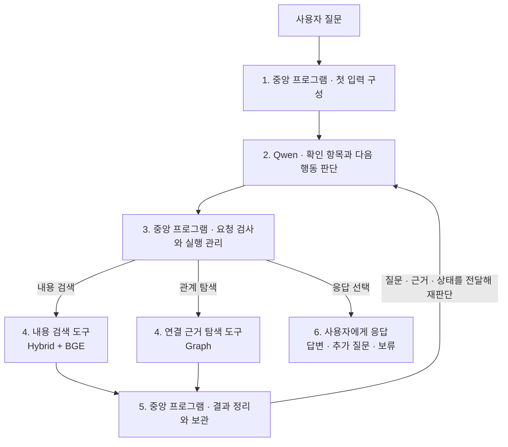

# Week 8 — Agentic Retrieval 설계

## 전체 흐름



## 구성 요소와 역할

| 구성 요소 | 사용 모델·구성 | 역할 |
|---|---|---|
| 에이전트 LLM | **Qwen3.8-Flash-Next** | 질문 해석, 확인 항목 작성, 다음 행동 선택, 응답 작성 |
| 중앙 프로그램 | Python 제어 프로그램 | 입력 구성, 요청 검사, 도구 호출, 자료 보관, 반복 관리 |
| BM25 | 키워드 기반 검색 | 검색어와 단어가 일치하는 자료를 찾음 |
| Dense 검색 | **Qwen3-VL-Embedding-8B**와 벡터 유사도 검색 | 자료와 검색어를 벡터로 표현하고, 유사한 자료를 찾음 |
| 리랭커 | **BAAI/bge-reranker-v2-m3** | Hybrid 후보를 현재 검색어와의 관련성으로 재정렬 |
| Graph | 서비스·조문·법령·제출서류·기관의 저장 관계 | 지정한 대상과 연결된 근거를 조회 |

## 중앙 프로그램과 Qwen의 메시지 전달

중앙 프로그램은 **system 메시지와 user 메시지를 하나의 요청에 함께 전달**하고, Qwen은 **assistant 메시지로 판단 결과를 반환**한다.

```text
중앙 프로그램 ── [system 메시지 + user 메시지] ──▶ Qwen
중앙 프로그램 ◀── [assistant 메시지: 판단 결과] ─── Qwen
```

| 메시지 | 역할 |
|---|---|
| `system` | 어떤 역할·자료 범위·규칙으로 판단하고 응답할지 안내 |
| `user` | 현재 해결할 질문과 탐색 진행 상황을 전달 |
| `assistant` | Qwen이 선택한 행동과 입력값 등 판단 결과를 반환 |

**user 메시지도 중앙 프로그램이 구성한다.** 첫 호출에는 질문과 초기 상태를 넣고, 재호출할 때는 확보한 근거와 갱신된 상태·이력을 함께 넣는다.

`system`·`user`·`assistant`는 메시지의 역할을 구분하는 이름이고, **JSON은 내용을 표현하는 형식**이다. 현재 구현은 user 메시지의 본문과 Qwen의 판단 결과를 JSON으로 구성한다.

## 1. 중앙 프로그램 · 첫 입력 구성

**중앙 프로그램이 Qwen을 처음 호출할 때**, 아래 항목으로 구성한 입력을 전달한다.

| 입력 항목 | 메시지 | 전달 내용 |
|---|---|---|
| 원래 질문 | `user` | 사용자가 입력한 질문 원문 |
| 역할·데이터 범위 | `system` | 민원·법령 근거를 탐색하는 역할, 보유 서비스 목록과 자료 종류, 저장 자료의 범위 |
| 도구와 관계 설명 | `system` | 두 검색 도구의 기능·입력·반환 내용, Graph에서 조회할 수 있는 관계 |
| 현재 실행 상태 | `user` | 첫 호출에는 검색 미실행, 확보 근거·실행 이력 없음 |
| 판단 지침 | `system` | 질문의 의도 유지, 확인 항목별 근거 검토, 정보 부족·충돌 구분 |
| 실행 규칙 | `user` | 선택 가능한 행동과 남은 호출 횟수 |
| 출력 양식 | `system` | 확인 항목·다음 행동·행동의 입력값·짧은 선택 이유를 반환하는 형식 |

**[첫 호출 요청 JSON 보기](examples/first_qwen_request.json)** — 예시 질문: “주민등록표 등본을 대리인이 발급받으려면 어떤 서류가 필요한가요?”

현재 코드와 기본 설정으로 구성한 전송 직전 요청 본문이다. `messages[0]`은 system, `messages[1]`은 user이며 모델명·생성 설정도 함께 담겨 있다. 서버 전송 없이 저장한 확인용 예시이며, 실행 시 읽는 설정 파일은 아니다.

## 2. Qwen · 판단

첫 호출에는 질문에서 확인할 항목을 만들고 다음 행동을 선택한다. 검색 이후에는 여러 자료를 확인 항목에 연결해 **어떤 정보가 확인됐고 무엇이 남았는지** 갱신한다.

| Qwen이 반환하는 항목 | 내용 |
|---|---|
| 확인 항목 `checks` | 확인할 정보, 현재 상태, 연결된 근거 ID |
| 다음 행동 `action` | 내용 검색 `search` / 관계 탐색 `graph` / 응답 `respond` |
| 입력값 `arguments` | 선택한 도구의 검색어·대상·관계, 또는 응답 문장과 근거 ID |
| 선택 이유 `reason` | 이번 행동으로 확인하려는 내용을 짧게 설명 |

출력은 JSON으로 받는다. 확인 상태는 현재 **미확인 / 일부 확인 / 확인 / 충돌**로 구분한다. 항목의 의미와 근거의 충분성은 Qwen이 판단하며, 이 상태값 자체가 정답을 보장하지는 않는다.

## 3. 중앙 프로그램 · 실행 관리

Qwen의 판단 결과를 읽고, 실행 가능한 요청인지 검사한 뒤 해당 행동을 수행한다.

| 검사·관리 대상 | 처리 |
|---|---|
| 요청 형식 | 필요한 항목과 입력값이 올바른지 검사 |
| 선택한 행동 | 허용된 행동인지, 남은 호출 한도 안에서 실행할 수 있는지 확인 |
| 근거 ID | 확인 상태와 응답에 연결한 ID가 Qwen에게 전달됐던 실제 근거인지 확인 |
| 실행 이력 | 선택한 행동·입력값·결과 상태를 기록하고 동일 요청의 결과를 재사용 |
| 잘못된 요청 | 수정할 정보를 Qwen에 전달하고, 반복 오류나 한도 초과 시 중단 |

**Qwen은 무엇을 확인하고 어떤 행동을 할지 결정하고, 중앙 프로그램은 그 요청을 검사·실행한다.**

## 4. 검색 도구

### 내용 검색 — Hybrid + BGE

**새로운 내용을 찾거나 부족한 항목에 맞춰 검색어를 바꿀 때** 사용한다.

`검색어 → BM25 + Dense 검색 → 순위를 결합해 후보 구성 → BGE 재정렬 → 근거 반환`

Dense 검색에서는 Qwen 임베딩 모델로 만든 자료 벡터를 미리 색인에 저장해 두고, 검색할 때 같은 모델로 만든 검색어 벡터와 비교한다.

| 항목 | 내용 |
|---|---|
| 입력 | Qwen이 작성한 검색어 |
| 검색 범위 | 저장된 전체 코퍼스 |
| 반환 | 자료 ID·제목·본문·출처, 검색 순위와 관련성 점수 |

같은 도구를 새로운 검색어로 반복 사용할 수 있다. BGE는 이 도구 안에서 후보를 정렬하며, **BGE 점수는 관련성 점수이고 답변을 뒷받침한다는 확률은 아니다.**

### 연결 근거 탐색 — Graph

**특정 대상의 제출서류·근거 조문·인용 관계 등을 확인할 때** 사용한다. 첫 질문에서 대상과 관계가 명확하면 첫 행동으로도 선택할 수 있다.

`대상 + 관계 → 저장된 연결 조회 → 관계와 이를 확인할 본문·출처 반환`

| 항목 | 내용 |
|---|---|
| 입력 | 실제 대상 ID 또는 저장된 이름, 조회할 관계 |
| 탐색 범위 | 지정한 대상에 연결된 저장 관계 |
| 반환 | 연결된 대상과 관계·경로, 관련 본문·출처, 저장된 조건 정보 |

| 지원 관계 | 확인하는 연결 |
|---|---|
| `REQUIRES` | 서비스 → 제출서류 종류 |
| `GROUNDED_BY` | 서비스 → 연결된 조문 |
| `REFERENCES` | 조문 → 인용한 조문 |
| `PART_OF` | 조문 → 소속 법령 |
| `HANDLED_BY` | 서비스 → 처리·접수기관 |

**Graph의 역할은 저장된 관계를 정확히 조회하는 것이다.** 연결이 없으면 찾지 못하는 한계는 그대로 남는다. Qwen은 조회 결과를 보고 내용 검색으로 전환하거나 다른 대상을 탐색할 수 있다. 관계가 있다는 사실만으로 자격·적용 조건까지 충족한다고 판단하지 않는다.

## 5. 중앙 프로그램 · 결과 처리와 재판단 요청

도구별 결과를 **공통 근거 정보와 도구 고유 정보**로 정리하고, 원래 질문과 함께 Qwen에 전달한다.

| 구분 | 중앙 프로그램이 보관하는 정보 | 다음 Qwen 판단에 전달하는 정보 |
|---|---|---|
| 질문 | 원래 질문 | 동일한 질문 원문 |
| 근거 | 자료 ID·제목·본문·출처를 ID별로 누적 | 전달량 한도 안에서 선택한 근거 |
| 도구 결과 | 실행 상태, 원결과, 검색 점수·순위, Graph 관계·경로 | 최신 결과의 상태·관계·반환 범위 등, 해당 근거 ID |
| 판단·실행 이력 | 확인 항목, Qwen의 판단 기록, 도구 호출 이력 | 최신 확인 항목, 도구 호출 이력, 남은 한도, 필요한 오류 안내 |

현재는 **새 근거 → 확인 항목에 연결된 기존 근거 → 나머지 근거** 순서로 전달한다. 검색 점수·순위는 원결과에 보관하고, 재전달하는 공통 근거에서는 제외한다. 이번 입력에 포함하지 못한 근거의 ID도 표시한다.

이 정리는 도구가 반환한 실제 필드를 옮기고 검사하는 코드가 수행한다. **자료의 의미를 해석하고 확인 항목을 갱신하는 일은 Qwen이 맡는다.** 결과 처리 후에는 갱신된 입력으로 **2번 Qwen 판단을 다시 호출**한다.

## 6. 사용자에게 응답

Qwen이 `respond`를 선택하면 응답 문장과 사용한 근거 ID를 반환한다. 중앙 프로그램은 해당 ID에 실제 자료의 제목·출처를 연결해 사용자에게 전달한다.

응답 문장에는 **근거에 기반한 답변, 필요한 추가 질문, 정보 부족에 따른 보류**를 담을 수 있다. 현재는 이를 하나의 응답 행동으로 처리한다.

현재 구현한 검사는 **출력 형식과 실제 근거 ID의 존재·전달 여부**다. 문장별로 근거가 답변을 뒷받침하는지 확인하는 검증과, 추가 질문에 대한 사용자 답변을 받아 탐색을 재개하는 과정은 추가 설계가 필요하다.

## 상의 없이 정한 초기 구현 선택

아래는 **현재 코드에 반영했지만 함께 검토하고 확정할 항목**이다. 기본 구조와 구분하며, 최적 성능을 확인한 설정은 아니다.

### 판단·실행·종료

| 항목 | 현재 선택 | 선택 이유·검토할 점 |
|---|---|---|
| 제어 방식 | Python 반복문, 한 번에 행동 하나 | 요청과 결과를 단계별로 추적하기 쉬움. 병렬 도구 호출은 미적용 |
| 판단 지침 | 확인 항목별 근거 검토, 부족·충돌 구분, 근거 기반 응답 | 충분한 근거와 응답 가능성을 판단하는 세부 기준을 함께 확정해야 함 |
| 출력 형식 | JSON 4개 항목, 확인 상태 4종류 | 실행 요청을 명확하게 읽고 검사하기 위한 초기 구분 |
| 호출 한도 | Qwen 최대 8회, 실제 도구 실행 최대 6회 | 무한 반복 제한. 마지막 모델 호출은 응답에 사용 |
| 잘못된 요청 | 연속 2회면 중단 | 형식 수정만 반복하는 상황 제한 |
| 실행 오류 | 도구 오류는 Qwen에 전달, 모델 통신 오류는 중단. 자동 통신 재시도 없음 | 자료를 못 찾은 상황과 실행 실패를 구분 |
| 동일 요청 | 같은 도구·입력의 오류 아닌 결과는 재사용 | 중복 실행을 줄임. Qwen 호출 횟수는 계속 소모 |
| 응답·대화 범위 | 한 질문의 탐색부터 응답까지 처리 | 답변·추가 질문·보류의 구체적 구분 기준과 후속 대화 재개 방식은 미확정 |

### 근거 보관·전달·인용

| 항목 | 현재 선택 | 선택 이유·검토할 점 |
|---|---|---|
| 전달 우선순위 | 새 근거 → 확인 항목에 연결된 근거 → 나머지 | 새로 찾은 정보를 다음 판단에서 먼저 확인하도록 구성 |
| 전달량 | 근거를 JSON으로 표현한 길이 합계 최대 60,000자 | 토큰 수나 전체 입력 길이의 상한은 아님. 한도를 넘는 자료는 이번 전달에서 제외하고 ID 표시 |
| 일부 결과 반환 | 반환 범위를 표시, 별도 페이지 조회 기능 없음 | 전달된 결과만으로 전체 후보를 읽었다고 오해하지 않도록 함 |
| 점수 처리 | 검색어별 점수·순위는 원결과에 보관 | 이전 검색 점수가 다음 판단의 공통 근거에 섞이지 않도록 분리 |
| 인용 방식 | 실제 근거 ID 사용, 전달됐던 자료만 인용 허용, 응답 끝에 출처 목록 | 문장별 인용 대응과 내용 검증 방식은 추가로 정해야 함 |

### 검색·모델 세부 설정

| 항목 | 현재 선택 | 선택 이유·검토할 점 |
|---|---|---|
| 내용 검색량 | 후보 100개를 BGE로 정렬해 10개 반환 | 검색량·Qwen의 읽기 부담·누락 가능성 사이의 균형을 검토해야 함 |
| Hybrid 결합 | BM25 `k1=1.2`, `b=0.75`, 순위 결합 RRF 상수 60 | 기존 검색 설정을 출발점으로 사용 |
| 문서 벡터 | 제목+본문을 임베딩하고 정규화 | 새 검색어로 전체 자료를 검색하도록 구성. 문서와 검색어의 인코더 설정을 맞춤 |
| BGE 처리 | CPU·float32, 배치 8, 입력 한도 1,024토큰 | 현재 로컬 실행 기본값. 처리 시간과 검색 품질을 함께 검토 |
| Graph 범위 | 나가는 방향 1홉, 관계 최대 20개·근거 최대 50개 | 한 번의 탐색 범위를 제한. Qwen은 대상·관계를 선택하며 방향·범위는 프로그램 설정 |
| Graph 대상 식별 | 실제 ID 또는 정규화한 저장 이름·별칭의 정확 일치 | 대상이 없거나 여러 개면 그 상태를 반환. 유사한 이름을 임의로 연결하지 않음 |
| Graph 근거 수집 | 관계의 출처 청크와 연결 대상의 원문 수집 | 공용 서류·기관 노드의 근거는 선택한 관계의 출처 문서로 제한해 다른 서비스 자료의 혼입을 줄임 |
| Qwen 생성 설정 | temperature 0, 최대 출력 2,000토큰, 응답 대기 120초 | 일관된 형식의 판단을 받기 위한 초기값. 판단 품질과 지연을 확인하며 조정 |
