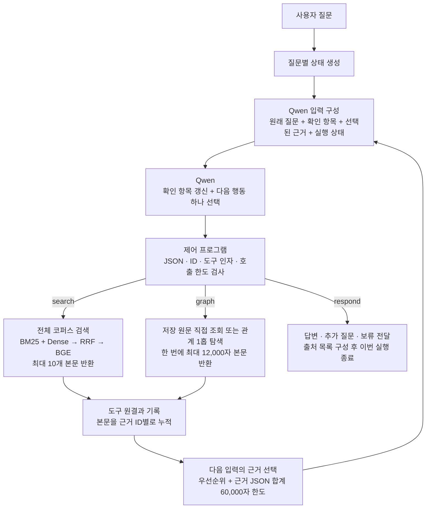
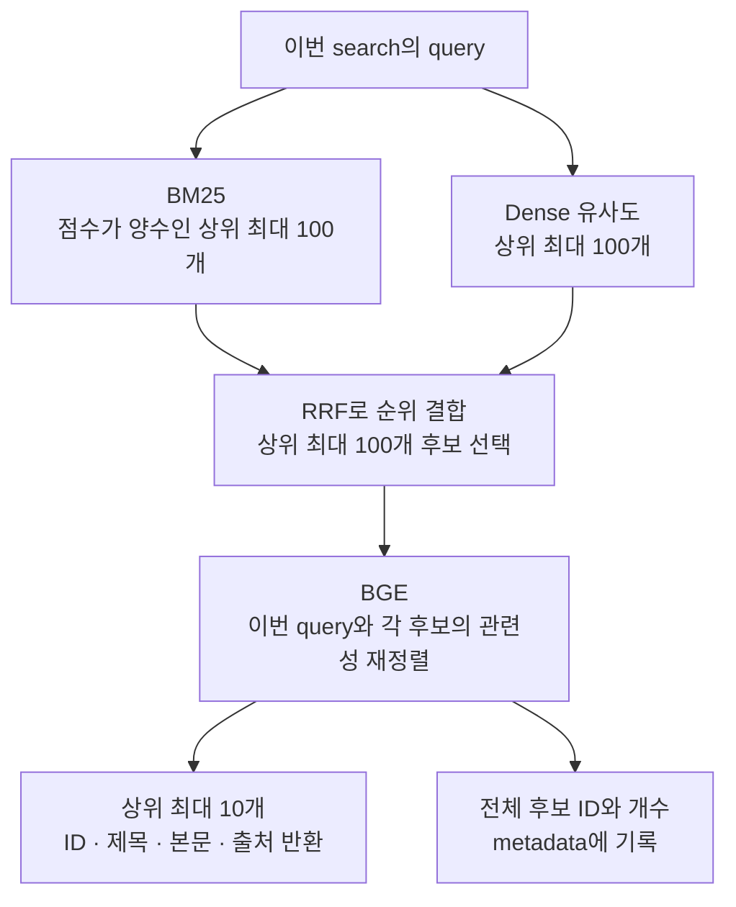

# Week 9 — 에이전트의 근거 흐름과 판단 구조

[Week 9 Meeting](https://app.notion.com/p/40f6d1078cb3806ea242fa643b447110)에서 나온 질문을 기준으로, **검색한 근거가 어디에 보관되고, 어떤 기준으로 Qwen에 전달되며, 최종 답변과 평가까지 어떻게 이어지는지** 설명한다.

2026-11-14의 구현(`4dfeb1b`)을 확인한 문서다. 수치는 별도 표시가 없으면 코드 기본값이며, 실제 실행 설정에 따라 달라질 수 있다. Week 8의 설계·실험 결과는 [AGENT.md](../week8/AGENT.md)에 있다.

## 1. 전체 흐름

**Qwen은 확인 항목과 다음 행동을 결정하고, Python 제어 프로그램은 도구 실행·근거 보관·다음 입력 구성을 담당한다.** 한 질문 안에서 이 과정을 반복한다.



이 그림은 유효한 요청의 정상 흐름이다. 요청이 잘못되면 오류 설명을 다음 Qwen 입력에 넣어 수정을 요청하며, 중단 조건은 7절에 정리한다. Graph 후보 요약은 입력 구성 중에도 생성하지만, 실제 본문 조회는 Qwen이 `graph`를 선택했을 때 실행한다.

### 일반 실행과 비교 실험의 시작점

| 구분 | 첫 Qwen 호출 전에 수행하는 일 | 첫 Qwen 입력 |
|---|---|---|
| 일반 실행 `run_agent.py` | 새 상태 생성. 선행 검색을 강제하지 않음 | 본문 근거·확인 항목·도구 이력은 비어 있음. 질문에서 식별한 Graph 후보는 제공될 수 있음 |
| A/B/C 비교 실험 | **원래 질문으로 첫 검색을 한 번 실행·저장하고 세 조건에 같은 결과 주입** | 첫 검색의 반환 근거와 실행 이력이 있는 상태. 확인 항목은 아직 비어 있음 |

| 비교 조건 | 공통 첫 검색 이후 Qwen이 선택할 수 있는 행동 |
|---|---|
| A · `single_search` | `respond` |
| B · `iterative_search` | `search`, `respond` |
| C · `iterative_graph` | `search`, `graph`, `respond` |

비교 실험에서는 공통 첫 검색도 각 조건의 도구 호출 1회로 계산한다. 이후 상태와 근거 누적은 조건별로 독립적이다. 일반 실행을 설명할 때의 “Qwen이 첫 검색어를 정한다”는 흐름을 비교 실험의 첫 검색에 그대로 적용하면 안 된다.

## 2. 질문 분해와 근거 충분성 판단은 누가 하는가

### Qwen의 입력과 출력

매 호출마다 제어 프로그램이 아래 **두 메시지를 새로 구성**한다.

| 메시지 | 내용 |
|---|---|
| `system` | 역할·자료 범위, 도구 설명, 판단 지침, 출력 형식 |
| `user` | 원래 질문, 현재 확인 항목·선택된 본문·최신 도구 결과·이력·후보, 허용 행동과 남은 호출 횟수 |

이전 대화 메시지를 계속 붙이는 방식이 아니라, 프로그램에 보관한 상태를 다음 입력으로 다시 전달한다. 전체 실행 기록은 별도로 남기지만 그 기록 전체가 다음 Qwen 입력에 들어가지는 않는다.

Qwen은 한 번의 호출에서 네 필드를 함께 반환한다.

| 필드 | 의미 |
|---|---|
| `checks` | 답에 필요한 확인 항목, 각 항목의 상태, 연결된 근거 ID |
| `action` | 다음 행동 하나: `search`, `graph`, `respond` |
| `arguments` | 검색어, Graph 조회 조건, 또는 응답 문장·인용 ID |
| `reason` | 이번 행동의 선택 목적을 짧게 기록 |

따라서 현재의 planning은 **확인 항목을 만들고 매 호출마다 갱신하는 과정**이다. 별도의 계획 모델이나 고정된 도구 실행 계획을 먼저 만드는 단계는 없다.

### 확인 항목과 상태

다음은 구조 설명용 예시다. `E1`은 이미 Qwen에 전달된 실제 본문 ID를 대신한 표기이며, 실험 결과가 아니다.

```json
{
  "checks": [
    {"item": "A 증명서의 대리 발급 서류", "status": "확인", "evidence_ids": ["E1"]},
    {"item": "B 증명서의 대리 발급 서류", "status": "미확인", "evidence_ids": []}
  ],
  "action": "search",
  "arguments": {"query": "B 증명서 대리 발급 제출서류"},
  "reason": "비교에 필요한 B의 서류를 추가로 확인"
}
```

확인 상태는 `미확인`, `일부 확인`, `확인`, `충돌`이다. Qwen은 본문이 질문의 대상·조건·시점·예외를 뒷받침하는지 보고 상태를 결정하도록 지시받는다. 일부만 찾았으면 추가 검색·Graph 조회를 선택하고, 답에 필요한 사용자 조건이 빠졌으면 추가 질문을 작성한다.

**프로그램은 이 판단의 의미적 정확성을 독립적으로 판정하지 않는다.** `일부 확인`·`확인`·`충돌`에 실제 제공 이력이 있는 근거 ID가 붙었는지는 검사하지만, 그 근거가 항목을 충분히 뒷받침하는지는 Qwen의 판단에 맡긴다.

또한 유효한 응답을 받으면 `checks` 전체를 새 목록으로 교체한다. 이전 항목을 유지하고 미해결 항목을 빠뜨리지 말라는 지침은 있으나, 코드가 항목 누락이나 잘못된 `확인` 판정을 자동으로 막지는 않는다. 질문 분해·충분성·다음 행동의 품질을 각각 살펴봐야 하는 이유다.

## 3. search: 후보 100개가 본문 10개가 되는 과정

검색 대상은 저장된 SQLite 코퍼스의 청크다. 청크의 **제목 + 줄바꿈 + 본문**을 검색용 텍스트로 사용한다. Dense 검색은 미리 만든 문서 벡터와 이번 검색어의 벡터를 비교하며, BM25는 같은 코퍼스의 단어 일치를 사용한다.



| 단계 | 보관·반환되는 정보 | 의미 |
|---|---|---|
| BM25·Dense | 각 검색의 후보 순위 | 두 목록을 합친 뒤 RRF로 최대 100개를 선택 |
| BGE | 후보 최대 100개의 관련성 순위 | 이번 검색어에 대한 순위. 답의 정확성이나 충분성 판정이 아님 |
| 도구 반환 `evidence` | 상위 최대 10개의 본문과 출처, 이번 검색의 순위·점수 | 제어 프로그램의 근거 저장소에 추가되는 대상 |
| 도구 반환 `metadata.candidate_ids` | BGE로 정렬한 전체 후보 ID | 나머지 후보의 본문까지 Qwen에 전달했다는 뜻은 아님 |

**새 검색을 할 때마다 전체 코퍼스에서 다시 후보를 찾는다.** 이전에 모은 근거와 새 후보를 합쳐 BGE로 다시 정렬하는 단계는 없다. 예를 들어 첫 검색 10개와 다음 검색 10개가 모두 다른 ID라면, 보관 근거는 20개가 된다. 두 검색 결과에서 전역 Top 10을 다시 뽑지 않는다.

BGE의 기본 입력 한도는 검색어·후보 쌍당 1,024토큰이며, 길면 후보 텍스트 쪽을 잘라 점수를 계산한다. **선택된 청크를 반환할 때는 저장된 본문을 반환**한다. BGE가 점수를 매길 때 읽는 범위와 이후 Qwen에 전달할 수 있는 본문 범위는 구분해야 한다.

## 4. graph: 본문을 더 확보하는 별도 경로

Graph는 검색된 청크를 자동으로 확장하는 후처리가 아니다. Qwen이 기존 근거와 후보를 보고 `graph`를 선택하면 별도의 도구 호출로 실행된다. 반환 본문은 search 결과와 **같은 근거 저장소**로 들어가며, 별도의 BGE 재정렬을 거치지 않는다.

### 4.1 조회 후보를 제공하는 과정

Qwen 입력을 구성할 때 `observe()`가 다음 단서를 모아 `graph_candidates`를 갱신한다.

| 단서 | 후보를 얻는 방식 |
|---|---|
| 원래 질문 | 저장된 이름·별칭 중 질문에 명시되고 대상을 고유하게 식별하는 것 |
| 이번 입력에 선택된 본문 | 해당 청크와 연결된 Graph 노드. 원문 범위 근거는 겹치는 `chunk_ids`를 이용 |
| 이전 후보 | 이미 관찰한 후보를 누적 유지 |
| 최신 Graph 결과 | 조회 대상·모호한 대상의 후보·조문 목록·관계 양끝의 노드 |

후보는 질문의 명시 대상 → 미해결 확인 항목의 근거와 연결된 대상 → 나머지 순서로 정렬한다. 고정 Top-K로 자르지 않으며, 전체 Graph의 모든 노드를 나열하는 것도 아니다. 요약에는 ID·이름·유형·연결된 근거 ID·선택 가능한 관계가 들어간다. 원문 문서 ID는 별도의 `document_candidates`에도 모은다.

**후보·조문 목록·관계 ID는 이동할 위치를 알려주는 정보다.** 그 대상의 본문을 확보했거나 해당 주장이 입증됐다는 뜻은 아니다.

### 4.2 Qwen이 선택하는 조회

| 방식 | 입력 | 본문을 모으는 범위 |
|---|---|---|
| 직접 조회 `mode=direct` | `target_type=node/document`, `target_id` | 서비스는 연결된 안내 문서 전체 등 저장 근거, 조문은 해당 조문 전체, 원문 문서는 저장 본문을 조회 |
| 관계 탐색 `mode=traverse` | `target_type=node`, `target_id`, `relation` | 시작점의 선택한 관계 1종류를 1홉 조회하고, 관계 출처와 연결 대상의 근거를 수집 |
| 특정 연결 대상 조회 | traverse에 `destination_id` 추가 | 해당 관계로 연결된 대상 중 지정한 대상에 한정 |
| 이어 읽기 | 같은 조회 조건에 이전 `next_cursor`를 `cursor`로 전달 | 앞에서 반환하지 못한 다음 본문 범위 |

기본 탐색 방향은 **나가는 방향 1홉**이다. 추가 홉은 결과를 받은 Qwen이 다시 조회를 선택해야 한다. 방향 설정은 도구 생성 시 정하며, 현재 Qwen 요청 필드에는 방향을 바꾸는 인자가 없다.

관계는 `GROUNDED_BY`(서비스→조문), `REFERENCES`(조문→인용 조문), `REQUIRES`(서비스→제출서류 종류), `HANDLED_BY`(서비스→기관), `PART_OF`(조문→법령)다. Graph의 `Document` 노드는 제출서류 종류이며, `target_type=document`로 읽는 **원문 문서**와 다른 개념이다.

법령·법령 문서에 조문 목록이 있으면 먼저 `article_catalog`를 반환한다. Qwen이 조문을 골라 다시 조회해야 본문을 얻는다. 여러 서비스가 공유하는 제출서류·기관 노드의 직접 조회가 모호하면 서비스 후보를 반환한다. 서비스에서 관계를 따라 조회할 때는 선택한 관계의 출처 범위를 유지한다.

### 4.3 반환 한도와 원문 범위

한 호출에서 모은 원문 범위를 문서별로 병합하고, **본문 합계 최대 12,000자**를 반환한다. 넘으면 `next_cursor`, 이미 반환한 범위, 남은 문자 수를 제공한다. 이어 읽기도 별도의 도구 호출을 사용한다. 과거 API의 관계 20개·근거 50개 제한은 현재 Qwen이 쓰는 새 조회 형식에 적용하지 않는다.

Graph 본문에는 `문서ID@시작:끝:본문해시` 형식의 근거 ID와 `start_char`, `end_char`, `chunk_ids`가 붙는다. 끝 위치는 포함하지 않는다. `chunk_ids`는 이 범위와 겹치는 청크를 알려주므로, ID가 적혔다고 그 청크 전체를 읽은 것은 아니다.

`missing_source_targets`는 저장 본문을 확보하지 못한 대상이다. 이것은 한도 때문에 아직 읽지 못한 본문과 다르며, 커서로 이어 읽는 것만으로 해결되지 않는다.

## 5. 도구 반환 → 누적 보관 → Qwen 입력

### 5.1 근거는 어디에 보관되는가

| 위치 | 보관 내용 | 다음 Qwen 호출에서의 사용 |
|---|---|---|
| `state.evidence` | search·graph가 반환한 본문을 근거 ID별로 누적 | 전달 후보가 되는 본문 저장소 |
| `state.checks` | Qwen이 가장 최근에 작성한 확인 항목·상태·근거 ID | 판단 상태를 전달하고 본문 우선순위에 사용 |
| `state.latest_result` | 가장 최근 도구의 원결과 | 본문 목록을 제외한 상태·관계·후보·metadata·커서 등을 전달. 본문은 선택된 `evidence`에서 읽음 |
| `state.history` | 모든 도구 요청의 인자·상태·반환 ID·캐시 여부 | 어떤 탐색을 했는지 요약 전달 |
| `state.graph_pages` | Graph 조회 조건·현재/다음 커서·대상·metadata | 이어 읽을 위치와 이전 조회 범위를 전달 |
| `state.events` | 모델 입력·출력, 유효한 결정, 도구 원결과, 오류 등 | 전체 추적 기록. 통째로 다음 입력에 붙이지 않음 |

도구 결과를 받을 때 필수 필드·결과 형식·한 결과 안의 ID 중복을 검사한다. 기존 ID와 제목·본문·출처가 충돌해도 오류로 처리한다. 통과한 본문은 ID별로 처음 받은 내용을 유지한다.

누적 보관 시 검색의 `rank`와 근거별 `metadata`를 제거한다. 따라서 이번 검색의 BGE·RRF 점수를 다른 검색의 근거와 비교하는 공통 점수로 사용하지 않는다. 원래 순위·점수는 `events`의 `tool_result`에 남는다.

중복 제거 기준은 **동일한 근거 ID**다. 내용이 같거나 겹치더라도 search의 청크 ID와 Graph의 원문 범위 ID가 다르면 각각 보관된다. 이 저장소 전체를 대상으로 의미 중복 제거·자동 요약·범위 병합을 수행하지 않는다.

### 5.2 Qwen에 전달할 본문을 선택하는 규칙

보관된 본문을 매번 모두 전달하는 것은 아니다. 다음 순서로 ID를 나열하고 중복 ID를 제거한 뒤, 들어갈 수 있는 본문을 고른다.

| 호출 시점 | 선택 순서 |
|---|---|
| 추가 도구 호출 예산이 남아 있는 동안 | **최신 도구 결과 → checks에 연결된 근거 → 나머지 누적 근거** |
| 도구 예산이 소진됐거나 마지막 모델 호출일 때 | **checks에 연결된 근거 → 최신 도구 결과 → 나머지 누적 근거** |

같은 그룹 안에서는 목록 순서를 따르고, 나머지 누적 근거는 처음 저장된 순서다. `checks`의 `확인` 상태만 우대하는 것이 아니라, 상태와 관계없이 항목에 연결된 ID를 사용한다.

각 본문 행을 `json.dumps(row, ensure_ascii=False)`로 표현한 길이를 더해 **60,000자 이내**로 선택한다. 본문 텍스트뿐 아니라 ID·제목·출처 등의 필드도 이 계산에 포함한다.

- 한 행이 남은 한도를 넘으면 그 행 전체를 제외하고 다음 행을 검토한다. 이 단계에서 본문을 잘라 넣거나 요약하지 않는다.
- 제외한 근거도 저장소에서 삭제하지 않는다. 이후 우선순위와 여유에 따라 다시 전달될 수 있다.
- 이 값은 **근거 행의 JSON 길이 합계**다. system 지침·질문·이력·후보·최신 결과의 metadata 등은 포함하지 않으므로, 전체 요청 크기나 토큰 수의 상한이 아니다.
- 모델이 자발적으로 일찍 `respond`를 고를지는 입력 구성 시점에 알 수 없다. 따라서 **모든 최종 답변 직전 입력이 checks 우선으로 재정렬되는 것은 아니다.** 예산이 남아 있으면 최신 근거 우선 입력으로도 답변할 수 있다.

### 5.3 “찾았다”와 “이번에 읽을 수 있다”의 차이

| 항목 | 정확한 의미 |
|---|---|
| 검색 후보 ID | BGE 후보 목록에 포함됨. 본문 반환 여부와 별개 |
| 보관 근거 `state.evidence` | 도구가 반환해 저장소에 들어온 본문 |
| 이번 입력 `supplied_evidence_ids` | 이번 Qwen 요청에 본문을 포함한 근거 |
| 제외 목록 `omitted_evidence_ids` | 저장돼 있지만 이번 입력의 문자 한도로 빠진 근거 |
| 제공 이력 `seen_ids` | 지금까지 한 번 이상 Qwen 입력에 포함한 근거 ID의 누적 집합 |
| 최종 인용 `respond.arguments.evidence_ids` | 이번 입력에 제공된 근거 중 응답에 사용한다고 Qwen이 지정한 ID |

`checks`에는 이전 입력에서 본 적 있는 근거를 연결해 유지할 수 있다. 반면 최종 응답의 인용 ID는 **이번 입력에 본문이 있는 ID로 제한**한다. 보관돼 있거나 예전에 봤다는 사실만으로는 최종 인용이 허용되지 않는다.

### 5.4 두 번 검색했을 때의 예시

다음은 전달 정책을 설명하기 위한 가정이며 실제 실행 결과가 아니다.

| 순서 | 저장소와 입력에서 일어나는 일 |
|---|---|
| 첫 검색 | `E1`~`E10` 반환·누적. 한도 내 본문을 Qwen에 전달 |
| Qwen 판단 | `E2`로 A 항목을 확인하고, B 항목을 찾기 위한 두 번째 검색 선택 |
| 두 번째 검색 | `E8`~`E17` 반환. 중복 ID를 제외하면 저장소에는 `E1`~`E17`, 총 17개 보관 |
| 다음 입력 선택 | 탐색 예산이 남았다면 최신 `E8`~`E17` → checks의 `E2` → 나머지 순서로 60,000자 한도 적용 |
| `E2`가 한도로 제외된 경우 | A 항목의 상태와 `E2` 연결은 남을 수 있지만, 이번 응답에서 `E2`를 인용하면 프로그램이 거부 |

따라서 **검색 결과가 늘어도 답변에 필요한 근거가 마지막 입력에 함께 남는다는 보장은 없다.** 이 예시는 가능한 실패 경로이며, 실제 성능 하락의 원인인지는 해당 문항의 기록으로 확인해야 한다.

## 6. 최종 답변과 인용은 어떻게 만들어지는가

Qwen이 `respond`를 선택하면 `arguments.text`에 사용자에게 전달할 문장을, `arguments.evidence_ids`에 인용 근거 ID를 넣는다. 답변·추가 질문·보류는 모두 이 행동을 사용한다. 문의가 여러 개라면 한 응답 안에서 일부는 답하고 일부는 추가 질문하거나 보류할 수 있다.

| 구분 | 현재 구현 |
|---|---|
| 근거 충분성 | Qwen이 `checks`와 제공 본문으로 판단. 프로그램은 모든 항목이 `확인`이어야만 응답하도록 강제하지 않음 |
| 인용 ID 검사 | 중복·알 수 없는 ID를 거부하고, 최종 인용은 이번 입력의 본문 ID로 한정 |
| 응답 표시 | Qwen이 작성한 문장에, 지정된 ID의 제목·출처 URL을 이용한 출처 목록을 덧붙임 |
| 문장과 인용의 대응 | 주장 옆에 `[근거 ID]`를 쓰라는 지침은 있음. 실제 문장 속 표기와 인용 목록의 일치·주장별 뒷받침 여부를 프로그램이 독립 검증하지 않음 |
| 실행 종료 | 유효한 `respond`를 받으면 즉시 `responded`로 종료. 내용의 정답 여부를 뜻하는 상태는 아님 |

현재 `run(question)`은 호출할 때마다 새 상태를 만든다. 추가 질문을 작성하는 기능은 있지만, **사용자의 후속 답변을 기다린 뒤 기존 근거·확인 항목을 복원해 이어가는 대화 흐름은 구현돼 있지 않다.** 비교 실행기의 재개 기능은 이미 완료한 문항·조건의 결과를 재사용하는 기능이다.

## 7. 반복, 캐시, 오류와 종료 한도

| 항목 | 기본 동작 |
|---|---|
| 모델 호출 | 최대 8회. 잘못된 요청을 수정하는 호출도 포함 |
| 도구 실행 | 최대 6회. 실제 실행 시 계산하며 실패한 실행과 Graph 이어 읽기도 포함 |
| 동일 요청 | 같은 도구와 같은 인자의 오류 아닌 결과는 이번 실행 안에서 캐시 재사용. 모델 호출은 소모하고 도구 실행 횟수는 늘리지 않음 |
| 한도 도달 전 입력 | 도구 예산이 끝났거나 마지막 모델 호출이면 허용 행동을 `respond`로 제한 |
| 잘못된 출력 | 오류를 다음 입력에 전달. 유효한 결정을 받으면 연속 오류 수를 초기화하고, 연속 2회 잘못된 요청이면 `invalid_output`으로 중단 |
| 도구 오류 | `error` 결과를 다음 Qwen 입력에 전달. 재시도 여부는 남은 예산 안에서 Qwen이 결정 |
| 모델 통신 오류 | 처리된 통신 오류는 `model_error`로 종료. 자동 재시도 없음 |
| 호출을 모두 사용하고도 응답하지 못함 | `budget_exhausted`로 종료 |

빈 결과·저장 대상 부재·실행 오류·본문 반환 한도는 서로 다른 상태다. 어느 경우도 그 자체로 “해당 요건이나 서류가 존재하지 않는다”는 근거가 되지 않는다.

## 8. 실행이 끝난 뒤 무엇을 평가하는가

### 8.1 근거 회수 평가는 네 위치를 구분한다

[근거 평가기](../src/civic_link/agent/evaluation.py)는 문항별 필수 근거와 다음 네 위치를 대조한다.

| 평가 단계 | 읽는 데이터 | 답하려는 질문 |
|---|---|---|
| `retrieved` | 실행 종료 시 누적 보관된 `result.evidence` | 도구가 본문을 반환했는가? **검색 후보 100개 전체를 뜻하지 않음** |
| `supplied` | 모든 `qwen_input`에서 전달한 본문의 합집합 | Qwen에 한 번이라도 전달했는가? |
| `final` | 마지막 `qwen_input`의 본문 | 마지막 판단 시점에 필요한 본문이 함께 있었는가? |
| `cited` | `result.sources`에 지정된 근거의 본문 | 최종 인용 목록에 필요한 근거가 포함됐는가? |

정상 응답에서는 `final`이 답변을 생성한 입력이다. 실패 실행에서는 단지 마지막으로 구성한 입력이므로 실행 상태도 함께 봐야 한다.

필수 근거의 인정 방식은 허용된 청크 전체가 있거나, 같은 문서의 반환 범위가 필수 인용 범위를 완전히 덮는지 확인하는 것이다. 여러 Graph 페이지의 범위를 합쳐 충족할 수도 있다. 단순히 겹치는 `chunk_ids`만 있다고 완전 회수로 인정하지 않는다.

Week 8 대표 지표인 **필수 근거 완전회수율은 `final` 단계에서 문항의 필수 근거를 모두 충족한 비율**이다. 최종 문장이 정확하거나 그 근거를 적절히 사용했는지는 별도 문제다.

### 8.2 응답 내용 평가는 사후에 수행한다

[내용 평가기](../scripts/judge_agent_comparison.py)는 저장된 응답을 대상으로 질문·정답/채점 기준·실제 마지막 입력의 본문·응답·출처 목록을 평가 모델에 전달한다. 문의별로 필수 처리, 사실 정확성, 제공 본문의 뒷받침, 인용의 적절성, 근거 없는 주장을 판정한다.

이 단계는 **응답 생성이 끝난 뒤의 실험 평가**다. 생성 중에 답변을 검증해 다시 검색하거나 답변을 수정하는 흐름에 연결돼 있지 않다. 정답·필수 근거 등 벤치마크 채점 정보도 생성 에이전트의 입력에는 넣지 않는다.

Week 8에서 보고한 근거 완전회수는 답변형 488문항, 내용 통과는 사전에 고른 60문항에 대한 값이다. 둘의 변화를 바로 원인·결과로 연결하기보다 **같은 문항의 근거 흐름과 답변**을 대조해야 한다. 내용 평가 모델의 오독 가능성도 실제 응답 오류와 나눠 확인해야 한다.

### 8.3 멘토 질문에 대응하는 관찰 위치

| 확인할 질문 | 기록에서 볼 위치 | 현재 수치만으로 알 수 없는 부분 |
|---|---|---|
| 계획을 잘 세웠는가? | `decision.checks`와 이후 항목 변화 | 필요한 항목을 빠뜨렸는지, 분해가 실제로 도움이 됐는지 |
| 후보 100개에는 있었는데 10개에서 빠졌는가? | `tool_result.result.metadata.candidate_ids`와 반환 `evidence` 비교 | 후보 포함과 본문 전달의 차이. 별도 대조가 필요 |
| 찾은 근거가 중간에 빠졌는가? | 누적 `result.evidence`, 각 `qwen_input`의 `context`·본문 | 문자 한도·우선순위가 해당 문항에 미친 영향 |
| 부족한데 멈추거나 충분한데 계속 검색했는가? | 당시 제공 본문 + `checks` + `action` + `reason` | Qwen의 충분성 판단과 행동 선택의 적절성 |
| Graph가 도움이 됐는가? | Graph 후보·실제 요청·반환 본문·이후 입력·최종 인용 | C 조건의 성공만으로 Graph 사용의 효과를 단정할 수 없음 |
| 근거는 있는데 왜 답변이 틀렸는가? | 같은 문항의 `final` 본문, 실제 응답·인용, 내용 평가 사유 | 근거 활용 오류·요구 처리 누락·평가 오독의 구분 |

즉, 확인할 연결은 **질문 분해 → 도구 선택 → 본문 회수 → 전달 근거 선택 → 충분성 판단 → 응답·인용**이다. 현재 단계별 근거 집계는 이 중 본문의 회수·전달·인용 위치를 보여주며, 각 판단이 적절했는지까지 자동으로 평가하지는 않는다.

## 9. 코드와 기록을 따라가는 위치

| 파일 | 이 문서와 연결되는 부분 |
|---|---|
| [controller.py](../src/civic_link/agent/controller.py) | `run`: 반복·종료, `_execute`: 도구 실행·근거 누적, `_messages`: 전달 본문 선택, `_finish`: 응답·출처 구성 |
| [prompts.py](../src/civic_link/agent/prompts.py) | Qwen 입력 구성, 확인 항목·충분성·인용 지침 |
| [protocol.py](../src/civic_link/agent/protocol.py) | JSON 형식·행동·확인 상태·근거 ID 검사 |
| [search.py](../src/civic_link/agent/search.py) · [index.py](../src/civic_link/agent/index.py) | BM25·Dense·RRF·BGE와 코퍼스 청크·벡터 연결 |
| [graph.py](../src/civic_link/agent/graph.py) · [graph_access.py](../src/civic_link/agent/graph_access.py) | Graph 로딩·방향, 후보 관찰, 직접 조회·관계 탐색·본문 범위·커서 |
| [experiment.py](../src/civic_link/agent/experiment.py) · [run_agent_comparison.py](../scripts/run_agent_comparison.py) | 공통 첫 검색과 A/B/C 허용 행동, 조건별 결과 저장 |
| [evaluation.py](../src/civic_link/agent/evaluation.py) · [judge_agent_comparison.py](../scripts/judge_agent_comparison.py) | 단계별 필수 근거 회수와 사후 응답 내용 평가 |

일반 실행에서 출력 디렉터리를 지정하면 `result.json`에 응답·누적 근거·확인 항목·이력, `trace.jsonl`에 상세 이벤트, `config.json`에 실행 설정을 저장한다. 비교 실험은 문항·조건별 결과 JSON의 `result.events`에 상세 이벤트를 포함한다. 실제 문항을 설명할 때는 이 기록의 `tool_result` → `qwen_input` → `decision` → 최종 응답 순서로 본문과 판단을 함께 확인한다.
