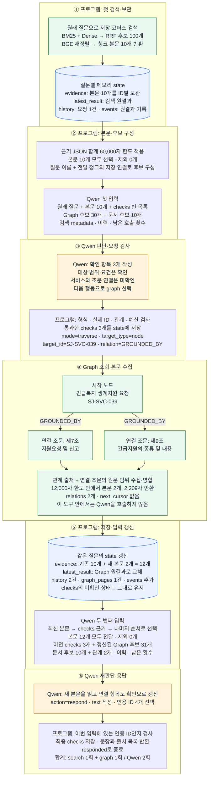

# Week 9 — 에이전트의 근거 흐름과 판단 구조

[Week 9 Meeting](https://app.notion.com/p/40f6d1078cb3806ea242fa643b447110)에서 나온 질문을 기준으로, **검색한 근거가 어디에 보관되고, 어떤 기준으로 Qwen에 전달되며, 최종 답변과 평가까지 어떻게 이어지는지** 설명한다.

2026-11-14의 구현(`4dfeb1b`의 에이전트 코드)과 Week 8의 608문항 비교 실행 기록을 확인한 문서다. 수치는 별도 표시가 없으면 코드 기본값이며, 실제 실행 설정에 따라 달라질 수 있다. Week 8의 설계·실험 결과는 [AGENT.md](../week8/AGENT.md)에 있다.

**반복의 주체는 Qwen과 제어 프로그램이다.** search는 청크를 찾고, graph는 지정된 대상의 본문이나 관계를 조회한다. Graph가 누적 근거를 앞에서부터 순회하거나, 정답 근거를 찾을 때까지 스스로 다음 홉을 결정하지 않는다. Qwen이 반환 본문을 읽고 다음 요청 또는 응답을 선택한다.

| 먼저 구분할 정보 | 담긴 것 | 쓰임 |
|---|---|---|
| 본문 근거 `evidence` | 실제 텍스트와 근거 ID·제목·출처 | Qwen이 내용을 읽고 확인 항목을 판단 |
| 조회 후보 `graph_candidates` | 노드 ID·이름·유형·연결 단서·선택 가능한 관계 | Qwen이 다음 조회 대상을 선택. 본문 확보 여부와 별개 |
| 확인 항목 `checks` | Qwen이 작성한 항목·상태·연결 근거 ID | 무엇을 확인했고 무엇이 부족한지 다음 호출에 전달 |

## 1. 검색부터 Graph 조회와 재판단까지: 실제 실행을 펼친 흐름

아래는 **`W7-MS-011`의 `iterative_graph` 조건에서 실제로 일어난 한 차례의 반복**이다. 추상적인 전체 구조를 반복해서 그리는 대신, 어떤 자료가 생기고 저장되며 다음 Qwen 호출에 무엇이 넘어갔는지 한 그림에 연결했다. 본문 수·후보 수·조회 대상은 실행 기록의 값이다. 실제 질문과 판단·반환 내용은 **5.4절**, 관계 이동 없이 직접 조회한 다른 사례는 **5.5절**에 정리한다.



그림의 실선은 이 사례에서 실행된 순서다. Graph의 두 갈래는 **호출 두 번이 아니라 한 번의 조회에서 발견한 두 연결**이다. 반환 본문도 다음 Qwen 입력에 한꺼번에 들어갔다. `checks`가 `미확인`에서 `확인`으로 바뀐 시점은 Graph 반환 직후가 아니라 **Qwen 두 번째 출력이 유효하다고 검사된 뒤**다.

여기서 보관하는 `state`는 **한 질문 실행 중의 Python 메모리 상태**다. 새 본문을 코퍼스 DB에 삽입하거나 Graph에 새 관계를 만드는 작업이 아니다. 실행 결과를 파일로 남기는 위치와 방식은 9절에 있다.

### 일반 실행과 비교 실험의 시작점

| 구분 | 첫 Qwen 호출 전에 수행하는 일 | 첫 Qwen 입력 |
|---|---|---|
| 일반 실행 `run_agent.py` | 새 상태 생성. 선행 검색을 강제하지 않음 | 본문 근거·확인 항목·도구 이력은 비어 있음. 질문에서 식별한 Graph 후보는 제공될 수 있음 |
| A/B/C 비교 실험 | **원래 질문으로 첫 검색을 한 번 실행·저장하고 세 조건에 같은 결과 주입** | 첫 검색의 반환 근거와 실행 이력이 있는 상태. 확인 항목은 아직 비어 있음 |

| 비교 조건 | 공통 첫 검색 이후 Qwen이 선택할 수 있는 행동 |
|---|---|
| A · `single_search` | `respond` |
| B · `iterative_search` | `search`, `respond` |
| C · `iterative_graph` | `search`, `graph`, `respond` |

비교 실험에서는 공통 첫 검색도 각 조건의 도구 호출 1회로 계산한다. 이후 상태와 근거 누적은 조건별로 독립적이다. 일반 실행을 설명할 때의 “Qwen이 첫 검색어를 정한다”는 흐름을 비교 실험의 첫 검색에 그대로 적용하면 안 된다.

## 2. 질문 분해와 근거 충분성 판단은 누가 하는가

### Qwen의 입력과 출력

매 호출마다 제어 프로그램이 아래 **두 메시지를 새로 구성**한다.

| 메시지 | 내용 |
|---|---|
| `system` | 역할·자료 범위, 도구 설명, 판단 지침, 출력 형식 |
| `user` | 원래 질문, 현재 확인 항목·선택된 본문·최신 도구 결과·이력·후보, 허용 행동과 남은 호출 횟수 |

이전 대화 메시지를 계속 붙이는 방식이 아니라, 프로그램에 보관한 상태를 다음 입력으로 다시 전달한다. 전체 실행 기록은 별도로 남기지만 그 기록 전체가 다음 Qwen 입력에 들어가지는 않는다.

Qwen은 한 번의 호출에서 네 필드를 함께 반환한다.

| 필드 | 의미 |
|---|---|
| `checks` | 답에 필요한 확인 항목, 각 항목의 상태, 연결된 근거 ID |
| `action` | 다음 행동 하나: `search`, `graph`, `respond` |
| `arguments` | 검색어, Graph 조회 조건, 또는 응답 문장·인용 ID |
| `reason` | 이번 행동의 선택 목적을 짧게 기록 |

따라서 현재의 planning은 **확인 항목을 만들고 매 호출마다 갱신하는 과정**이다. 별도의 계획 모델이나 고정된 도구 실행 계획을 먼저 만드는 단계는 없다.

### 확인 항목과 상태

확인 상태는 `미확인`, `일부 확인`, `확인`, `충돌`이다. Qwen은 본문이 질문의 대상·조건·시점·예외를 뒷받침하는지 보고 상태를 결정하도록 지시받는다. 일부만 찾았으면 추가 검색·Graph 조회를 선택하고, 답에 필요한 사용자 조건이 빠졌으면 추가 질문을 작성한다.

**프로그램은 이 판단의 의미적 정확성을 독립적으로 판정하지 않는다.** `일부 확인`·`확인`·`충돌`에 실제 제공 이력이 있는 근거 ID가 붙었는지는 검사하지만, 그 근거가 항목을 충분히 뒷받침하는지는 Qwen의 판단에 맡긴다.

또한 유효한 응답을 받으면 `checks` 전체를 새 목록으로 교체한다. 이전 항목을 유지하고 미해결 항목을 빠뜨리지 말라는 지침은 있으나, 코드가 항목 누락이나 잘못된 `확인` 판정을 자동으로 막지는 않는다. 질문 분해·충분성·다음 행동의 품질을 각각 살펴봐야 하는 이유다.

**벤치마크의 필수 근거 목록은 이 판단에 주어지지 않는다.** Qwen이 스스로 만든 확인 항목과 평가 데이터에 지정된 필수 근거는 서로 다르다. 정답 근거와 대조하는 작업은 응답 생성 후 평가 단계에서 수행한다.

## 3. search: 후보 100개가 본문 10개가 되는 과정

검색 대상은 저장된 SQLite 코퍼스의 **청크이며, 문서 전체 10개를 반환하는 의미는 아니다.** 청크의 제목 + 줄바꿈 + 본문을 검색용 텍스트로 사용한다. Dense 검색은 미리 만든 문서 벡터와 이번 검색어의 벡터를 비교하며, BM25는 같은 코퍼스의 단어 일치를 사용한다.

BM25는 점수가 양수인 상위 최대 100개, Dense는 상위 최대 100개를 뽑는다. 두 순위를 RRF로 결합해 다시 최대 100개를 선택한 뒤, BGE가 이번 검색어와 각 후보의 관련성을 평가해 최대 10개를 반환한다.

| 단계 | 보관·반환되는 정보 | 의미 |
|---|---|---|
| BM25·Dense | 각 검색의 후보 순위 | 두 목록을 합친 뒤 RRF로 최대 100개를 선택 |
| BGE | 후보 최대 100개의 관련성 순위 | 이번 검색어에 대한 순위. 답의 정확성이나 충분성 판정이 아님 |
| 도구 반환 `evidence` | 상위 최대 10개의 본문과 출처, 이번 검색의 순위·점수 | 제어 프로그램의 근거 저장소에 추가되는 대상 |
| 도구 반환 `metadata.candidate_ids` | BGE로 정렬한 전체 후보 ID | 나머지 후보의 본문까지 Qwen에 전달했다는 뜻은 아님 |

**새 검색을 할 때마다 전체 코퍼스에서 다시 후보를 찾는다.** 이전에 모은 근거와 새 후보를 합쳐 BGE로 다시 정렬하는 단계는 없다. 예를 들어 첫 검색 10개와 다음 검색 10개가 모두 다른 ID라면, 보관 근거는 20개가 된다. 두 검색 결과에서 전역 Top 10을 다시 뽑지 않는다.

BGE의 기본 입력 한도는 검색어·후보 쌍당 1,024토큰이며, 길면 후보 텍스트 쪽을 잘라 점수를 계산한다. **선택된 청크를 반환할 때는 저장된 본문을 반환**한다. BGE가 점수를 매길 때 읽는 범위와 이후 Qwen에 전달할 수 있는 본문 범위는 구분해야 한다.

## 4. graph: 본문을 더 확보하는 별도 경로

Graph는 검색된 청크를 자동으로 확장하는 후처리가 아니다. Qwen이 기존 근거와 후보를 보고 `graph`를 선택하면 별도의 도구 호출로 실행된다. 반환 본문은 search 결과와 **같은 근거 저장소**로 들어가며, 별도의 BGE 재정렬을 거치지 않는다.

### 4.1 조회 후보를 제공하는 과정

Graph를 로딩할 때 원문 청크와 노드·관계의 근거 연결을 읽어 **청크 ID → 관련 노드 ID 집합**을 구성한다. 노드에 연결된 청크라면 그 노드를, 관계에 연결된 청크라면 그 관계의 양끝 노드를 등록한다. 청크 하나에 여러 노드가 연결될 수 있다.

Qwen 입력을 구성할 때는 먼저 전달할 본문을 선택하고, `observe()`가 다음 단서를 모아 `graph_candidates`를 갱신한다. 이 후보 구성은 프로그램의 저장 정보 조회이며 별도 LLM 호출을 사용하지 않는다.

| 단서 | 후보를 얻는 방식 |
|---|---|
| 원래 질문 | 저장된 이름·별칭 중 질문에 명시되고 대상을 고유하게 식별하는 것 |
| 이번 입력에 선택된 본문 | 해당 청크와 연결된 Graph 노드. 원문 범위 근거는 겹치는 `chunk_ids`를 이용 |
| 이전 후보 | 이미 관찰한 후보를 누적 유지 |
| 최신 Graph 결과 | 조회 대상·모호한 대상의 후보·조문 목록·관계 양끝의 노드 |

질문의 이름 매칭은 저장된 고유 이름·별칭을 이용한다. Qwen이 질문에서 새로운 노드나 관계를 생성하는 과정은 아니다. 전달 청크를 후보로 연결하는 단계도 본문을 새로 의미 분석하는 대신 저장된 근거 연결을 사용한다. **아직 한 번도 Qwen 입력에 넣지 않은 저장 본문 전체를 무조건 후보 생성에 사용하는 것은 아니다.** 이전에 관찰된 후보는 해당 본문이 이번 입력에서 빠져도 유지될 수 있다.

후보는 질문의 명시 대상 → 미해결 확인 항목의 근거와 연결된 대상 → 나머지 순서로 정렬한다. 두 번째 우선순위는 항목의 문장과 노드 이름을 의미 검색하는 것이 아니라, `확인`이 아닌 항목의 `evidence_ids`와 후보의 연결 근거 ID가 겹치는지로 정한다. 같은 그룹 안에서는 노드 ID 순서다. 고정 Top-K로 자르지 않으며, 전체 Graph의 모든 노드를 나열하는 것도 아니다.

| 후보 필드 | Qwen이 읽을 수 있는 정보 | 이 정보만으로는 알 수 없는 것 |
|---|---|---|
| `id`, `label`, `type` | 어떤 노드인지, 서비스·조문·법령 등 어떤 종류인지 | 실제 본문의 내용 |
| `evidence_ids` | 이 후보와 연결된, 이미 전달한 근거의 ID | 후보 노드의 전체 본문을 읽었다는 보장. 관계의 출처에서 발견한 노드일 수도 있음 |
| `relations` | 그 노드에서 나가는 관계 종류 | 각 관계의 모든 도착 대상·전체 본문 |
| `document_id` | 노드에 등록된 원문 문서 ID. 있는 경우에 제공 | 문서 전체를 읽었다는 보장 |

원문 문서 ID는 별도의 `document_candidates`에도 모은다. 이 목록에는 선택된 본문의 문서와 후보 노드에 등록된 문서가 포함된다. `graph_candidates`는 노드 조회에, `document_candidates`는 원문 문서 직접 조회에 참고한다.

**후보·조문 목록·관계 ID는 이동할 위치를 알려주는 정보다.** 그 대상의 본문을 확보했거나 해당 주장이 입증됐다는 뜻은 아니다.

### 4.2 Qwen이 선택하는 조회

Qwen은 **원래 질문 + 이번에 제공된 본문 + 이전 checks + 후보의 ID·이름·관계 + 최신 결과·이력·남은 예산**을 함께 읽는다. 무엇이 부족한지 판단한 뒤, 검색어를 바꿀지, 알고 있는 본문을 더 읽을지, 특정 관계를 조회할지 선택한다. 프로그램이 후보 목록의 첫 항목을 자동 선택하거나 후보별로 도구를 차례로 실행하지 않는다.

| 방식 | 입력 | 본문을 모으는 범위 |
|---|---|---|
| 직접 조회 `mode=direct` | `target_type=node/document`, `target_id` | 서비스는 연결된 안내 문서 전체 등 저장 근거, 조문은 해당 조문 전체, 원문 문서는 저장 본문을 조회 |
| 관계 탐색 `mode=traverse` | `target_type=node`, `target_id`, `relation` | 시작점의 선택한 관계 1종류를 1홉 조회하고, 관계 출처와 연결 대상의 근거를 수집 |
| 특정 연결 대상 조회 | traverse에 `destination_id` 추가 | 해당 관계로 연결된 대상 중 지정한 대상에 한정 |
| 이어 읽기 | 같은 조회 조건에 이전 `next_cursor`를 `cursor`로 전달 | 앞에서 반환하지 못한 다음 본문 범위 |

`traverse`의 **시작점 하나·관계 한 종류·1홉**은 연결 대상 하나만 반환한다는 뜻이 아니다. `destination_id`를 생략하면 선택한 관계에 해당하는 연결들을 조회한다. 같은 관계로 조문 5개가 연결됐다면 그 5개가 조회 대상에 포함될 수 있다. 특정 연결 대상 하나로 좁힐 때 `destination_id`를 지정한다.

기본 탐색 방향은 **나가는 방향 1홉**이다. 추가 홉은 결과를 받은 Qwen이 다시 조회를 선택해야 한다. 방향 설정은 도구 생성 시 정하며, 현재 Qwen 요청 필드에는 방향을 바꾸는 인자가 없다. 다음 요청이 반드시 방금 도착한 노드에서 출발할 필요도 없다. 이전 후보로 돌아가거나 다른 문서를 직접 읽거나 search로 전환할 수 있다.

관계는 `GROUNDED_BY`(서비스→조문), `REFERENCES`(조문→인용 조문), `REQUIRES`(서비스→제출서류 종류), `HANDLED_BY`(서비스→기관), `PART_OF`(조문→법령)다. Graph의 `Document` 노드는 제출서류 종류이며, `target_type=document`로 읽는 **원문 문서**와 다른 개념이다.

법령·법령 문서에 조문 목록이 있으면 먼저 `article_catalog`를 반환한다. Qwen이 조문을 골라 다시 조회해야 본문을 얻는다. 여러 서비스가 공유하는 제출서류·기관 노드의 직접 조회가 모호하면 서비스 후보를 반환한다. 서비스에서 관계를 따라 조회할 때는 선택한 관계의 출처 범위를 유지한다.

### 4.3 선택된 요청이 실제 본문으로 바뀌는 과정

Qwen이 `graph`를 선택했다고 바로 실행하지 않는다. 프로그램은 JSON 형식, 노드·문서 ID의 존재, 지원 관계, 지정한 도착 대상의 실제 연결 여부, 커서와 조회 조건의 일치, 호출 예산을 검사한다. 통과한 `checks`를 저장한 뒤 도구를 실행한다. 형식·대상 검사는 이 조회가 질문에 적절한지를 판정하는 과정은 아니다.

**Graph 도구에 전달되는 것은 조회 인자다.** 원래 질문·미해결 확인 항목·벤치마크 정답을 전달해 도구 내부에서 의미 판단을 시키지 않는다. 도구는 다음 과정을 수행한 뒤 한 번의 결과를 반환한다.

| 순서 | `traverse` 내부에서 하는 일 | 산출 정보 |
|---|---|---|
| 1 | 시작 노드에서 지정한 방향·관계의 연결을 찾고, 있으면 `destination_id`로 제한 | 이번에 조회할 관계 목록 |
| 2 | 각 관계의 저장된 근거 연결을 따라 출처 청크의 원문 범위를 확보 | 관계 자체의 `source_ranges` |
| 3 | 연결 대상의 본문 범위를 확보. 조문은 해당 조문 전체 범위, 공용 서류·기관은 선택한 관계의 출처 범위 사용 | `connected_ranges`. 법령 대상으로는 조문 목록도 제공 가능 |
| 4 | 같은 문서에서 겹치거나 이어지는 범위를 병합하고 본문 반환 한도 적용 | 실제 반환할 원문 범위와 텍스트 |
| 5 | 반환 범위별 근거 ID를 만들고, 관계와 실제 반환 본문의 연결을 기록 | `evidence`, `relations`, 반환·미반환 범위, `next_cursor` |

본문 수는 관계 수나 연결 노드 수와 같지 않을 수 있다. 여러 관계가 같은 출처를 가리키거나 여러 범위가 병합될 수 있기 때문이다. 관계 목록에는 대상이 있어도 본문 한도로 이번 페이지에서 그 대상의 텍스트가 빠질 수 있다. 관계의 `evidence_ids`·`connected_evidence_ids`와 실제 `evidence`를 함께 확인해야 한다.

직접 조회 `direct`는 관계 이동 없이 지정 노드·문서의 범위를 확보한다. 본문 대신 조문 목록이나 서비스 선택 후보를 반환하는 경우도 있다. 이때 도구가 다음 조문이나 서비스를 자동 선택하지 않고 Qwen에 결과를 돌려준다.

### 4.4 반환 한도와 이어 읽기

한 호출에서 모은 원문 범위를 문서별로 병합하고, **본문 합계 최대 12,000자**를 반환한다. 넘으면 `next_cursor`, 이미 반환한 범위, 남은 문자 수를 제공한다. 이어 읽기도 별도의 도구 호출을 사용한다. 과거 API의 관계 20개·근거 50개 제한은 현재 Qwen이 쓰는 새 조회 형식에 적용하지 않는다.

반환 범위는 문서 ID·원문 위치 기준으로 정렬된다. 질문 관련성이나 BGE 점수로 다시 순위를 매겨 자르는 과정은 없다. 따라서 남은 본문이 있다는 정보를 보고 이어 읽기를 요청할지도 Qwen의 판단에 달려 있다.

Graph 본문에는 `문서ID@시작:끝:본문해시` 형식의 근거 ID와 `start_char`, `end_char`, `chunk_ids`가 붙는다. 끝 위치는 포함하지 않는다. `chunk_ids`는 이 범위와 겹치는 청크를 알려주므로, ID가 적혔다고 그 청크 전체를 읽은 것은 아니다.

`missing_source_targets`는 저장 본문을 확보하지 못한 대상이다. 이것은 한도 때문에 아직 읽지 못한 본문과 다르며, 커서로 이어 읽는 것만으로 해결되지 않는다.

| 반환 후 Qwen이 마주한 상황 | 선택할 수 있는 다음 요청 | 다음 호출에서 새로 얻으려는 것 |
|---|---|---|
| 조문 목록만 받고 본문은 없음 | 선택한 조문 ID로 `direct` | 그 조문의 실제 본문 |
| 같은 조회의 남은 본문이 필요함 | 조회 조건을 유지하고 `cursor` 추가 | 같은 조회 범위의 다음 페이지. 새로운 홉이 아님 |
| 읽은 조문이 인용한 다른 조문이 필요함 | 해당 노드의 `REFERENCES`를 `traverse` | 한 홉 연결 대상과 그 근거 |
| 다른 서비스·다른 조문을 확인해야 함 | 다른 후보에서 `direct` 또는 `traverse` | 새로 선택한 대상의 본문·연결 근거 |
| 적절한 후보가 없거나 검색어로 찾는 편이 적절함 | `search` | 전체 코퍼스에서 새 검색 결과 |
| 충분하다고 판단하거나 사용자 조건이 필요하거나 한도에 도달함 | `respond` | 답변·추가 질문·보류로 현재 실행 종료 |

이 표는 가능한 경로다. 실제 요청은 Qwen이 결정하며, 프로그램이 각 상황을 완벽히 분류해 정답 경로를 강제하지 않는다.

## 5. 도구 반환 → 누적 보관 → Qwen 입력

### 5.1 근거는 어디에 보관되는가

아래는 모두 `run(question)` 안에서 생성한 메모리 상태다. 코퍼스·Graph는 조회 대상이며, 이 상태와 분리돼 있다. 한 번의 Graph 반환으로 본문 저장소는 늘어날 수 있지만 `checks`의 판단 상태는 그대로다. 다음 Qwen이 갱신한 유효한 결정을 반환해야 `checks`가 교체된다.

| 위치 | 보관 내용 | 다음 Qwen 호출에서의 사용 |
|---|---|---|
| `state.evidence` | search·graph가 반환한 본문을 근거 ID별로 누적 | 전달 후보가 되는 본문 저장소 |
| `state.checks` | Qwen이 가장 최근에 작성한 확인 항목·상태·근거 ID | 판단 상태를 전달하고 본문 우선순위에 사용 |
| `state.latest_result` | 가장 최근 도구의 원결과 | 본문 목록을 제외한 상태·관계·후보·metadata·커서 등을 전달. 본문은 선택된 `evidence`에서 읽음 |
| `state.history` | 모든 도구 요청의 인자·상태·반환 ID·캐시 여부 | 어떤 탐색을 했는지 요약 전달 |
| `state.graph_pages` | Graph 조회 조건·현재/다음 커서·대상·metadata | 이어 읽을 위치와 이전 조회 범위를 전달 |
| `state.graph_candidates`, `state.document_candidates` | 지금까지 관찰한 노드·문서 조회 후보 | 본문 선택 이후 관찰 정보를 갱신해 전달 |
| `state.cache` | 같은 도구·같은 인자로 실행한 오류 아닌 결과 | 같은 요청의 재실행을 줄임. 캐시 전체는 Qwen에 전달하지 않음 |
| `state.events` | 모델 입력·출력, 유효한 결정, 도구 원결과, 오류 등 | 전체 추적 기록. 통째로 다음 입력에 붙이지 않음 |

도구 결과를 받을 때 필수 필드·결과 형식·한 결과 안의 ID 중복을 검사한다. 기존 ID와 제목·본문·출처가 충돌해도 오류로 처리한다. 통과한 본문은 ID별로 처음 받은 내용을 유지한다.

누적 보관 시 검색의 `rank`와 근거별 `metadata`를 제거한다. 따라서 이번 검색의 BGE·RRF 점수를 다른 검색의 근거와 비교하는 공통 점수로 사용하지 않는다. 원래 순위·점수는 `events`의 `tool_result`에 남는다.

중복 제거 기준은 **동일한 근거 ID**다. 내용이 같거나 겹치더라도 search의 청크 ID와 Graph의 원문 범위 ID가 다르면 각각 보관된다. 이 저장소 전체를 대상으로 의미 중복 제거·자동 요약·범위 병합을 수행하지 않는다.

`latest_result`는 호출마다 교체된다. 다음 Qwen 입력에는 여기서 `evidence` 본문 목록을 뺀 뒤 반환 ID 목록을 넣어 전달한다. 실제 읽을 본문은 아래 정책으로 고른 `현재 실행 상태.evidence`에 한 번 넣는다. 이전 도구들의 전체 원결과는 `events`에 남고, 다음 입력의 `history`에는 요청·상태·ID 등의 요약이 남는다.

### 5.2 Qwen에 전달할 본문을 선택하는 규칙

보관된 본문을 매번 모두 전달하는 것은 아니다. 다음 순서로 ID를 나열하고 중복 ID를 제거한 뒤, 들어갈 수 있는 본문을 고른다.

| 호출 시점 | 선택 순서 |
|---|---|
| 추가 도구 호출 예산이 남아 있는 동안 | **최신 도구 결과 → checks에 연결된 근거 → 나머지 누적 근거** |
| 도구 예산이 소진됐거나 마지막 모델 호출일 때 | **checks에 연결된 근거 → 최신 도구 결과 → 나머지 누적 근거** |

같은 그룹 안에서는 목록 순서를 따르고, 나머지 누적 근거는 처음 저장된 순서다. `checks`의 `확인` 상태만 우대하는 것이 아니라, 상태와 관계없이 항목에 연결된 ID를 사용한다.

각 본문 행을 `json.dumps(row, ensure_ascii=False)`로 표현한 길이를 더해 **60,000자 이내**로 선택한다. 본문 텍스트뿐 아니라 ID·제목·출처 등의 필드도 이 계산에 포함한다.

- 한 행이 남은 한도를 넘으면 그 행 전체를 제외하고 다음 행을 검토한다. 이 단계에서 본문을 잘라 넣거나 요약하지 않는다.
- 제외한 근거도 저장소에서 삭제하지 않는다. 이후 우선순위와 여유에 따라 다시 전달될 수 있다.
- 이 값은 **근거 행의 JSON 길이 합계**다. system 지침·질문·이력·후보·최신 결과의 metadata 등은 포함하지 않으므로, 전체 요청 크기나 토큰 수의 상한이 아니다.
- 모델이 자발적으로 일찍 `respond`를 고를지는 입력 구성 시점에 알 수 없다. 따라서 **모든 최종 답변 직전 입력이 checks 우선으로 재정렬되는 것은 아니다.** 예산이 남아 있으면 최신 근거 우선 입력으로도 답변할 수 있다.

### 5.3 “찾았다”와 “이번에 읽을 수 있다”의 차이

| 항목 | 정확한 의미 |
|---|---|
| 검색 후보 ID | BGE 후보 목록에 포함됨. 본문 반환 여부와 별개 |
| 보관 근거 `state.evidence` | 도구가 반환해 저장소에 들어온 본문 |
| 이번 입력 `supplied_evidence_ids` | 이번 Qwen 요청에 본문을 포함한 근거 |
| 제외 목록 `omitted_evidence_ids` | 저장돼 있지만 이번 입력의 문자 한도로 빠진 근거 |
| 제공 이력 `seen_ids` | 지금까지 한 번 이상 Qwen 입력에 포함한 근거 ID의 누적 집합 |
| 최종 인용 `respond.arguments.evidence_ids` | 이번 입력에 제공된 근거 중 응답에 사용한다고 Qwen이 지정한 ID |

`checks`에는 이전 입력에서 본 적 있는 근거를 연결해 유지할 수 있다. 반면 최종 응답의 인용 ID는 **이번 입력에 본문이 있는 ID로 제한**한다. 보관돼 있거나 예전에 봤다는 사실만으로는 최종 인용이 허용되지 않는다.

### 5.4 실제 사례 1: 서비스의 관계를 조회하고 새 본문으로 재판단

**문항 `W7-MS-011` · 조건 `iterative_graph` · 1절 흐름도의 실행**

> 국내 체류 외국인이고 한국인 배우자랑 이혼했어요. 한국 국적 자녀는 제가 돌보는데 긴급 생계지원 외국인 특례에서 빠지는 건가요? 연결된 대상 규정 좀.

아래는 저장된 모델 입력·결정·도구 반환을 설명한 것이다. 법률 내용의 현행성이나 Qwen의 판단 정확성을 별도로 검증했다는 의미는 아니다. 원기록 식별자는 9절에 있다.

#### 첫 검색: 본문 10개를 반환하고 Qwen 입력 준비

원래 질문으로 검색해 BGE 후보 100개 중 청크 10개를 반환했다. 그 안에는 `국민기초생활 보장법 / 제5조의2`, `긴급복지지원법 시행령 / 제1조의2`, `긴급복지지원법 / 제5조의2` 등 여러 법령의 청크가 섞여 있었다. 관련성 순위가 높다는 이유만으로 어느 법령을 답에 적용할지 확정한 것은 아니다.

처음에는 누적 본문 10개를 모두 Qwen 입력에 넣었다. Graph 후보 30개와 문서 후보 10개도 전달했다. `checks`는 아직 빈 목록이었다. 후보 중에는 다음 항목이 있었다. 이 JSON은 실제 첫 입력에 있는 값이다.

```json
{
  "id": "SJ-SVC-039",
  "label": "긴급복지 생계지원 요청",
  "type": "Service",
  "evidence_ids": [],
  "relations": ["GROUNDED_BY"]
}
```

Qwen은 여기서 **서비스 노드의 ID와 선택 가능한 관계 종류**를 알게 된다. 첫 입력에서 이 후보의 `evidence_ids`는 비어 있다. 질문에서 식별된 대상은 관련 본문 연결이 없어도 후보가 될 수 있다. 이 후보 요약에는 이후 조회할 제7조·제9조의 본문이 들어 있지 않다.

#### Qwen 첫 판단: 이미 읽은 본문과 미확인 항목을 연결해 요청 선택

다음 별칭은 본문의 ID를 읽기 쉽게 표시하기 위한 것이다. 실제 저장·전달에는 오른쪽 ID를 사용한다. `G1`, `G2`는 이 시점에는 아직 확보하지 않았으며, 아래 Graph 호출에서 반환된다.

| 문서 안의 별칭 | 실제 근거 ID | 확보 경로 |
|---|---|---|
| `E1` | `DOC-6a0b34f7fc81d71c704d-C0006` | 첫 검색: 긴급복지지원법 제5조의2 청크 |
| `E2` | `DOC-218d0a6bc8da3a9e1311-C0002` | 첫 검색: 긴급복지지원법 시행령 제1조의2 청크 |
| `G1` | `DOC-6a0b34f7fc81d71c704d@2266:3629:65291e5ce730` | Graph: 제7조 연결에서 수집한 원문 범위 |
| `G2` | `DOC-6a0b34f7fc81d71c704d@5270:6116:96c67008a588` | Graph: 제9조 연결에서 수집한 원문 범위 |

첫 입력의 본문에는 다음 구절이 실제로 포함돼 있었다. 아래는 내용을 확인할 수 있도록 일부만 발췌한 것이며, Qwen에는 해당 청크 전체를 전달했다.

| 근거 | 첫 입력에 있던 본문 발췌 |
|---|---|
| `E1` | 국내에 체류하고 있는 외국인 중 대통령령으로 정하는 사람이 제5조에 해당하는 경우에는 긴급지원대상자가 된다. |
| `E2` | 대한민국 국민인 배우자와 이혼하거나 그 배우자가 사망한 사람으로서 대한민국 국적을 가진 직계존비속(直系尊卑屬)을 돌보고 있는 사람 |

Qwen은 본문 10개와 후보 목록을 읽은 뒤, 한 번의 출력에서 확인 항목과 Graph 요청을 함께 반환했다. 항목명은 아래 표에서 줄여 적었다.

| Qwen이 작성한 항목 | 첫 판단 상태 | 연결한 근거 |
|---|---|---|
| 외국인 긴급지원대상자 범위 | 확인 | `E2`, `E1` |
| 시행령의 구체적 요건 | 확인 | `E2` |
| 긴급복지 생계지원 서비스와 법적 근거 조문의 연결 | 미확인 | 없음 |

이 실행에서 Qwen은 처음 두 항목은 본문으로 확인했다고 판단했고, 세 번째 연결을 더 확인하려고 서비스 후보 `SJ-SVC-039`의 `GROUNDED_BY` 관계를 골랐다. 다음은 실제 `arguments`다.

```json
{
  "mode": "traverse",
  "target_type": "node",
  "target_id": "SJ-SVC-039",
  "relation": "GROUNDED_BY"
}
```

프로그램이 지정한 고정 경로를 따른 것이 아니라 **Qwen이 서비스 연결을 미확인 항목으로 만들고 그 확인을 위한 요청을 선택**한 것이다. 왜 이 조회를 선택했는지는 `decision.reason`에도 기록돼 있다. 프로그램은 이 요청의 형식·대상·예산을 검사하고, 세 항목의 `checks`를 저장한 뒤 Graph를 실행했다.

#### Graph 실행: 한 번의 요청에서 두 연결과 본문 두 범위 반환

`destination_id`가 없으므로 서비스의 `GROUNDED_BY` 연결들을 조회했다. 저장된 연결은 다음 두 개였다. 이 사이에 Qwen 호출은 없었다.

| 시작점 | 관계 | 연결 대상 | 반환된 본문 | 원문 범위 | 본문 길이 |
|---|---|---|---|---|---:|
| 긴급복지 생계지원 요청 | `GROUNDED_BY` | 제7조(지원요청 및 신고) | `G1` | `[2266, 3629)` | 1,363자 |
| 긴급복지 생계지원 요청 | `GROUNDED_BY` | 제9조(긴급지원의 종류 및 내용) | `G2` | `[5270, 6116)` | 846자 |

두 범위의 원문 문서는 `DOC-6a0b34f7fc81d71c704d`다. 관계 출처와 연결 조문의 범위를 모은 결과, 합계 2,209자를 반환했다. 한도 내에서 모두 반환했으므로 `remaining_body_chars=0`, `next_cursor=null`이었다. 도구의 `status=ok`는 조회 성공을 뜻하며, 질문에 충분하다는 판정은 아니다.

반환 본문에는 다음 내용이 포함돼 있었다. Qwen이 다음 호출에서 읽은 것은 관계 이름만이 아니라 이 문장들을 포함한 실제 원문 범위다.

| 근거 | 새로 반환한 본문 발췌 |
|---|---|
| `G1` | 긴급지원대상자와 친족, 그 밖의 관계인은 구술 또는 서면 등으로 관할 시장ㆍ군수ㆍ구청장에게 이 법에 따른 지원을 요청할 수 있다. |
| `G2` | 가. 생계지원: 식료품비ㆍ의복비 등 생계유지에 필요한 비용 또는 현물 지원 |

#### 프로그램의 갱신: 새 본문을 보관하고 두 번째 Qwen 입력 생성

도구가 반환한 직후에는 다음처럼 상태를 갱신한다.

| 상태 | 프로그램이 한 일 |
|---|---|
| `evidence` | 기존 검색 본문 10개에 새로운 ID `G1`, `G2`를 추가해 12개 보관 |
| `latest_result` | 첫 검색 결과에서 이번 Graph 결과로 교체 |
| `history` | Graph 요청·결과 상태·반환 ID를 추가해 도구 이력 2건 |
| `graph_pages` | 조회 조건·대상·반환 범위·다음 커서 정보를 1건 추가 |
| `events` | Graph 원결과 기록. 앞선 모델 입력·출력·결정도 유지 |
| `checks` | **변경하지 않음.** 서비스와 조문 연결은 여전히 `미확인` |

그다음 `_messages()`가 전달할 본문을 고른다. 이때는 탐색 예산이 남아 있으므로 **`G1` → `G2` → `E2` → `E1` → 나머지 검색 본문 8개** 순서로 검토한다. 저장소의 삽입 순서와 모델에 전달하는 순서는 다를 수 있다. 이 실행에서는 모두 한도 안에 들어가 12개를 전부 전달했다.

선택된 본문·이전 후보·이번 Graph 관계를 반영해 후보 목록도 갱신했다. 같은 노드 ID는 중복 제거하므로, 두 연결을 조회했다고 후보가 반드시 두 개 늘어나는 것은 아니다. 여기서는 30개에서 31개가 됐다.

| 다음 호출로 넘어가는 정보 | 첫 Qwen 입력 | 두 번째 Qwen 입력 |
|---|---|---|
| 원래 질문 | 원문 유지 | 같은 원문 유지 |
| 누적 보관 본문 | 10개 | 12개 |
| 실제 전달 본문 / 한도로 제외한 본문 | 10개 / 0개 | 12개 / 0개 |
| 이전 `checks` | 빈 목록 | 3개: `확인`, `확인`, **`미확인`** |
| Graph 후보 / 문서 후보 | 30개 / 10개 | 31개 / 10개 |
| `latest_result`의 본문 외 정보 | 첫 검색 metadata와 반환 ID | 조회 대상·관계 2개·반환 범위·커서 없음·반환 ID |
| 도구 이력 / Graph 조회 기록 | 1건 / 0건 | 2건 / 1건 |

두 번째 입력의 `latest_result`에는 본문을 중복해서 넣지 않는다. 실제 본문은 `현재 실행 상태.evidence`의 12개에서 ID로 읽는다. 검색 후보 100개의 ID가 첫 입력 metadata에 있었다는 사실도, 그 100개 본문을 읽었다는 의미는 아니다.

#### Qwen 두 번째 판단: 미확인 항목을 갱신하고 응답

Qwen은 두 번째 입력의 `G1`, `G2` 본문과 기존 근거를 읽고, 서비스와 조문 연결 항목을 `확인`으로 바꿨다. 그 항목의 근거 ID에는 `G1`, `G2`를 붙였고, `action=respond`를 선택했다.

프로그램은 이번 입력에 있는 근거인지 검사한 뒤 새 `checks`를 저장하고 응답을 종료했다. 최종 인용 목록에는 `E1`, `E2`, `G2`, `G1`의 네 ID가 들어갔다. **본문 12개 보관·전달, 인용 4개, 도구 실행 2회(search 1회 + graph 1회), Qwen 호출 2회**였다.

이는 Qwen이 추가 근거를 읽고 종료를 선택한 기록이다. Graph 도구나 프로그램이 정답 근거 목록과 대조해 종료한 것이 아니며, 이 조회가 꼭 필요했는지와 답변이 정확한지는 별도 평가 대상이다.

### 5.5 실제 사례 2: 문서의 조문 목록을 받은 뒤 본문 직접 조회

**문항 `W7V2-LA018` · 조건 `iterative_graph`**

> 군 복무중이면 병적증명 아예 안 나온다는데 입영했다는 사실 확인용도 안 돼요? 현역 입영한 경우예요. 제외 원칙이랑 예외가 어느 규정인지 같이 알려주세요.

이 사례는 **Graph를 두 번 호출했지만 관계를 따라 두 홉을 이동한 실행이 아니다.** 두 요청 모두 `mode=direct`였다. 첫 번째는 문서의 조문 목록을, 두 번째는 선택한 조문의 본문을 얻었다.

첫 검색에서 읽은 제2조 청크에는 다음 구절이 있었다. Qwen은 이 본문의 조문 참조를 보고 더 읽을 대상을 정했다.

> 다만, 제5조제6항에 따라 입영사실 확인용도로 발급하는 경우 현역으로 입영한 사람에 대해서도 발급할 수 있다.

| 순서·담당 | 입력에서 본 것 / 실행한 요청 | 반환·저장 및 다음 단계 |
|---|---|---|
| 1 · search와 프로그램 | 원래 질문으로 공통 첫 검색 | 본문 10개 보관. 첫 Qwen 입력에 본문 10개·Graph 후보 14개·문서 후보 3개 전달 |
| 2 · Qwen 첫 판단 | 검색된 제2조 본문을 읽고 제외 원칙·예외 규정을 `확인`, 예외의 구체적 내용인 제5조제6항은 `미확인`으로 기록 | 원문 문서 `DOC-7b131b062187951fed06`을 `direct`, `target_type=document`로 요청 |
| 3 · Graph 첫 실행 | 병적증명서 발급 규정 문서 직접 조회 | `article_catalog`에 **조문 목록 16개**, `evidence`는 빈 목록, `next_cursor=null` 반환 |
| 4 · 프로그램 | 목록과 조회 이력을 보관하고 다음 입력 구성 | 본문은 10개 그대로. Graph 후보는 목록을 합쳐 중복 제거한 24개. 미확인 항목도 그대로 전달 |
| 5 · Qwen 두 번째 판단 | 조문 목록에서 제5조의 실제 노드 ID를 확인 | `ART-eb8641ad21f53cc6f4da`를 `direct`, `target_type=node`로 요청 |
| 6 · Graph 두 번째 실행 | 선택된 제5조(병적증명서 발급 등) 직접 조회 | 원문 `[824, 2373)`의 **본문 1개, 1,549자** 반환. 관계 목록은 빈 목록 |
| 7 · 프로그램 | 새 원문 범위 근거를 누적하고 입력 재구성 | 본문 11개 모두 전달. Graph 후보 24개 유지. 제5조제6항의 구체적 내용은 아직 `미확인` |
| 8 · Qwen 세 번째 판단 | 기존 제2조와 새 제5조 본문을 함께 읽음 | 남은 항목을 `확인`으로 갱신하고 `respond`. 프로그램이 검사 후 종료 |

두 번의 실제 Graph 요청 인자는 다음 순서였다.

```json
[
  {
    "mode": "direct",
    "target_type": "document",
    "target_id": "DOC-7b131b062187951fed06"
  },
  {
    "mode": "direct",
    "target_type": "node",
    "target_id": "ART-eb8641ad21f53cc6f4da"
  }
]
```

이 JSON 배열은 두 요청을 순서대로 나열한 설명용 표기다. 실제 Qwen은 한 번에 요청 하나를 반환하며, 첫 요청 결과를 읽은 다음에야 두 번째 요청을 작성했다.

| Qwen 입력에 남아 있는 정보 | 첫 호출 | 조문 목록을 받은 뒤 두 번째 호출 | 제5조 본문을 받은 뒤 세 번째 호출 |
|---|---|---|---|
| 보관 본문 / 실제 전달 본문 | 10개 / 10개 | 10개 / 10개 | 11개 / 11개 |
| Graph 후보 / 문서 후보 | 14개 / 3개 | 24개 / 3개 | 24개 / 3개 |
| 예외의 구체적 내용에 대한 이전 판단 | 아직 항목 작성 전 | 미확인 | 미확인 |
| 최신 결과 | 첫 검색 | 조문 목록 16개, 새 본문 0개 | 제5조의 새 본문 1개 |

새 근거 ID는 `DOC-7b131b062187951fed06@824:2373:0cea52cfd993`였다. 최종 인용에는 첫 검색의 `DOC-7b131b062187951fed06-C0002`와 이 ID를 사용했다. **본문 11개 보관·전달, 인용 2개, 도구 실행 3회(search 1회 + graph 2회), Qwen 호출 3회**였다.

Qwen이 확인하려고 한 항목은 제5조제6항이었지만, 도구 요청 단위는 제5조의 노드 ID다. 따라서 도구는 특정 항만 추려 주는 대신 제5조 전체 범위를 반환했고, 필요한 구절을 읽고 판단하는 일은 Qwen에 남았다.

조문 목록으로 후보가 늘어도 본문 저장소는 늘지 않았고, 미확인 상태도 해소되지 않았다. 실제 조문 본문을 받은 후 **세 번째 Qwen이 판단을 갱신**했다는 점이 첫 사례와 공통이다. 따라서 `graph` 사용 횟수, 관계 이동 횟수, 새 본문 수, Qwen 판단 횟수를 각각 구분해야 한다.

두 사례에서는 전달 한도 때문에 빠진 본문이 없었다. 다른 실행에서는 보관한 본문이 60,000자 한도로 마지막 입력에서 빠질 수 있다. 실제 성능 문제를 분석할 때는 이러한 누락과 Qwen의 잘못된 판단을 구분해야 한다.

## 6. 최종 답변과 인용은 어떻게 만들어지는가

Qwen이 `respond`를 선택하면 `arguments.text`에 사용자에게 전달할 문장을, `arguments.evidence_ids`에 인용 근거 ID를 넣는다. 답변·추가 질문·보류는 모두 이 행동을 사용한다. 문의가 여러 개라면 한 응답 안에서 일부는 답하고 일부는 추가 질문하거나 보류할 수 있다.

| 구분 | 현재 구현 |
|---|---|
| 근거 충분성 | Qwen이 `checks`와 제공 본문으로 판단. 프로그램은 모든 항목이 `확인`이어야만 응답하도록 강제하지 않음 |
| 인용 ID 검사 | 중복·알 수 없는 ID를 거부하고, 최종 인용은 이번 입력의 본문 ID로 한정 |
| 응답 표시 | Qwen이 작성한 문장에, 지정된 ID의 제목·출처 URL을 이용한 출처 목록을 덧붙임 |
| 문장과 인용의 대응 | 주장 옆에 `[근거 ID]`를 쓰라는 지침은 있음. 실제 문장 속 표기와 인용 목록의 일치·주장별 뒷받침 여부를 프로그램이 독립 검증하지 않음 |
| 실행 종료 | 유효한 `respond`를 받으면 즉시 `responded`로 종료. 내용의 정답 여부를 뜻하는 상태는 아님 |

현재 `run(question)`은 호출할 때마다 새 상태를 만든다. 추가 질문을 작성하는 기능은 있지만, **사용자의 후속 답변을 기다린 뒤 기존 근거·확인 항목을 복원해 이어가는 대화 흐름은 구현돼 있지 않다.** 비교 실행기의 재개 기능은 이미 완료한 문항·조건의 결과를 재사용하는 기능이다.

## 7. 반복, 캐시, 오류와 종료 한도

| 항목 | 기본 동작 |
|---|---|
| 모델 호출 | 최대 8회. 잘못된 요청을 수정하는 호출도 포함 |
| 도구 실행 | 최대 6회. 실제 실행 시 계산하며 실패한 실행과 Graph 이어 읽기도 포함 |
| 동일 요청 | 같은 도구와 같은 인자의 오류 아닌 결과는 이번 실행 안에서 캐시 재사용. 모델 호출은 소모하고 도구 실행 횟수는 늘리지 않음 |
| 한도 도달 전 입력 | 도구 예산이 끝났거나 마지막 모델 호출이면 허용 행동을 `respond`로 제한 |
| 잘못된 출력 | 오류를 다음 입력에 전달. 유효한 결정을 받으면 연속 오류 수를 초기화하고, 연속 2회 잘못된 요청이면 `invalid_output`으로 중단 |
| 도구 오류 | `error` 결과를 다음 Qwen 입력에 전달. 재시도 여부는 남은 예산 안에서 Qwen이 결정 |
| 모델 통신 오류 | 처리된 통신 오류는 `model_error`로 종료. 자동 재시도 없음 |
| 호출을 모두 사용하고도 응답하지 못함 | `budget_exhausted`로 종료 |

빈 결과·저장 대상 부재·실행 오류·본문 반환 한도는 서로 다른 상태다. 어느 경우도 그 자체로 “해당 요건이나 서류가 존재하지 않는다”는 근거가 되지 않는다.

## 8. 실행이 끝난 뒤 무엇을 평가하는가

### 8.1 근거 회수 평가는 네 위치를 구분한다

[근거 평가기](../src/civic_link/agent/evaluation.py)는 문항별 필수 근거와 다음 네 위치를 대조한다.

| 평가 단계 | 읽는 데이터 | 답하려는 질문 |
|---|---|---|
| `retrieved` | 실행 종료 시 누적 보관된 `result.evidence` | 도구가 본문을 반환했는가? **검색 후보 100개 전체를 뜻하지 않음** |
| `supplied` | 모든 `qwen_input`에서 전달한 본문의 합집합 | Qwen에 한 번이라도 전달했는가? |
| `final` | 마지막 `qwen_input`의 본문 | 마지막 판단 시점에 필요한 본문이 함께 있었는가? |
| `cited` | `result.sources`에 지정된 근거의 본문 | 최종 인용 목록에 필요한 근거가 포함됐는가? |

정상 응답에서는 `final`이 답변을 생성한 입력이다. 실패 실행에서는 단지 마지막으로 구성한 입력이므로 실행 상태도 함께 봐야 한다.

필수 근거의 인정 방식은 허용된 청크 전체가 있거나, 같은 문서의 반환 범위가 필수 인용 범위를 완전히 덮는지 확인하는 것이다. 여러 Graph 페이지의 범위를 합쳐 충족할 수도 있다. 단순히 겹치는 `chunk_ids`만 있다고 완전 회수로 인정하지 않는다.

Week 8 대표 지표인 **필수 근거 완전회수율은 `final` 단계에서 문항의 필수 근거를 모두 충족한 비율**이다. 최종 문장이 정확하거나 그 근거를 적절히 사용했는지는 별도 문제다.

### 8.2 응답 내용 평가는 사후에 수행한다

[내용 평가기](../scripts/judge_agent_comparison.py)는 저장된 응답을 대상으로 질문·정답/채점 기준·실제 마지막 입력의 본문·응답·출처 목록을 평가 모델에 전달한다. 문의별로 필수 처리, 사실 정확성, 제공 본문의 뒷받침, 인용의 적절성, 근거 없는 주장을 판정한다.

이 단계는 **응답 생성이 끝난 뒤의 실험 평가**다. 생성 중에 답변을 검증해 다시 검색하거나 답변을 수정하는 흐름에 연결돼 있지 않다. 정답·필수 근거 등 벤치마크 채점 정보도 생성 에이전트의 입력에는 넣지 않는다.

Week 8에서 보고한 근거 완전회수는 답변형 488문항, 내용 통과는 사전에 고른 60문항에 대한 값이다. 둘의 변화를 바로 원인·결과로 연결하기보다 **같은 문항의 근거 흐름과 답변**을 대조해야 한다. 내용 평가 모델의 오독 가능성도 실제 응답 오류와 나눠 확인해야 한다.

### 8.3 멘토 질문에 대응하는 관찰 위치

| 확인할 질문 | 기록에서 볼 위치 | 현재 수치만으로 알 수 없는 부분 |
|---|---|---|
| 계획을 잘 세웠는가? | `decision.checks`와 이후 항목 변화 | 필요한 항목을 빠뜨렸는지, 분해가 실제로 도움이 됐는지 |
| 후보 100개에는 있었는데 10개에서 빠졌는가? | `tool_result.result.metadata.candidate_ids`와 반환 `evidence` 비교 | 후보 포함과 본문 전달의 차이. 별도 대조가 필요 |
| 찾은 근거가 중간에 빠졌는가? | 누적 `result.evidence`, 각 `qwen_input`의 `context`·본문 | 문자 한도·우선순위가 해당 문항에 미친 영향 |
| 부족한데 멈추거나 충분한데 계속 검색했는가? | 당시 제공 본문 + `checks` + `action` + `reason` | Qwen의 충분성 판단과 행동 선택의 적절성 |
| Graph가 도움이 됐는가? | Graph 후보·실제 요청·반환 본문·이후 입력·최종 인용 | C 조건의 성공만으로 Graph 사용의 효과를 단정할 수 없음 |
| 근거는 있는데 왜 답변이 틀렸는가? | 같은 문항의 `final` 본문, 실제 응답·인용, 내용 평가 사유 | 근거 활용 오류·요구 처리 누락·평가 오독의 구분 |

즉, 확인할 연결은 **질문 분해 → 도구 선택 → 본문 회수 → 전달 근거 선택 → 충분성 판단 → 응답·인용**이다. 현재 단계별 근거 집계는 이 중 본문의 회수·전달·인용 위치를 보여주며, 각 판단이 적절했는지까지 자동으로 평가하지는 않는다.

## 9. 코드와 기록을 따라가는 위치

| 파일 | 이 문서와 연결되는 부분 |
|---|---|
| [controller.py](../src/civic_link/agent/controller.py) | `run`: 반복·종료, `_execute`: 도구 실행·근거 누적, `_messages`: 전달 본문 선택, `_finish`: 응답·출처 구성 |
| [prompts.py](../src/civic_link/agent/prompts.py) | Qwen 입력 구성, 확인 항목·충분성·인용 지침 |
| [protocol.py](../src/civic_link/agent/protocol.py) | JSON 형식·행동·확인 상태·근거 ID 검사 |
| [search.py](../src/civic_link/agent/search.py) · [index.py](../src/civic_link/agent/index.py) | BM25·Dense·RRF·BGE와 코퍼스 청크·벡터 연결 |
| [graph.py](../src/civic_link/agent/graph.py) · [graph_access.py](../src/civic_link/agent/graph_access.py) | Graph 로딩·방향, 후보 관찰, 직접 조회·관계 탐색·본문 범위·커서 |
| [experiment.py](../src/civic_link/agent/experiment.py) · [run_agent_comparison.py](../scripts/run_agent_comparison.py) | 공통 첫 검색과 A/B/C 허용 행동, 조건별 결과 저장 |
| [evaluation.py](../src/civic_link/agent/evaluation.py) · [judge_agent_comparison.py](../scripts/judge_agent_comparison.py) | 단계별 필수 근거 회수와 사후 응답 내용 평가 |

일반 실행에서 출력 디렉터리를 지정하면 `result.json`에 응답·누적 근거·확인 항목·이력, `trace.jsonl`에 상세 이벤트, `config.json`에 실행 설정을 저장한다. 비교 실험은 문항·조건별 결과 JSON의 `result.events`에 상세 이벤트를 포함한다. 실제 문항을 설명할 때는 이 기록의 `tool_result` → `qwen_input` → `decision` → 최종 응답 순서로 본문과 판단을 함께 확인한다.

### 이 문서에 사용한 실제 실행 원본

두 사례의 원본은 로컬 실행 산출물이며 Git 관리 대상이 아니다. 이 문서의 흐름도·질문·요청 인자·근거 ID·단계별 수치는 아래 파일에서 확인한 내용을 담아, 원본이 없는 환경에서도 흐름을 읽을 수 있게 했다.

공통 디렉터리: `outputs/runyourai-v100-20261113/week8-gpu-608-w16/iterative_graph/`

| 문항 | 원본 파일명 |
|---|---|
| `W7-MS-011` | `b9fe916c21a6fb8b058df345c230dfc50aea42ba8622b685a9ea76c431f48771.json` |
| `W7V2-LA018` | `5a8fd20e7b75d29a30f7f4b261983bae30a1bef9b670e821a8ca803ee38c5e5b.json` |

| 원본의 위치 | 이 문서에서 확인한 내용 |
|---|---|
| 최상위 `query_id`, `question`, `condition` | 문항과 실행 조건 |
| `result.events`의 `tool_result.result` | 실제 반환 본문·관계·조문 목록·범위·커서 |
| `result.events`의 `qwen_input.messages[1].content`를 JSON으로 해석한 `현재 실행 상태` | **그 시점에 실제 전달한** 본문·checks·후보·이력. 나중에 누적된 결과와 구분 |
| `result.events`의 `decision` | Qwen이 갱신한 checks, 선택한 행동·인자·이유 |
| `result.evidence`, `result.sources`, `result.model_calls`, `result.tool_calls` | 종료 시 보관 근거, 최종 인용, 호출 횟수 |

Graph 도구가 어느 본문을 반환했는지와 Qwen이 그 본문을 보고 어떤 결정을 내렸는지를 같은 문항의 연속 이벤트로 대조한다.
