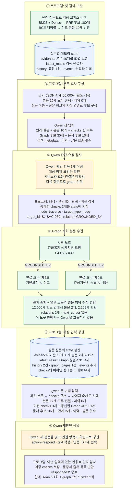

# Week 9 — 에이전트 근거 흐름

## 1. 관계 조회 · 긴급 생계지원 연결 규정 `W7-MS-011`

## 2. Qwen 입력 → 판단 → 출력

### 프로그램 → Qwen

| 입력 | 내용 |
|---|---|
| 지침 `system` | 역할·자료 범위, 도구 설명, 판단 기준, 출력 형식 |
| 원래 질문 | 사용자 질문 원문 |
| `checks` | 확인 항목·상태·연결 근거 ID |
| `evidence` | 이번 호출에 선택된 실제 본문·제목·출처 |
| 조회 후보 | `graph_candidates`: 노드 ID·이름·유형·관계·연결 근거 / `document_candidates`: 원문 문서 ID |
| `latest_result` | 최신 도구의 상태·관계·metadata·반환 ID·커서. 본문은 `evidence`에서 전달 |
| 탐색 이력 | `history`: 이전 요청·상태·반환 ID / `graph_pages`: Graph 조회 조건·범위·커서 |
| 실행 규칙 | 허용 행동, 남은 호출 횟수, 오류 피드백 |

### Qwen → 프로그램

| 출력 | 내용 |
|---|---|
| `checks` | 질문을 확인 항목으로 분해하고 상태·근거 ID 갱신 |
| `action` | `search` · `graph` · `respond` 중 다음 행동 하나 |
| `arguments` | 검색어 / Graph 조회 조건 / 응답 문장·인용 ID |
| `reason` | 선택 목적 |

| 판단 상태 | Qwen의 판단 기준 |
|---|---|
| 미확인 | 필요한 본문 미확보 |
| 일부 확인 | 대상·조건·예외 중 일부만 뒷받침 |
| 확인 | 항목에 필요한 내용이 본문으로 뒷받침됨 |
| 충돌 | 출처 간 내용 불일치 |

### 실행 시작점

| 실행 | 첫 Qwen 입력 | 이후 허용 행동 |
|---|---|---|
| 일반 실행 | 본문·checks·이력 없음. 질문에서 식별한 후보는 가능 | search · graph · respond |
| 비교 A | 원래 질문의 공통 첫 검색 결과 | respond |
| 비교 B | 같은 첫 검색 결과 | search · respond |
| 비교 C | 같은 첫 검색 결과 | search · graph · respond |

공통 첫 검색도 도구 1회로 계산. 이후 상태는 조건별 독립 관리.

## 3. 조회 대상 선택과 도구 실행

### search — 검색어로 청크 찾기

| 순서 | 처리 | 결과 |
|---|---|---|
| 1 | `query`로 전체 저장 코퍼스 검색 | BM25 양수 점수 상위 최대 100개 + Dense 상위 최대 100개 |
| 2 | 두 순위를 RRF로 결합 | 후보 최대 100개 |
| 3 | BGE로 이번 검색어와의 관련성 재정렬 | 상위 최대 10개 청크 본문·출처 반환 |
| 4 | 검색 결과 기록 | 전체 후보 ID는 metadata, 반환 근거의 순위·점수는 원결과에 보관 |

- 검색 텍스트: 청크 제목 + 본문.
- 검색마다 새 후보를 선정. 누적 근거 전체를 BGE로 다시 정렬하지 않음.
- 후보 ID만 있는 자료는 본문 미전달.

### graph — 후보 구성

| 후보의 출처 | 프로그램이 추가하는 대상 |
|---|---|
| 질문의 고유 이름·별칭 | 식별된 서비스·법령·조문 |
| 이번에 전달할 청크 | 저장된 근거 연결의 노드. 관계 출처 청크는 관계 양끝 노드 |
| 이전 후보 | 이미 관찰한 노드 유지 |
| 최신 Graph 결과 | 조회 대상, 관계 양끝, 조문 목록, 모호한 대상의 선택 후보 |

| 구성 규칙 | 내용 |
|---|---|
| 후보 정렬 | 질문 명시 대상 → 미확인·일부 확인·충돌 항목의 근거 ID와 연결된 대상 → 나머지 |
| 중복·개수 | 노드 ID 중복 제거. 고정 Top-K 제한 없음 |
| 후보 요약 | ID·이름·유형·연결 근거 ID·나가는 관계 종류·원문 문서 ID |
| 문서 후보 | 전달 본문과 노드에서 확인한 원문 문서 ID |
| 실행 담당 | 프로그램의 저장 정보 조회. LLM 호출 없음 |

### graph — Qwen의 선택과 요청

| Qwen이 확인하려는 것 | 요청 인자 | 도구가 반환하는 것 |
|---|---|---|
| 알고 있는 문서·노드의 본문 | `mode=direct`, `target_type=node/document`, `target_id` | 서비스 안내·선택 조문·원문 본문 |
| 법령 문서의 특정 조문 | 문서를 `direct` 조회 → 목록에서 고른 조문을 다시 `direct` 조회 | 첫 호출: `article_catalog` / 다음 호출: 선택 조문 본문 |
| 노드에 연결된 근거 | `mode=traverse`, `target_type=node`, `target_id`, `relation` | 해당 관계의 연결 목록 + 관계 출처·연결 대상 본문 |
| 연결 대상 하나만 확인 | traverse에 `destination_id` 추가 | 지정 대상에 한정한 결과 |
| 이전 조회의 남은 본문 | 같은 조회 조건에 `cursor` 추가 | 다음 본문 페이지 |

| 관계 | 연결 |
|---|---|
| `GROUNDED_BY` | 서비스 → 조문 |
| `REFERENCES` | 조문 → 인용 조문 |
| `REQUIRES` | 서비스 → 제출서류 종류 |
| `HANDLED_BY` | 서비스 → 기관 |
| `PART_OF` | 조문 → 법령 |

### graph — 요청 검사부터 본문 반환까지

| 단계 | 처리 |
|---|---|
| 요청 검사 | 프로그램이 형식·실제 ID·관계·도착 대상 연결·커서·호출 예산 확인 |
| 관계 조회 | 기본: 시작 노드 1개·관계 1종류·나가는 방향 1홉. 도착 대상을 생략하면 해당 연결들을 함께 조회 |
| 본문 수집 | 관계 출처 범위 + 연결 대상 본문. 공용 서류·기관은 선택한 관계의 출처 범위 유지 |
| 범위 병합 | 같은 문서의 겹치거나 이어지는 범위 병합. 문서 ID·원문 위치 순서 |
| 본문 반환 | 호출당 최대 **12,000자**. 원문 범위별 근거 ID·본문·출처·시작/끝 위치·겹치는 청크 ID |
| 미반환 정보 | 한도 초과: `next_cursor`·남은 범위 / 저장 본문 누락: `missing_source_targets` |
| 다음 행동 | Qwen이 반환 본문을 읽고 직접 조회·관계 조회·이어 읽기·재검색·응답 중 선택 |

## 4. 저장 → 다음 Qwen 입력

**보관 위치: 질문별 Python 메모리 `state`. 코퍼스 DB·Graph는 읽기 전용.**

### 상태별 갱신·전달

| 상태 | 갱신 방식 | 다음 Qwen 입력 |
|---|---|---|
| `evidence` | search·graph 본문을 ID별 누적. 같은 ID는 최초 본문 유지 | 전달 정책으로 선택한 본문 |
| `checks` | 유효한 Qwen 출력으로 전체 교체 | 항목·상태·근거 ID |
| `latest_result` | 최신 도구 결과로 교체 | 본문을 제외한 결과 + 반환 ID |
| 조회 후보 | 입력 구성 시 관찰 정보 추가·중복 제거 | 노드·문서 후보 요약 |
| `history` | 도구 요청·상태·반환 ID·캐시 여부 추가 | 도구 이력 |
| `graph_pages` | Graph 조회 조건·범위·커서 추가 | 조회·이어 읽기 상태 |
| `events` | 모델 입력·출력·결정·도구 원결과·오류 기록 | 전체 기록은 전달하지 않음 |
| `cache` | 동일 도구·인자의 오류 아닌 결과 저장 | 재실행 시 재사용 |

### 본문 선택 정책

| 항목 | 규칙 |
|---|---|
| 탐색 예산이 남은 호출 | 최신 도구 본문 → checks 연결 근거 → 나머지 누적 근거 |
| 도구 예산 소진·마지막 모델 호출 | checks 연결 근거 → 최신 도구 본문 → 나머지 누적 근거 |
| 전달 한도 | 근거 행 JSON 길이 합계 **60,000자**. 지침·질문·이력·후보 등은 별도 |
| 한도 초과 | 해당 행 전체 제외 후 다음 행 검토. 저장소에는 유지 |
| 중복 처리 | 동일 ID 제거. 서로 다른 청크·원문 범위 ID의 의미 중복은 유지 |
| 검색 점수 | 누적 본문에서는 rank·점수 metadata 제거. 도구 원기록에는 유지 |
| 입력 재구성 | 매 호출마다 system + user 메시지 생성. 선택 본문·상태를 다시 전달 |

### 제공 이력과 인용

| 구분 | 사용 범위 |
|---|---|
| `seen_ids` | 한 번 이상 전달한 본문 ID. checks에 연결 가능 |
| `supplied_evidence_ids` | 이번 입력의 본문 ID. 최종 응답에 인용 가능 |
| `omitted_evidence_ids` | 저장돼 있지만 이번 입력에서 제외된 ID |

## 5. 직접 조회 사례 · 병적증명서 원칙·예외 `W7V2-LA018`

| 순서 | 실행·판단 | 다음 단계에 넘긴 정보 |
|---|---|---|
| 1 | search: 관련 청크 검색 | 본문 10개, Graph 후보 14개, 문서 후보 3개 |
| 2 | Qwen: 제2조의 제5조제6항 참조 확인. 구체 내용은 미확인 | 병적증명서 발급 규정 문서 `direct` 요청 |
| 3 | Graph: 문서 조회 | 조문 목록 16개, 새 본문 0개 |
| 4 | 프로그램: 후보 갱신 | 본문 10개 유지, Graph 후보 24개. checks 미확인 유지 |
| 5 | Qwen: 목록에서 제5조 선택 | 제5조 노드 `direct` 요청 |
| 6 | Graph: 제5조 전체 본문 조회 | 원문 범위 `[824, 2373)`, 1,549자 |
| 7 | 프로그램: 본문 누적·입력 구성 | 본문 11개 모두 전달, 후보 24개. checks 미확인 유지 |
| 8 | Qwen: 새 본문을 읽고 확인으로 갱신·respond | 인용 2개. search 1회 + graph 2회 / Qwen 3회 |

## 6. 종료·검사·평가

### 판단과 검사

| 담당 | 수행 범위 |
|---|---|
| Qwen | 질문 분해, 근거 충분성·충돌 판단, 다음 행동 선택, 응답 작성 |
| 프로그램 | JSON·필드·ID·인자·커서·예산 검사, 실행·보관·입력 구성 |
| 인용 검사 | 이번 입력에 전달된 ID인지 확인. 주장과 본문의 의미적 대응은 독립 검증하지 않음 |
| respond | 답변·추가 질문·보류 전달 후 실행 종료. 사용자 후속 답변으로 상태를 복원하는 대화 재개는 미구현 |

### 실행 한도·오류

| 항목 | 기본 동작 |
|---|---|
| 호출 한도 | Qwen **8회**, 실제 도구 **6회**. 도구 실패·Graph 이어 읽기도 도구 횟수에 포함 |
| 예산 소진 | 도구 예산 소진·마지막 모델 호출에서는 respond만 허용 |
| 동일 요청 | 캐시 재사용 시 도구 횟수 미증가. Qwen 호출은 소모 |
| 잘못된 요청 | 오류 피드백 후 수정 요청. 연속 **2회**면 `invalid_output` |
| 도구 오류 | 다음 Qwen 입력에 전달 |
| 모델 통신 오류 / 미응답 한도 소진 | `model_error` / `budget_exhausted` 종료 |

### 사후 평가

| 단계 | 평가 대상 |
|---|---|
| `retrieved` | 도구가 반환해 누적 보관한 본문 |
| `supplied` | 한 번 이상 Qwen에 전달한 본문 |
| `final` | 마지막 Qwen 입력의 본문 |
| `cited` | 최종 인용 목록의 본문 |
| 내용 평가 | 실제 응답의 필수 처리·사실 정확성·근거 뒷받침·인용 적절성 |

필수 근거는 허용 청크 전체 또는 필수 원문 범위의 완전 포함으로 판정. 벤치마크 정답·필수 근거는 생성 입력에 미제공.

코드·실행 원본

| 기능 | 코드 |
|---|---|
| 반복·저장·입력 구성 | [controller.py](../src/civic_link/agent/controller.py) |
| 지침·출력 검사 | [prompts.py](../src/civic_link/agent/prompts.py) · [protocol.py](../src/civic_link/agent/protocol.py) |
| 검색 | [search.py](../src/civic_link/agent/search.py) |
| Graph 후보·조회·범위·커서 | [graph_access.py](../src/civic_link/agent/graph_access.py) · [graph.py](../src/civic_link/agent/graph.py) |
| 비교 실행 | [experiment.py](../src/civic_link/agent/experiment.py) |
| 사후 평가 | [evaluation.py](../src/civic_link/agent/evaluation.py) · [judge_agent_comparison.py](../scripts/judge_agent_comparison.py) |

로컬 원본: `outputs/runyourai-v100-20261113/week8-gpu-608-w16/iterative_graph/`

| 문항 | 파일명 |
|---|---|
| `W7-MS-011` | `b9fe916c21a6fb8b058df345c230dfc50aea42ba8622b685a9ea76c431f48771.json` |
| `W7V2-LA018` | `5a8fd20e7b75d29a30f7f4b261983bae30a1bef9b670e821a8ca803ee38c5e5b.json` |

추적 위치: `result.events`의 `tool_result` · `qwen_input` · `decision`, 최종 `result.evidence` · `result.sources`.

